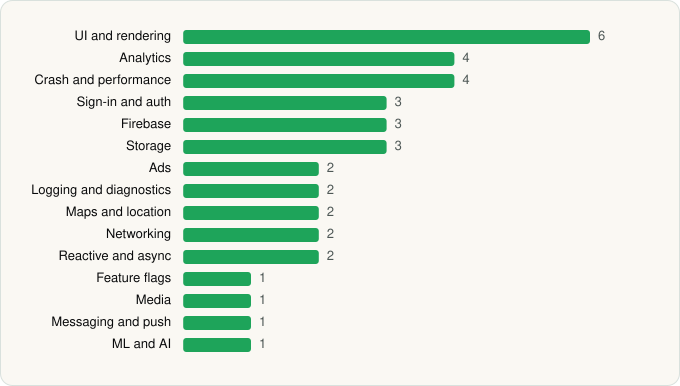

<picture><source media="(prefers-color-scheme: dark)" srcset="../../../../assets/logo/logo-dark.svg"></picture> [Tech Stack](../../../../README.md) / [Target Corporation](../../../../companies/target-corporation.md) / Target

# Target: Shop. Style. Save.

<picture><source media="(prefers-color-scheme: dark)" srcset="../../../../assets/badges/android-dark.svg"></picture> <picture><source media="(prefers-color-scheme: dark)" srcset="../../../../assets/badges/inactive-dark.svg"></picture>

[Google Play](https://play.google.com/store/apps/details?id=com.target.ui) · [latest.json](latest.json)

| | |
|---|---|
| Company | [Target Corporation](../../../../companies/target-corporation.md) |
| Store id | `com.target.ui` |
| Bundle / package id | `com.target.ui` |
| Latest version | 2026.21.0 (analysed 2026-06-19) |
| Versions tracked | 1 |
| SDKs in latest version | 37 |
| Languages | C/C++ (native), Java, Kotlin |
| UI | Coil, Glide, Jetpack Compose, Lottie, Material Components |
| Build | Gradle (inferred) |
| Minimum OS | API 28, targets API 35 |
| Devices / ABIs | Android |
| Capabilities | 12 |
| Declares tracking | Yes |
| Tracked | No. Kept for history. |

## SDKs by category

<picture><source media="(prefers-color-scheme: dark)" srcset="../../../../assets/charts/apps/android/target-corporation/target-dark.svg"></picture>

- **UI and rendering** (6): AndroidSVG, Coil, Glide, Jetpack Compose, Lottie, Material Components
- **Analytics** (4): Facebook SDK, Firebase Analytics, FullStory, Google App Measurement
- **Crash and performance** (4): Bugsnag, Firebase Crashlytics, Firebase Performance, OpenTelemetry
- **Sign-in and auth** (3): Auth0, Credential Manager, Google Sign-In / Auth
- **Firebase** (3): Firebase, Google DataTransport, Google Play services
- **Storage** (3): DataStore, Okio, Room
- **Ads** (2): Google Ad Manager, Google Mobile Ads (AdMob)
- **Logging and diagnostics** (2): Chucker, LeakCanary
- **Maps and location** (2): Google Location, Google Maps
- **Networking** (2): OkHttp, Retrofit
- **Reactive and async** (2): Kotlin Coroutines, RxJava
- **Feature flags** (1): Firebase Remote Config
- **Media** (1): Media3 (ExoPlayer)
- **Messaging and push** (1): Firebase Messaging
- **ML and AI** (1): ML Kit

Capabilities (12)

Advertising ID, Approximate location, Biometric auth, Bluetooth, Bluetooth (connect), Bluetooth (scan), Camera, Fingerprint auth, Foreground service, Foreground service: location, Notifications, Precise location

## Version history

| Version | Analysed | Store update | SDKs | Change | SDK list is a floor | Binary encrypted | File |
|---|---|---|---|---|---|---|---|
| 2026.21.0 | 2026-06-19 |  | 37 |  | No | No | [2026.21.0.json](2026.21.0.json) |

## Model-written summary

> Android retail app in Kotlin/Java with Jetpack Compose, ARCore+Filament 3D/AR, first-party Target APIs, dynamic code loading via Play Core, and dual crash reporting.

Written by a language model from the detected signals (`inferred[]`). It is commentary, not measurement.

---

Generated by `scripts/build_readme.py` from the JSON files. Do not edit by hand.
