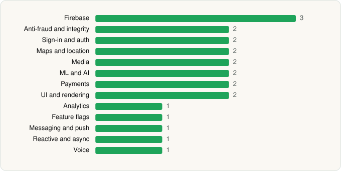

<picture><source media="(prefers-color-scheme: dark)" srcset="../../../../assets/logo/logo-dark.svg"></picture> [Tech Stack](../../../../README.md) / [Telegram FZ-LLC](../../../../companies/telegram-fz-llc.md) / Telegram

# Telegram

<picture><source media="(prefers-color-scheme: dark)" srcset="../../../../assets/badges/android-dark.svg"></picture> <picture><source media="(prefers-color-scheme: dark)" srcset="../../../../assets/badges/inactive-dark.svg"></picture>

[Google Play](https://play.google.com/store/apps/details?id=org.telegram.messenger) · [latest.json](latest.json)

| | |
|---|---|
| Company | [Telegram FZ-LLC](../../../../companies/telegram-fz-llc.md) |
| Store id | `org.telegram.messenger` |
| Bundle / package id | `org.telegram.messenger` |
| Latest version | 12.7.3 (analysed 2026-06-19) |
| Versions tracked | 1 |
| SDKs in latest version | 22 |
| Languages | C/C++ (native), Java, Kotlin |
| UI | Android Views (inferred) |
| Build | Gradle (inferred) |
| Minimum OS | API 23, targets API 35 |
| Devices / ABIs | Android |
| Capabilities | 25 |
| Declares tracking | Yes |
| Tracked | No. Kept for history. |

## SDKs by category

<picture><source media="(prefers-color-scheme: dark)" srcset="../../../../assets/charts/apps/android/telegram-fz-llc/telegram-dark.svg"></picture>

- **Firebase** (3): Firebase, Google DataTransport, Google Play services
- **Anti-fraud and integrity** (2): Play Integrity, reCAPTCHA
- **Sign-in and auth** (2): Credential Manager, Google Sign-In / Auth
- **Maps and location** (2): Google Location, Google Maps
- **Media** (2): ExoPlayer, Google Cast
- **ML and AI** (2): ML Kit, Mobile Vision
- **Payments** (2): Google Play Billing, Stripe
- **UI and rendering** (2): jLaTeXMath, Markwon
- **Analytics** (1): Firebase Analytics
- **Feature flags** (1): Firebase Remote Config
- **Messaging and push** (1): Firebase Messaging
- **Reactive and async** (1): Kotlin Coroutines
- **Voice** (1): WebRTC

Capabilities (25)

Approximate location, Background location, Biometric auth, Bluetooth, Bluetooth (connect), Camera, Contacts (read), Contacts (write), Draw over other apps, Fingerprint auth, Foreground service, Foreground service: camera, Foreground service: location, Foreground service: media playback, Foreground service: microphone, Install other apps, Media: audio, Media: images, Media: video, Microphone, Notifications, Phone / carrier info, Precise location, Storage (read), Storage (write)

## Version history

| Version | Analysed | Store update | SDKs | Change | SDK list is a floor | Binary encrypted | File |
|---|---|---|---|---|---|---|---|
| 12.7.3 | 2026-06-19 |  | 22 |  | No | No | [12.7.3.json](12.7.3.json) |

---

Generated by `scripts/build_readme.py` from the JSON files. Do not edit by hand.
