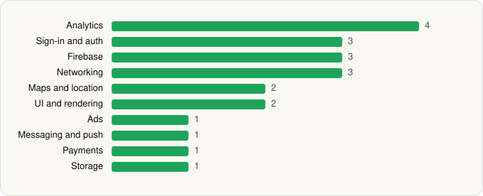

<picture><source media="(prefers-color-scheme: dark)" srcset="../../../../assets/logo/logo-dark.svg"></picture> [Tech Stack](../../../../README.md) / [Temu](../../../../companies/temu.md) / Temu

# Temu: Shop Like a Billionaire

<picture><source media="(prefers-color-scheme: dark)" srcset="../../../../assets/badges/android-dark.svg"></picture> <picture><source media="(prefers-color-scheme: dark)" srcset="../../../../assets/badges/active-dark.svg"></picture>

[Google Play](https://play.google.com/store/apps/details?id=com.einnovation.temu) · [latest.json](latest.json)

| | |
|---|---|
| Company | [Temu](../../../../companies/temu.md) |
| Store id | `com.einnovation.temu` |
| Bundle / package id | `com.einnovation.temu` |
| Latest version | 4.91.0 (analysed 2026-10-24) |
| Versions tracked | 1 |
| SDKs in latest version | 21 |
| Languages | C/C++ (native), Java, Kotlin |
| UI | Glide, Material Components |
| Build | Gradle (inferred) |
| Minimum OS | API 23, targets API 36 |
| Devices / ABIs | Android |
| Capabilities | 4 |
| Declares tracking | Yes |
| Tracked | Yes |

## SDKs by category

<picture><source media="(prefers-color-scheme: dark)" srcset="../../../../assets/charts/apps/android/temu/temu-dark.svg"></picture>

- **Analytics** (4): Adjust, Facebook SDK, Firebase Analytics, Google App Measurement
- **Sign-in and auth** (3): Credential Manager, Facebook Login, Google Sign-In / Auth
- **Firebase** (3): Firebase, Google DataTransport, Google Play services
- **Networking** (3): Cronet, Cronet (Google), OkHttp
- **Maps and location** (2): Google Location, Google Maps
- **UI and rendering** (2): Glide, Material Components
- **Ads** (1): Google Mobile Ads (AdMob)
- **Messaging and push** (1): Firebase Messaging
- **Payments** (1): Braintree
- **Storage** (1): Room

Capabilities (4)

Advertising ID, Approximate location, Notifications, Precise location

## Version history

| Version | Analysed | Store update | SDKs | Change | SDK list is a floor | Binary encrypted | File |
|---|---|---|---|---|---|---|---|
| 4.91.0 | 2026-10-24 | 2026-10-22 | 21 |  | No | No | [4.91.0.json](4.91.0.json) |

---

Generated by `scripts/build_readme.py` from the JSON files. Do not edit by hand.
