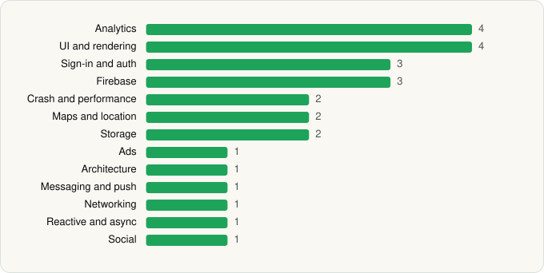

<picture><source media="(prefers-color-scheme: dark)" srcset="../../../../assets/logo/logo-dark.svg"></picture> [Tech Stack](../../../../README.md) / [The Clubhouse Gym](../../../../companies/the-clubhouse-gym.md) / The Clubhouse Gym

# The Clubhouse Gym

<picture><source media="(prefers-color-scheme: dark)" srcset="../../../../assets/badges/android-dark.svg"></picture> <picture><source media="(prefers-color-scheme: dark)" srcset="../../../../assets/badges/inactive-dark.svg"></picture>

[Google Play](https://play.google.com/store/apps/details?id=com.bsport_76__2656) · [latest.json](latest.json)

| | |
|---|---|
| Company | [The Clubhouse Gym](../../../../companies/the-clubhouse-gym.md) |
| Store id | `com.bsport_76__2656` |
| Bundle / package id | `com.bsport_76__2656` |
| Latest version | 7.24.0 (analysed 2026-06-23) |
| Versions tracked | 1 |
| SDKs in latest version | 26 |
| Languages | C/C++ (native), Java, Kotlin, React Native / JavaScript |
| UI | Fresco, Glide, Material Components |
| Build | Gradle (inferred) |
| Minimum OS | API 21, targets API 34 |
| Devices / ABIs | Android |
| Capabilities | 8 |
| Declares tracking | Yes |
| Tracked | No. Kept for history. |

## SDKs by category

<picture><source media="(prefers-color-scheme: dark)" srcset="../../../../assets/charts/apps/android/the-clubhouse-gym/the-clubhouse-gym-dark.svg"></picture>

- **Analytics** (4): Branch, Facebook SDK, Firebase Analytics, Google App Measurement
- **UI and rendering** (4): Fresco, Glide, Material Components, React Native Reanimated
- **Sign-in and auth** (3): Facebook Login, Firebase Auth, Google Sign-In / Auth
- **Firebase** (3): Firebase, Google DataTransport, Google Play services
- **Crash and performance** (2): Sentry, Sentry (native)
- **Maps and location** (2): Google Location, Google Maps
- **Storage** (2): Okio, Room
- **Ads** (1): Google Mobile Ads (AdMob)
- **Architecture** (1): Redux
- **Messaging and push** (1): Firebase Messaging
- **Networking** (1): OkHttp
- **Reactive and async** (1): Kotlin Coroutines
- **Social** (1): Facebook Share

Capabilities (8)

Advertising ID, Draw over other apps, Foreground service, Notifications, Phone / carrier info, Precise location, Storage (read), Storage (write)

## Version history

| Version | Analysed | Store update | SDKs | Change | SDK list is a floor | Binary encrypted | File |
|---|---|---|---|---|---|---|---|
| 7.24.0 | 2026-06-23 |  | 26 |  | No | No | [7.24.0.json](7.24.0.json) |

---

Generated by `scripts/build_readme.py` from the JSON files. Do not edit by hand.
