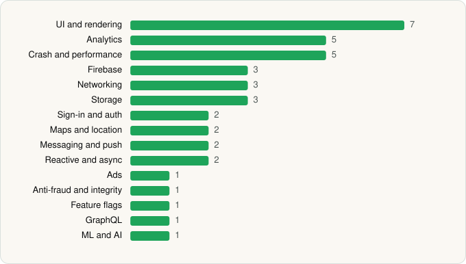

<picture><source media="(prefers-color-scheme: dark)" srcset="../../../../assets/logo/logo-dark.svg"></picture> [Tech Stack](../../../../README.md) / [The Home Depot, Inc](../../../../companies/the-home-depot-inc.md) / The Home Depot

# The Home Depot

<picture><source media="(prefers-color-scheme: dark)" srcset="../../../../assets/badges/android-dark.svg"></picture> <picture><source media="(prefers-color-scheme: dark)" srcset="../../../../assets/badges/inactive-dark.svg"></picture>

[Google Play](https://play.google.com/store/apps/details?id=com.thehomedepot) · [latest.json](latest.json)

| | |
|---|---|
| Company | [The Home Depot, Inc](../../../../companies/the-home-depot-inc.md) |
| Store id | `com.thehomedepot` |
| Bundle / package id | `com.thehomedepot` |
| Latest version | 7.61.2 (analysed 2026-06-19) |
| Versions tracked | 1 |
| SDKs in latest version | 39 |
| Languages | C/C++ (native), Java, Kotlin |
| UI | Coil, Glide, Jetpack Compose, Material Components, Picasso |
| Build | Gradle (inferred) |
| Minimum OS | API 28, targets API 35 |
| Devices / ABIs | Android |
| Capabilities | 19 |
| Declares tracking | Yes |
| Tracked | No. Kept for history. |

## SDKs by category

<picture><source media="(prefers-color-scheme: dark)" srcset="../../../../assets/charts/apps/android/the-home-depot-inc/the-home-depot-dark.svg"></picture>

- **UI and rendering** (7): AndroidSVG, Coil, Glide, Jetpack Compose, Markwon, Material Components, Picasso
- **Analytics** (5): Adobe Experience Platform, AppsFlyer, Firebase Analytics, Google App Measurement, Qualtrics
- **Crash and performance** (5): Embrace, Firebase Crashlytics, Firebase Performance, New Relic, OpenTelemetry
- **Firebase** (3): Firebase, Google DataTransport, Google Play services
- **Networking** (3): Ktor, OkHttp, Retrofit
- **Storage** (3): DataStore, Okio, Room
- **Sign-in and auth** (2): Firebase Auth, Google Sign-In / Auth
- **Maps and location** (2): Google Location, Google Maps
- **Messaging and push** (2): Airship, Firebase Messaging
- **Reactive and async** (2): Kotlin Coroutines, RxJava
- **Ads** (1): Google Mobile Ads (AdMob)
- **Anti-fraud and integrity** (1): Play Integrity
- **Feature flags** (1): Firebase Remote Config
- **GraphQL** (1): Apollo GraphQL
- **ML and AI** (1): Mobile Vision

Capabilities (19)

Advertising ID, Approximate location, Biometric auth, Bluetooth, Bluetooth (connect), Bluetooth (scan), Camera, Draw over other apps, Fingerprint auth, Foreground service, Foreground service: location, Media: images, Media: video, Microphone, Notifications, Phone / carrier info, Precise location, Storage (read), Storage (write)

## Version history

| Version | Analysed | Store update | SDKs | Change | SDK list is a floor | Binary encrypted | File |
|---|---|---|---|---|---|---|---|
| 7.61.2 | 2026-06-19 |  | 39 |  | No | No | [7.61.2.json](7.61.2.json) |

---

Generated by `scripts/build_readme.py` from the JSON files. Do not edit by hand.
