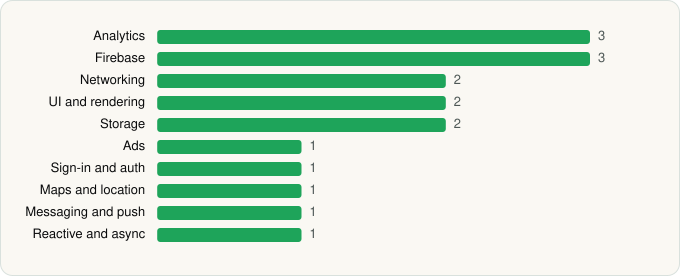

<picture><source media="(prefers-color-scheme: dark)" srcset="../../../../assets/logo/logo-dark.svg"></picture> [Tech Stack](../../../../README.md) / [TikTok Pte. Ltd.](../../../../companies/tiktok-pte-ltd.md) / TikTok Lite

# TikTok Lite - Faster TikTok

<picture><source media="(prefers-color-scheme: dark)" srcset="../../../../assets/badges/android-dark.svg"></picture> <picture><source media="(prefers-color-scheme: dark)" srcset="../../../../assets/badges/inactive-dark.svg"></picture>

[Google Play](https://play.google.com/store/apps/details?id=com.tiktok.lite.go) · [latest.json](latest.json)

| | |
|---|---|
| Company | [TikTok Pte. Ltd.](../../../../companies/tiktok-pte-ltd.md) |
| Store id | `com.tiktok.lite.go` |
| Bundle / package id | `com.tiktok.lite.go` |
| Latest version | 47.5.52 (analysed 2026-11-02) |
| Versions tracked | 1 |
| SDKs in latest version | 17 |
| Languages | C/C++ (native), Java, Kotlin |
| UI | Fresco, Material Components |
| Build | Gradle (inferred) |
| Minimum OS | API 21, targets API 36 |
| Devices / ABIs | Android |
| Capabilities | 14 |
| Declares tracking | Yes |
| Tracked | No. Kept for history. |

## SDKs by category

<picture><source media="(prefers-color-scheme: dark)" srcset="../../../../assets/charts/apps/android/tiktok-pte-ltd/tiktok-lite-dark.svg"></picture>

- **Analytics** (3): AppsFlyer, Firebase Analytics, Google App Measurement
- **Firebase** (3): Firebase, Google DataTransport, Google Play services
- **Networking** (2): OkHttp, Retrofit
- **UI and rendering** (2): Fresco, Material Components
- **Storage** (2): Okio, Room
- **Ads** (1): Google Mobile Ads (AdMob)
- **Sign-in and auth** (1): Google Sign-In / Auth
- **Maps and location** (1): Google Maps
- **Messaging and push** (1): Firebase Messaging
- **Reactive and async** (1): Kotlin Coroutines

Capabilities (14)

Advertising ID, Biometric auth, Camera, Contacts (read), Fingerprint auth, Foreground service, Media: audio, Media: images, Media: video, Microphone, Notifications, Phone / carrier info, Storage (read), Storage (write)

## Version history

| Version | Analysed | Store update | SDKs | Change | SDK list is a floor | Binary encrypted | File |
|---|---|---|---|---|---|---|---|
| 47.5.52 | 2026-11-02 | 2026-10-29 | 17 |  | No | No | [47.5.52.json](47.5.52.json) |

---

Generated by `scripts/build_readme.py` from the JSON files. Do not edit by hand.
