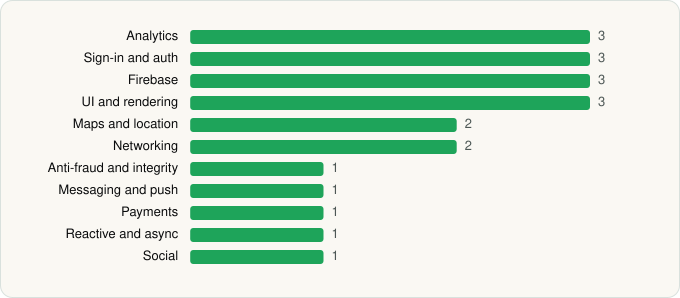

<picture><source media="(prefers-color-scheme: dark)" srcset="../../../../assets/logo/logo-dark.svg"></picture> [Tech Stack](../../../../README.md) / [TIKTOK PTE. LTD.](../../../../companies/tiktok-pte-ltd.md) / TikTok Pro

# TikTok Pro - Events

<picture><source media="(prefers-color-scheme: dark)" srcset="../../../../assets/badges/android-dark.svg"></picture> <picture><source media="(prefers-color-scheme: dark)" srcset="../../../../assets/badges/inactive-dark.svg"></picture>

[Google Play](https://play.google.com/store/apps/details?id=com.ss.android.ugc.tiktok.pro) · [latest.json](latest.json)

| | |
|---|---|
| Company | [TIKTOK PTE. LTD.](../../../../companies/tiktok-pte-ltd.md) |
| Store id | `com.ss.android.ugc.tiktok.pro` |
| Bundle / package id | `com.ss.android.ugc.tiktok.pro` |
| Latest version | 47.4.3 (analysed 2026-11-01) |
| Versions tracked | 1 |
| SDKs in latest version | 21 |
| Languages | C/C++ (native), Java, Kotlin |
| UI | Fresco, Material Components |
| Build | Gradle (inferred) |
| Minimum OS | API 23, targets API 36 |
| Devices / ABIs | Android |
| Capabilities | 0 |
| Declares tracking | Yes |
| Tracked | No. Kept for history. |

## SDKs by category

<picture><source media="(prefers-color-scheme: dark)" srcset="../../../../assets/charts/apps/android/tiktok-pte-ltd/tiktok-pro-dark.svg"></picture>

- **Analytics** (3): Facebook SDK, Firebase Analytics, Google App Measurement
- **Sign-in and auth** (3): AppAuth, Facebook Login, Google Sign-In / Auth
- **Firebase** (3): Firebase, Google DataTransport, Google Play services
- **UI and rendering** (3): Fresco, Markwon, Material Components
- **Maps and location** (2): Google Location, Google Maps
- **Networking** (2): Cronet, OkHttp
- **Anti-fraud and integrity** (1): Play Integrity
- **Messaging and push** (1): Firebase Messaging
- **Payments** (1): Stripe
- **Reactive and async** (1): RxJava
- **Social** (1): Facebook Share

## Version history

| Version | Analysed | Store update | SDKs | Change | SDK list is a floor | Binary encrypted | File |
|---|---|---|---|---|---|---|---|
| 47.4.3 | 2026-11-01 |  | 21 |  | No | No | [47.4.3.json](47.4.3.json) |

---

Generated by `scripts/build_readme.py` from the JSON files. Do not edit by hand.
