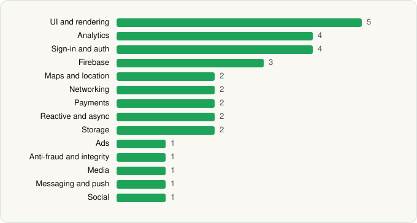

<picture><source media="(prefers-color-scheme: dark)" srcset="../../../../assets/logo/logo-dark.svg"></picture> [Tech Stack](../../../../README.md) / [TikTok Pte. Ltd.](../../../../companies/tiktok-pte-ltd.md) / TikTok

# TikTok - Videos, Shop & LIVE

<picture><source media="(prefers-color-scheme: dark)" srcset="../../../../assets/badges/android-dark.svg"></picture> <picture><source media="(prefers-color-scheme: dark)" srcset="../../../../assets/badges/inactive-dark.svg"></picture>

[Google Play](https://play.google.com/store/apps/details?id=com.zhiliaoapp.musically) · [latest.json](latest.json)

| | |
|---|---|
| Company | [TikTok Pte. Ltd.](../../../../companies/tiktok-pte-ltd.md) |
| Store id | `com.zhiliaoapp.musically` |
| Bundle / package id | `com.zhiliaoapp.musically` |
| Latest version | 45.5.1 (analysed 2026-06-19) |
| Versions tracked | 1 |
| SDKs in latest version | 31 |
| Languages | C/C++ (native), Java, Kotlin |
| UI | Fresco, Jetpack Compose, Lottie, Material Components |
| Build | Gradle (inferred) |
| Minimum OS | API 23, targets API 36 |
| Devices / ABIs | Android |
| Capabilities | 23 |
| Declares tracking | Yes |
| Tracked | No. Kept for history. |

## SDKs by category

<picture><source media="(prefers-color-scheme: dark)" srcset="../../../../assets/charts/apps/android/tiktok-pte-ltd/tiktok-dark.svg"></picture>

- **UI and rendering** (5): Fresco, Jetpack Compose, Lottie, Markwon, Material Components
- **Analytics** (4): AppsFlyer, Facebook SDK, Firebase Analytics, Google App Measurement
- **Sign-in and auth** (4): AppAuth, Credential Manager, Facebook Login, Google Sign-In / Auth
- **Firebase** (3): Firebase, Google DataTransport, Google Play services
- **Maps and location** (2): Google Location, Google Maps
- **Networking** (2): Cronet, OkHttp
- **Payments** (2): Google Play Billing, Stripe
- **Reactive and async** (2): Kotlin Coroutines, RxJava
- **Storage** (2): Okio, Room
- **Ads** (1): Google Mobile Ads (AdMob)
- **Anti-fraud and integrity** (1): Play Integrity
- **Media** (1): FFmpeg
- **Messaging and push** (1): Firebase Messaging
- **Social** (1): Facebook Share

Capabilities (23)

Advertising ID, Approximate location, Biometric auth, Bluetooth, Bluetooth (connect), Bluetooth (scan), Camera, Contacts (read), Draw over other apps, Fingerprint auth, Foreground service, Foreground service: camera, Foreground service: media playback, Foreground service: microphone, Media: audio, Media: images, Media: video, Microphone, NFC, Notifications, Precise location, Storage (read), Storage (write)

## Version history

| Version | Analysed | Store update | SDKs | Change | SDK list is a floor | Binary encrypted | File |
|---|---|---|---|---|---|---|---|
| 45.5.1 | 2026-06-19 |  | 31 |  | No | No | [45.5.1.json](45.5.1.json) |

## Model-written summary

> Android TikTok with 30+ native C++ media libs (NLE, ByteVC1, Pitaya, ByteAI), Jetpack Compose UI, 31 SDKs, TikTok CDN backends

Written by a language model from the detected signals (`inferred[]`). It is commentary, not measurement.

---

Generated by `scripts/build_readme.py` from the JSON files. Do not edit by hand.
