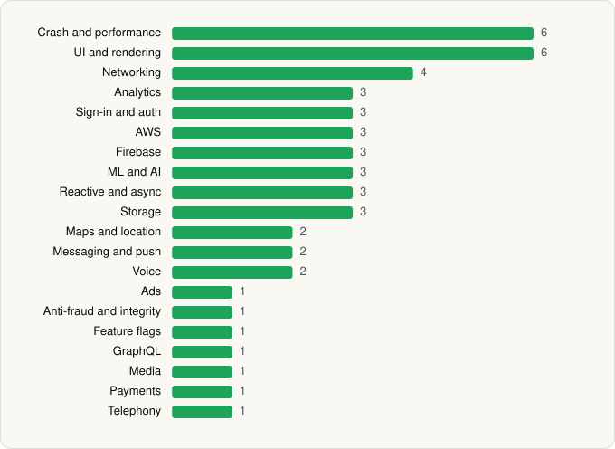

<picture><source media="(prefers-color-scheme: dark)" srcset="../../../../assets/logo/logo-dark.svg"></picture> [Tech Stack](../../../../README.md) / [Trade Republic Bank GmbH](../../../../companies/trade-republic-bank-gmbh.md) / Trade Republic

# Trade Republic: Broker & Bank

<picture><source media="(prefers-color-scheme: dark)" srcset="../../../../assets/badges/android-dark.svg"></picture> <picture><source media="(prefers-color-scheme: dark)" srcset="../../../../assets/badges/inactive-dark.svg"></picture>

[Google Play](https://play.google.com/store/apps/details?id=de.traderepublic.app) · [latest.json](latest.json)

| | |
|---|---|
| Company | [Trade Republic Bank GmbH](../../../../companies/trade-republic-bank-gmbh.md) |
| Store id | `de.traderepublic.app` |
| Bundle / package id | `de.traderepublic.app` |
| Latest version | 4.2645.1 (analysed 2026-11-12) |
| Versions tracked | 1 |
| SDKs in latest version | 50 |
| Languages | C/C++ (native), Java, Kotlin |
| UI | Coil, Jetpack Compose, Lottie, Material Components, Rive |
| Build | Gradle (inferred) |
| Minimum OS | API 29, targets API 36 |
| Devices / ABIs | Android |
| Capabilities | 16 |
| Declares tracking | Yes |
| Tracked | No. Kept for history. |

## SDKs by category

<picture><source media="(prefers-color-scheme: dark)" srcset="../../../../assets/charts/apps/android/trade-republic-bank-gmbh/trade-republic-dark.svg"></picture>

- **Crash and performance** (6): Datadog, Firebase Crashlytics, Firebase Performance, OpenTelemetry, Sentry, Sentry (native)
- **UI and rendering** (6): AndroidSVG, Coil, Jetpack Compose, Lottie, Material Components, Rive
- **Networking** (4): Ktor, OkHttp, Retrofit, Volley
- **Analytics** (3): Adjust, Firebase Analytics, Google App Measurement
- **Sign-in and auth** (3): Auth0, Credential Manager, Google Sign-In / Auth
- **AWS** (3): AWS Amplify, AWS SDK, AWS SDK (Kotlin)
- **Firebase** (3): Firebase, Google DataTransport, Google Play services
- **ML and AI** (3): ML Kit, TensorFlow, TensorFlow Lite
- **Reactive and async** (3): Kotlin Coroutines, RxJava, RxJava 3
- **Storage** (3): DataStore, Okio, Room
- **Maps and location** (2): Google Location, Google Maps
- **Messaging and push** (2): Braze, Firebase Messaging
- **Voice** (2): LiveKit, WebRTC
- **Ads** (1): Google Mobile Ads (AdMob)
- **Anti-fraud and integrity** (1): Play Integrity
- **Feature flags** (1): Firebase Remote Config
- **GraphQL** (1): Apollo GraphQL
- **Media** (1): Media3 (ExoPlayer)
- **Payments** (1): Adyen
- **Telephony** (1): libphonenumber

Capabilities (16)

Advertising ID, Approximate location, Biometric auth, Bluetooth, Bluetooth (connect), Camera, Contacts (read), Fingerprint auth, Foreground service, Foreground service: camera, Foreground service: microphone, Microphone, Notifications, Precise location, Storage (read), Storage (write)

## Version history

| Version | Analysed | Store update | SDKs | Change | SDK list is a floor | Binary encrypted | File |
|---|---|---|---|---|---|---|---|
| 4.2645.1 | 2026-11-12 |  | 50 |  | No | No | [4.2645.1.json](4.2645.1.json) |

---

Generated by `scripts/build_readme.py` from the JSON files. Do not edit by hand.
