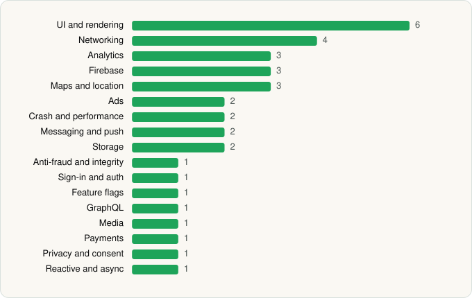

<picture><source media="(prefers-color-scheme: dark)" srcset="../../../../assets/logo/logo-dark.svg"></picture> [Tech Stack](../../../../README.md) / [Tripadvisor](../../../../companies/tripadvisor.md) / Tripadvisor

# Tripadvisor: Plan & Book Trips

<picture><source media="(prefers-color-scheme: dark)" srcset="../../../../assets/badges/android-dark.svg"></picture> <picture><source media="(prefers-color-scheme: dark)" srcset="../../../../assets/badges/inactive-dark.svg"></picture>

[Google Play](https://play.google.com/store/apps/details?id=com.tripadvisor.tripadvisor) · [latest.json](latest.json)

| | |
|---|---|
| Company | [Tripadvisor](../../../../companies/tripadvisor.md) |
| Store id | `com.tripadvisor.tripadvisor` |
| Bundle / package id | `com.tripadvisor.tripadvisor` |
| Latest version | 68.5 (analysed 2026-06-19) |
| Versions tracked | 1 |
| SDKs in latest version | 35 |
| Languages | C/C++ (native), Java, Kotlin |
| UI | Coil, Glide, Jetpack Compose, Lottie, Material Components |
| Build | Gradle (inferred) |
| Minimum OS | API 29, targets API 35 |
| Devices / ABIs | Android |
| Capabilities | 11 |
| Declares tracking | Yes |
| Tracked | No. Kept for history. |

## SDKs by category

<picture><source media="(prefers-color-scheme: dark)" srcset="../../../../assets/charts/apps/android/tripadvisor/tripadvisor-dark.svg"></picture>

- **UI and rendering** (6): Coil, Glide, Jetpack Compose, Lottie, Markwon, Material Components
- **Networking** (4): Cronet, Cronet (Google), OkHttp, Retrofit
- **Analytics** (3): AppsFlyer, Firebase Analytics, Google App Measurement
- **Firebase** (3): Firebase, Google DataTransport, Google Play services
- **Maps and location** (3): Google Location, Google Maps, Mapbox
- **Ads** (2): Google Ad Manager, Google Mobile Ads (AdMob)
- **Crash and performance** (2): Firebase Crashlytics, Firebase Performance
- **Messaging and push** (2): Braze, Firebase Messaging
- **Storage** (2): DataStore, Room
- **Anti-fraud and integrity** (1): Play Integrity
- **Sign-in and auth** (1): Google Sign-In / Auth
- **Feature flags** (1): Firebase Remote Config
- **GraphQL** (1): Apollo GraphQL
- **Media** (1): ExoPlayer
- **Payments** (1): Braintree
- **Privacy and consent** (1): OneTrust
- **Reactive and async** (1): Kotlin Coroutines

Capabilities (11)

Advertising ID, Approximate location, Biometric auth, Camera, Fingerprint auth, Foreground service, Foreground service: location, Notifications, Precise location, Storage (read), Storage (write)

## Version history

| Version | Analysed | Store update | SDKs | Change | SDK list is a floor | Binary encrypted | File |
|---|---|---|---|---|---|---|---|
| 68.5 | 2026-06-19 |  | 35 |  | No | No | [68.5.json](68.5.json) |

---

Generated by `scripts/build_readme.py` from the JSON files. Do not edit by hand.
