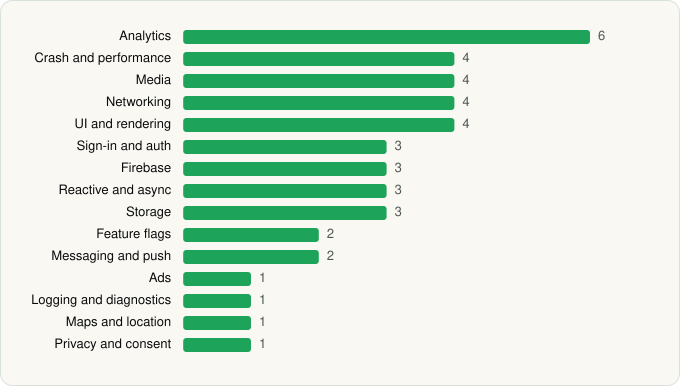

<picture><source media="(prefers-color-scheme: dark)" srcset="../../../../assets/logo/logo-dark.svg"></picture> [Tech Stack](../../../../README.md) / [Tubi TV](../../../../companies/tubi-tv.md) / Tubi

# Tubi: Free Movies & Live TV

<picture><source media="(prefers-color-scheme: dark)" srcset="../../../../assets/badges/android-dark.svg"></picture> <picture><source media="(prefers-color-scheme: dark)" srcset="../../../../assets/badges/active-dark.svg"></picture> <picture><source media="(prefers-color-scheme: dark)" srcset="../../../../assets/badges/floor-dark.svg"></picture>

[Google Play](https://play.google.com/store/apps/details?id=com.tubitv) · [latest.json](latest.json)

| | |
|---|---|
| Company | [Tubi TV](../../../../companies/tubi-tv.md) |
| Store id | `com.tubitv` |
| Bundle / package id | `com.tubitv` |
| Latest version | 10.22.1 (analysed 2026-06-19) |
| Versions tracked | 1 |
| SDKs in latest version | 42 |
| Languages | C/C++ (native), Java, Kotlin |
| UI | Glide, Jetpack Compose, Lottie, Material Components |
| Build | Gradle (inferred), R8 / ProGuard (name obfuscation detected) |
| Minimum OS | API 29, targets API 36 |
| Devices / ABIs | Android |
| Capabilities | 14 |
| Declares tracking | Yes |
| Tracked | Yes |

## SDKs by category

<picture><source media="(prefers-color-scheme: dark)" srcset="../../../../assets/charts/apps/android/tubi-tv/tubi-dark.svg"></picture>

- **Analytics** (6): Adjust, Branch, Facebook SDK, Firebase Analytics, Google Analytics (legacy), Google App Measurement
- **Crash and performance** (4): Firebase Crashlytics, Firebase Performance, Sentry, Sentry (native)
- **Media** (4): ExoPlayer, Google Cast, Media3 (ExoPlayer), Mux
- **Networking** (4): Cronet, Cronet (Google), OkHttp, Retrofit
- **UI and rendering** (4): Glide, Jetpack Compose, Lottie, Material Components
- **Sign-in and auth** (3): Auth0, Credential Manager, Google Sign-In / Auth
- **Firebase** (3): Firebase, Google DataTransport, Google Play services
- **Reactive and async** (3): Kotlin Coroutines, RxJava, RxJava 3
- **Storage** (3): DataStore, Okio, Room
- **Feature flags** (2): Firebase Remote Config, Statsig
- **Messaging and push** (2): Braze, Firebase Messaging
- **Ads** (1): Google Mobile Ads (AdMob)
- **Logging and diagnostics** (1): Stetho
- **Maps and location** (1): Google Location
- **Privacy and consent** (1): OneTrust

Capabilities (14)

Advertising ID, Approximate location, Biometric auth, Bluetooth, Camera, Fingerprint auth, Foreground service, Foreground service: media playback, Microphone, NFC, Notifications, Precise location, Storage (read), Storage (write)

## Version history

| Version | Analysed | Store update | SDKs | Change | SDK list is a floor | Binary encrypted | File |
|---|---|---|---|---|---|---|---|
| 10.22.1 | 2026-06-19 |  | 42 |  | Yes | No | [10.22.1.json](10.22.1.json) |

---

Generated by `scripts/build_readme.py` from the JSON files. Do not edit by hand.
