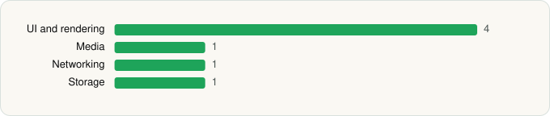

<picture><source media="(prefers-color-scheme: dark)" srcset="../../../../assets/logo/logo-dark.svg"></picture> [Tech Stack](../../../../README.md) / [Tusky Team](../../../../companies/tusky-team.md) / Tusky for Mastodon

# Tusky for Mastodon

<picture><source media="(prefers-color-scheme: dark)" srcset="../../../../assets/badges/android-dark.svg"></picture> <picture><source media="(prefers-color-scheme: dark)" srcset="../../../../assets/badges/inactive-dark.svg"></picture> <picture><source media="(prefers-color-scheme: dark)" srcset="../../../../assets/badges/floor-dark.svg"></picture>

[Google Play](https://play.google.com/store/apps/details?id=com.keylesspalace.tusky) · [latest.json](latest.json)

| | |
|---|---|
| Company | [Tusky Team](../../../../companies/tusky-team.md) |
| Store id | `com.keylesspalace.tusky` |
| Bundle / package id | `com.keylesspalace.tusky` |
| Latest version | 32.2 (analysed 2026-06-19) |
| Versions tracked | 1 |
| SDKs in latest version | 7 |
| Languages | C/C++ (native), Java, Kotlin |
| UI | Coil, Glide, Jetpack Compose, Material Components |
| Build | Gradle (inferred), R8 / ProGuard (name obfuscation detected) |
| Minimum OS | API 24, targets API 36 |
| Devices / ABIs | Android |
| Capabilities | 4 |
| Declares tracking | No |
| Tracked | No. Kept for history. |

## SDKs by category

<picture><source media="(prefers-color-scheme: dark)" srcset="../../../../assets/charts/apps/android/tusky-team/tusky-for-mastodon-dark.svg"></picture>

- **UI and rendering** (4): Coil, Glide, Jetpack Compose, Material Components
- **Media** (1): Media3 (ExoPlayer)
- **Networking** (1): OkHttp
- **Storage** (1): Room

Capabilities (4)

Foreground service, Notifications, Storage (read), Storage (write)

## Version history

| Version | Analysed | Store update | SDKs | Change | SDK list is a floor | Binary encrypted | File |
|---|---|---|---|---|---|---|---|
| 32.2 | 2026-06-19 |  | 7 |  | Yes | No | [32.2.json](32.2.json) |

---

Generated by `scripts/build_readme.py` from the JSON files. Do not edit by hand.
