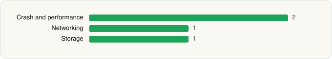

<picture><source media="(prefers-color-scheme: dark)" srcset="../../../../assets/logo/logo-dark.svg"></picture> [Tech Stack](../../../../README.md) / [Twitch Interactive, Inc.](../../../../companies/twitch-interactive-inc.md) / Twitch

# Twitch: Live Streaming

<picture><source media="(prefers-color-scheme: dark)" srcset="../../../../assets/badges/android-dark.svg"></picture> <picture><source media="(prefers-color-scheme: dark)" srcset="../../../../assets/badges/inactive-dark.svg"></picture> <picture><source media="(prefers-color-scheme: dark)" srcset="../../../../assets/badges/floor-dark.svg"></picture>

[Google Play](https://play.google.com/store/apps/details?id=tv.twitch.android.app) · [latest.json](latest.json)

| | |
|---|---|
| Company | [Twitch Interactive, Inc.](../../../../companies/twitch-interactive-inc.md) |
| Store id | `tv.twitch.android.app` |
| Bundle / package id | `tv.twitch.android.app` |
| Latest version | 13.0.0.2 (analysed 2026-06-19) |
| Versions tracked | 1 |
| SDKs in latest version | 4 |
| Languages | C/C++ (native), Java |
| UI | Android Views (inferred) |
| Build | Gradle (inferred), R8 / ProGuard (name obfuscation detected) |
| Minimum OS | API 21, targets API 34 |
| Devices / ABIs | Android |
| Capabilities | 2 |
| Declares tracking | Yes |
| Tracked | No. Kept for history. |

## SDKs by category

<picture><source media="(prefers-color-scheme: dark)" srcset="../../../../assets/charts/apps/android/twitch-interactive-inc/twitch-dark.svg"></picture>

- **Crash and performance** (2): Sentry, Sentry (native)
- **Networking** (1): OkHttp
- **Storage** (1): Room

Capabilities (2)

Advertising ID, Foreground service

## Version history

| Version | Analysed | Store update | SDKs | Change | SDK list is a floor | Binary encrypted | File |
|---|---|---|---|---|---|---|---|
| 13.0.0.2 | 2026-06-19 |  | 4 |  | Yes | No | [13.0.0.2.json](13.0.0.2.json) |

---

Generated by `scripts/build_readme.py` from the JSON files. Do not edit by hand.
