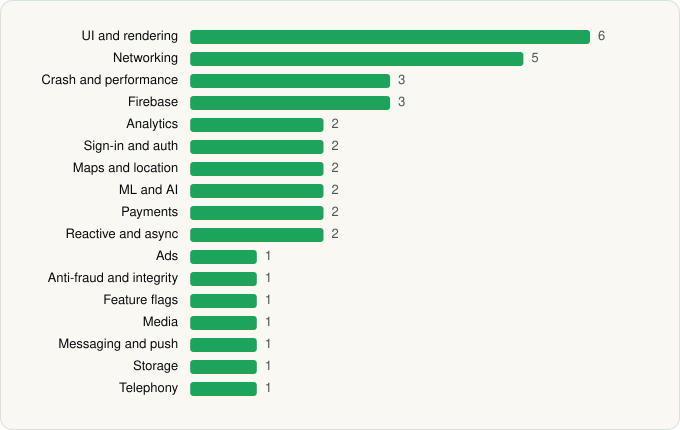

<picture><source media="(prefers-color-scheme: dark)" srcset="../../../../assets/logo/logo-dark.svg"></picture> [Tech Stack](../../../../README.md) / [Uber Technologies, Inc.](../../../../companies/uber-technologies-inc.md) / Uber Eats

# Uber Eats: Food and Grocery

<picture><source media="(prefers-color-scheme: dark)" srcset="../../../../assets/badges/android-dark.svg"></picture> <picture><source media="(prefers-color-scheme: dark)" srcset="../../../../assets/badges/inactive-dark.svg"></picture>

[Google Play](https://play.google.com/store/apps/details?id=com.ubercab.eats) · [latest.json](latest.json)

| | |
|---|---|
| Company | [Uber Technologies, Inc.](../../../../companies/uber-technologies-inc.md) |
| Store id | `com.ubercab.eats` |
| Bundle / package id | `com.ubercab.eats` |
| Latest version | 6.326.10001 (analysed 2026-06-19) |
| Versions tracked | 1 |
| SDKs in latest version | 36 |
| Languages | C/C++ (native), Java, Kotlin |
| UI | Coil, Glide, Jetpack Compose, Lottie, Material Components, Picasso |
| Build | Gradle (inferred) |
| Minimum OS | API 28, targets API 36 |
| Devices / ABIs | Android |
| Capabilities | 11 |
| Declares tracking | Yes |
| Tracked | No. Kept for history. |

## SDKs by category

<picture><source media="(prefers-color-scheme: dark)" srcset="../../../../assets/charts/apps/android/uber-technologies-inc/uber-eats-dark.svg"></picture>

- **UI and rendering** (6): Coil, Glide, Jetpack Compose, Lottie, Material Components, Picasso
- **Networking** (5): Cronet, Cronet (Chromium net), Cronet (Google), OkHttp, Retrofit
- **Crash and performance** (3): Crashlytics, Firebase Performance, OpenTelemetry
- **Firebase** (3): Firebase, Google DataTransport, Google Play services
- **Analytics** (2): Firebase Analytics, Google App Measurement
- **Sign-in and auth** (2): Credential Manager, Google Sign-In / Auth
- **Maps and location** (2): Google Location, Google Maps
- **ML and AI** (2): TensorFlow, TensorFlow Lite
- **Payments** (2): Adyen, Braintree
- **Reactive and async** (2): Kotlin Coroutines, RxJava
- **Ads** (1): Google Mobile Ads (AdMob)
- **Anti-fraud and integrity** (1): Play Integrity
- **Feature flags** (1): Firebase Remote Config
- **Media** (1): Media3 (ExoPlayer)
- **Messaging and push** (1): Firebase Messaging
- **Storage** (1): Room
- **Telephony** (1): libphonenumber

Capabilities (11)

Advertising ID, Approximate location, Biometric auth, Camera, Fingerprint auth, Foreground service, Foreground service: location, Notifications, Precise location, Storage (read), Storage (write)

## Version history

| Version | Analysed | Store update | SDKs | Change | SDK list is a floor | Binary encrypted | File |
|---|---|---|---|---|---|---|---|
| 6.326.10001 | 2026-06-19 |  | 36 |  | No | No | [6.326.10001.json](6.326.10001.json) |

## Model-written summary

> Android Uber Eats client with Kotlin/Java, Jetpack Compose UI, TensorFlow Lite ML, Cronet networking, Firebase, Uber backends, and Adyen/Braintree payments

Written by a language model from the detected signals (`inferred[]`). It is commentary, not measurement.

---

Generated by `scripts/build_readme.py` from the JSON files. Do not edit by hand.
