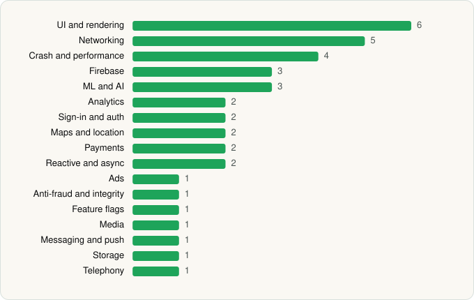

<picture><source media="(prefers-color-scheme: dark)" srcset="../../../../assets/logo/logo-dark.svg"></picture> [Tech Stack](../../../../README.md) / [Uber Technologies, Inc.](../../../../companies/uber-technologies-inc.md) / Uber

# Uber - Request a ride

<picture><source media="(prefers-color-scheme: dark)" srcset="../../../../assets/badges/android-dark.svg"></picture> <picture><source media="(prefers-color-scheme: dark)" srcset="../../../../assets/badges/active-dark.svg"></picture>

[Google Play](https://play.google.com/store/apps/details?id=com.ubercab) · [latest.json](latest.json)

| | |
|---|---|
| Company | [Uber Technologies, Inc.](../../../../companies/uber-technologies-inc.md) |
| Store id | `com.ubercab` |
| Bundle / package id | `com.ubercab` |
| Latest version | 4.634.10003 (analysed 2026-06-19) |
| Versions tracked | 1 |
| SDKs in latest version | 38 |
| Languages | C/C++ (native), Java, Kotlin |
| UI | Coil, Glide, Jetpack Compose, Lottie, Material Components, Picasso |
| Build | Gradle (inferred) |
| Minimum OS | API 29, targets API 36 |
| Devices / ABIs | Android |
| Capabilities | 18 |
| Declares tracking | Yes |
| Tracked | Yes |

## SDKs by category

<picture><source media="(prefers-color-scheme: dark)" srcset="../../../../assets/charts/apps/android/uber-technologies-inc/uber-dark.svg"></picture>

- **UI and rendering** (6): Coil, Glide, Jetpack Compose, Lottie, Material Components, Picasso
- **Networking** (5): Cronet, Cronet (Chromium net), Cronet (Google), OkHttp, Retrofit
- **Crash and performance** (4): Crashlytics, Firebase Crashlytics, Firebase Performance, OpenTelemetry
- **Firebase** (3): Firebase, Google DataTransport, Google Play services
- **ML and AI** (3): ML Kit (barcode/vision), TensorFlow, TensorFlow Lite
- **Analytics** (2): Firebase Analytics, Google App Measurement
- **Sign-in and auth** (2): Credential Manager, Google Sign-In / Auth
- **Maps and location** (2): Google Location, Google Maps
- **Payments** (2): Adyen, Braintree
- **Reactive and async** (2): Kotlin Coroutines, RxJava
- **Ads** (1): Google Mobile Ads (AdMob)
- **Anti-fraud and integrity** (1): Play Integrity
- **Feature flags** (1): Firebase Remote Config
- **Media** (1): Media3 (ExoPlayer)
- **Messaging and push** (1): Firebase Messaging
- **Storage** (1): Room
- **Telephony** (1): libphonenumber

Capabilities (18)

Advertising ID, Approximate location, Biometric auth, Bluetooth, Bluetooth (connect), Bluetooth (scan), Camera, Contacts (read), Draw over other apps, Fingerprint auth, Foreground service, Foreground service: location, Foreground service: microphone, Notifications, Phone / carrier info, Precise location, Storage (read), Storage (write)

## Version history

| Version | Analysed | Store update | SDKs | Change | SDK list is a floor | Binary encrypted | File |
|---|---|---|---|---|---|---|---|
| 4.634.10003 | 2026-06-19 |  | 38 |  | No | No | [4.634.10003.json](4.634.10003.json) |

---

Generated by `scripts/build_readme.py` from the JSON files. Do not edit by hand.
