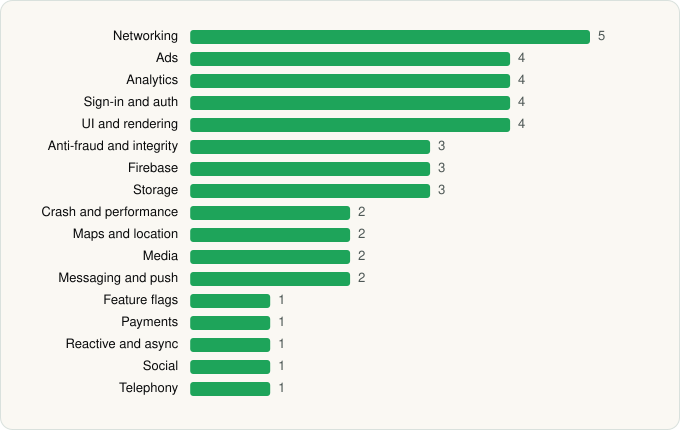

<picture><source media="(prefers-color-scheme: dark)" srcset="../../../../assets/logo/logo-dark.svg"></picture> [Tech Stack](../../../../README.md) / [Utility Apps Home](../../../../companies/utility-apps-home.md) / Settings Home

# Settings Home

<picture><source media="(prefers-color-scheme: dark)" srcset="../../../../assets/badges/android-dark.svg"></picture> <picture><source media="(prefers-color-scheme: dark)" srcset="../../../../assets/badges/inactive-dark.svg"></picture>

[Google Play](https://play.google.com/store/apps/details?id=com.eet.settings.launcher) · [latest.json](latest.json)

| | |
|---|---|
| Company | [Utility Apps Home](../../../../companies/utility-apps-home.md) |
| Store id | `com.eet.settings.launcher` |
| Bundle / package id | `com.eet.settings.launcher` |
| Latest version | 1.6.4 (analysed 2026-11-01) |
| Versions tracked | 1 |
| SDKs in latest version | 43 |
| Languages | C/C++ (native), Java, Kotlin |
| UI | Coil, Jetpack Compose, Lottie, Material Components |
| Build | Gradle (inferred) |
| Minimum OS | API 28, targets API 36 |
| Devices / ABIs | Android |
| Capabilities | 10 |
| Declares tracking | Yes |
| Tracked | No. Kept for history. |

## SDKs by category

<picture><source media="(prefers-color-scheme: dark)" srcset="../../../../assets/charts/apps/android/utility-apps-home/settings-home-dark.svg"></picture>

- **Networking** (5): Cronet, Cronet (Google), Ktor, OkHttp, Retrofit
- **Ads** (4): Google Mobile Ads (AdMob), Meta Audience Network, Mintegral, Vungle
- **Analytics** (4): Facebook SDK, Firebase Analytics, Google App Measurement, Singular
- **Sign-in and auth** (4): Credential Manager, Facebook Login, Firebase Auth, Google Sign-In / Auth
- **UI and rendering** (4): Coil, Jetpack Compose, Lottie, Material Components
- **Anti-fraud and integrity** (3): Play Integrity, reCAPTCHA, RootBeer
- **Firebase** (3): Firebase, Google DataTransport, Google Play services
- **Storage** (3): DataStore, Okio, Room
- **Crash and performance** (2): Firebase Crashlytics, Firebase Performance
- **Maps and location** (2): Google Location, Google Maps
- **Media** (2): ExoPlayer, Media3 (ExoPlayer)
- **Messaging and push** (2): Braze, Firebase Messaging
- **Feature flags** (1): Firebase Remote Config
- **Payments** (1): Google Play Billing
- **Reactive and async** (1): Kotlin Coroutines
- **Social** (1): Facebook Share
- **Telephony** (1): libphonenumber

Capabilities (10)

Advertising ID, Approximate location, Biometric auth, Bluetooth (connect), Fingerprint auth, Foreground service, Notifications, Precise location, Storage (read), Storage (write)

## Version history

| Version | Analysed | Store update | SDKs | Change | SDK list is a floor | Binary encrypted | File |
|---|---|---|---|---|---|---|---|
| 1.6.4 | 2026-11-01 |  | 43 |  | No | No | [1.6.4.json](1.6.4.json) |

---

Generated by `scripts/build_readme.py` from the JSON files. Do not edit by hand.
