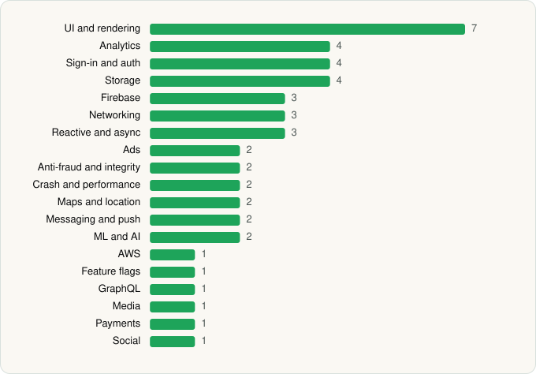

<picture><source media="(prefers-color-scheme: dark)" srcset="../../../../assets/logo/logo-dark.svg"></picture> [Tech Stack](../../../../README.md) / [VEVOR STORE LLC](../../../../companies/vevor-store-llc.md) / VEVOR

# VEVOR

<picture><source media="(prefers-color-scheme: dark)" srcset="../../../../assets/badges/android-dark.svg"></picture> <picture><source media="(prefers-color-scheme: dark)" srcset="../../../../assets/badges/inactive-dark.svg"></picture>

[Google Play](https://play.google.com/store/apps/details?id=com.vevor.store) · [latest.json](latest.json)

| | |
|---|---|
| Company | [VEVOR STORE LLC](../../../../companies/vevor-store-llc.md) |
| Store id | `com.vevor.store` |
| Bundle / package id | `com.vevor.store` |
| Latest version | v2.1.2 (analysed 2026-06-19) |
| Versions tracked | 1 |
| SDKs in latest version | 46 |
| Languages | C/C++ (native), Flutter / Dart, Java, Kotlin |
| UI | Coil, Glide, Jetpack Compose, Lottie, Material Components, Picasso |
| Build | Gradle (inferred) |
| Minimum OS | API 26, targets API 35 |
| Devices / ABIs | Android |
| Capabilities | 13 |
| Declares tracking | Yes |
| Tracked | No. Kept for history. |

## SDKs by category

<picture><source media="(prefers-color-scheme: dark)" srcset="../../../../assets/charts/apps/android/vevor-store-llc/vevor-dark.svg"></picture>

- **UI and rendering** (7): AndroidSVG, Coil, Glide, Jetpack Compose, Lottie, Material Components, Picasso
- **Analytics** (4): AppsFlyer, Facebook SDK, Firebase Analytics, Google App Measurement
- **Sign-in and auth** (4): Credential Manager, Facebook Login, Firebase Auth, Google Sign-In / Auth
- **Storage** (4): DataStore, MMKV, Okio, Room
- **Firebase** (3): Firebase, Google DataTransport, Google Play services
- **Networking** (3): OkHttp, Retrofit, Volley
- **Reactive and async** (3): Kotlin Coroutines, RxJava, RxJava 3
- **Ads** (2): Google Ad Manager, Google Mobile Ads (AdMob)
- **Anti-fraud and integrity** (2): Play Integrity, reCAPTCHA
- **Crash and performance** (2): Firebase Crashlytics, Firebase Performance
- **Maps and location** (2): Google Location, Google Maps
- **Messaging and push** (2): Firebase Messaging, Zendesk
- **ML and AI** (2): ML Kit, ML Kit (barcode/vision)
- **AWS** (1): AWS SDK
- **Feature flags** (1): Firebase Remote Config
- **GraphQL** (1): Apollo GraphQL
- **Media** (1): Media3 (ExoPlayer)
- **Payments** (1): Adyen
- **Social** (1): Facebook Share

Capabilities (13)

Advertising ID, Approximate location, Calendar (read), Calendar (write), Camera, Fingerprint auth, Foreground service, Media: audio, Notifications, Phone / carrier info, Precise location, Storage (read), Storage (write)

## Version history

| Version | Analysed | Store update | SDKs | Change | SDK list is a floor | Binary encrypted | File |
|---|---|---|---|---|---|---|---|
| v2.1.2 | 2026-06-19 |  | 46 |  | No | No | [v2.1.2.json](v2.1.2.json) |

## Model-written summary

> Flutter Android app with C++ natives (libflutter, libmpv, libbarhopper), bundled TFLite ML models, Firebase+AppsFlyer tracking, and Adyen payments

Written by a language model from the detected signals (`inferred[]`). It is commentary, not measurement.

---

Generated by `scripts/build_readme.py` from the JSON files. Do not edit by hand.
