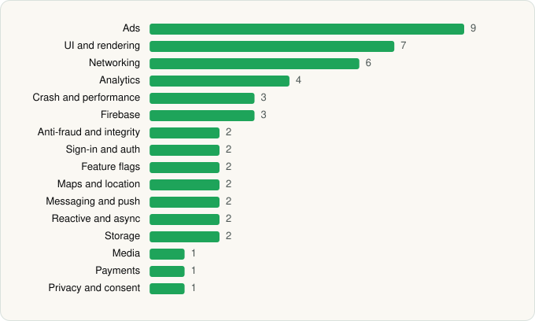

<picture><source media="(prefers-color-scheme: dark)" srcset="../../../../assets/logo/logo-dark.svg"></picture> [Tech Stack](../../../../README.md) / [Vinted](../../../../companies/vinted.md) / Vinted

# Vinted: Shop & sell pre-loved

<picture><source media="(prefers-color-scheme: dark)" srcset="../../../../assets/badges/android-dark.svg"></picture> <picture><source media="(prefers-color-scheme: dark)" srcset="../../../../assets/badges/inactive-dark.svg"></picture>

[Google Play](https://play.google.com/store/apps/details?id=fr.vinted) · [latest.json](latest.json)

| | |
|---|---|
| Company | [Vinted](../../../../companies/vinted.md) |
| Store id | `fr.vinted` |
| Bundle / package id | `fr.vinted` |
| Latest version | 26.43.0 (analysed 2026-11-10) |
| Versions tracked | 1 |
| SDKs in latest version | 49 |
| Languages | C/C++ (native), Java, Kotlin, Unity (C# / IL2CPP) |
| UI | Coil, Glide, Jetpack Compose, Lottie, Material Components, Picasso |
| Build | Gradle (inferred) |
| Minimum OS | API 29, targets API 36 |
| Devices / ABIs | Android |
| Capabilities | 11 |
| Declares tracking | Yes |
| Tracked | No. Kept for history. |

## SDKs by category

<picture><source media="(prefers-color-scheme: dark)" srcset="../../../../assets/charts/apps/android/vinted/vinted-dark.svg"></picture>

- **Ads** (9): AppLovin, Fyber, Google Ad Manager, Google Mobile Ads (AdMob), Meta Audience Network, Mintegral, PubMatic, Unity Ads, Vungle
- **UI and rendering** (7): AndroidSVG, Coil, Glide, Jetpack Compose, Lottie, Material Components, Picasso
- **Networking** (6): Cronet, Cronet (Google), Ktor, OkHttp, Retrofit, Volley
- **Analytics** (4): Adjust, Facebook SDK, Firebase Analytics, Google App Measurement
- **Crash and performance** (3): Crashlytics, Firebase Crashlytics, OpenTelemetry
- **Firebase** (3): Firebase, Google DataTransport, Google Play services
- **Anti-fraud and integrity** (2): Fingerprint, Play Integrity
- **Sign-in and auth** (2): Facebook Login, Google Sign-In / Auth
- **Feature flags** (2): Firebase Remote Config, LaunchDarkly
- **Maps and location** (2): Google Location, Google Maps
- **Messaging and push** (2): Braze, Firebase Messaging
- **Reactive and async** (2): Kotlin Coroutines, RxJava
- **Storage** (2): DataStore, Room
- **Media** (1): Media3 (ExoPlayer)
- **Payments** (1): Adyen
- **Privacy and consent** (1): OneTrust

Capabilities (11)

Advertising ID, Approximate location, Biometric auth, Camera, Fingerprint auth, Foreground service, Media: images, Notifications, Precise location, Storage (read), Storage (write)

## Version history

| Version | Analysed | Store update | SDKs | Change | SDK list is a floor | Binary encrypted | File |
|---|---|---|---|---|---|---|---|
| 26.43.0 | 2026-11-10 |  | 49 |  | No | No | [26.43.0.json](26.43.0.json) |

---

Generated by `scripts/build_readme.py` from the JSON files. Do not edit by hand.
