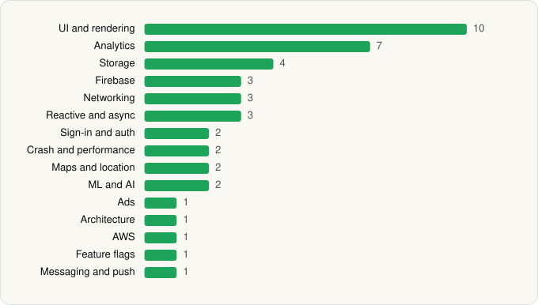

<picture><source media="(prefers-color-scheme: dark)" srcset="../../../../assets/logo/logo-dark.svg"></picture> [Tech Stack](../../../../README.md) / [Walgreens Co](../../../../companies/walgreens-co.md) / Walgreens

# Walgreens

<picture><source media="(prefers-color-scheme: dark)" srcset="../../../../assets/badges/android-dark.svg"></picture> <picture><source media="(prefers-color-scheme: dark)" srcset="../../../../assets/badges/inactive-dark.svg"></picture>

[Google Play](https://play.google.com/store/apps/details?id=com.usablenet.mobile.walgreen) · [latest.json](latest.json)

| | |
|---|---|
| Company | [Walgreens Co](../../../../companies/walgreens-co.md) |
| Store id | `com.usablenet.mobile.walgreen` |
| Bundle / package id | `com.usablenet.mobile.walgreen` |
| Latest version | 113.1 (analysed 2026-06-19) |
| Versions tracked | 1 |
| SDKs in latest version | 43 |
| Languages | C/C++ (native), Cordova (web), Java, Kotlin, React Native / JavaScript |
| UI | Coil, Fresco, Glide, Jetpack Compose, Lottie, Material Components, Picasso |
| Build | Gradle (inferred) |
| Minimum OS | API 29, targets API 35 |
| Devices / ABIs | Android |
| Capabilities | 13 |
| Declares tracking | Yes |
| Tracked | No. Kept for history. |

## SDKs by category

<picture><source media="(prefers-color-scheme: dark)" srcset="../../../../assets/charts/apps/android/walgreens-co/walgreens-dark.svg"></picture>

- **UI and rendering** (10): AndroidSVG, Coil, Fresco, Glide, Jetpack Compose, Lottie, Material Components, Picasso, React Native Reanimated, react-native-svg
- **Analytics** (7): Adobe Experience Platform, Amplitude, Branch, Firebase Analytics, Google Analytics (legacy), Google App Measurement, Medallia
- **Storage** (4): DataStore, Okio, Room, SQLCipher
- **Firebase** (3): Firebase, Google DataTransport, Google Play services
- **Networking** (3): axios, OkHttp, Retrofit
- **Reactive and async** (3): Kotlin Coroutines, RxJava, RxJava 3
- **Sign-in and auth** (2): Auth0, Google Sign-In / Auth
- **Crash and performance** (2): Firebase Crashlytics, Firebase Performance
- **Maps and location** (2): Google Location, Google Maps
- **ML and AI** (2): ML Kit, Mobile Vision
- **Ads** (1): Google Mobile Ads (AdMob)
- **Architecture** (1): Redux
- **AWS** (1): AWS SDK
- **Feature flags** (1): Firebase Remote Config
- **Messaging and push** (1): Firebase Messaging

Capabilities (13)

Advertising ID, Approximate location, Biometric auth, Bluetooth, Camera, Fingerprint auth, Foreground service, Media: images, NFC, Notifications, Precise location, Storage (read), Storage (write)

## Version history

| Version | Analysed | Store update | SDKs | Change | SDK list is a floor | Binary encrypted | File |
|---|---|---|---|---|---|---|---|
| 113.1 | 2026-06-19 |  | 43 |  | No | No | [113.1.json](113.1.json) |

## Model-written summary

> React Native Android app with 294 activities, bundled face-detection TFLite models, Firebase, root detection, and 43 third-party SDKs

Written by a language model from the detected signals (`inferred[]`). It is commentary, not measurement.

---

Generated by `scripts/build_readme.py` from the JSON files. Do not edit by hand.
