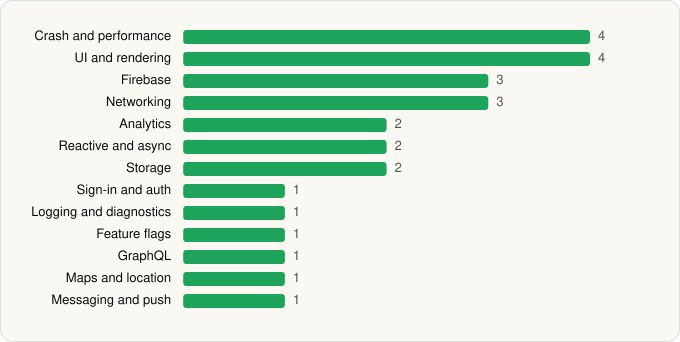

<picture><source media="(prefers-color-scheme: dark)" srcset="../../../../assets/logo/logo-dark.svg"></picture> [Tech Stack](../../../../README.md) / [Wayfair, LLC](../../../../companies/wayfair-llc.md) / Wayfair Service Pro

# Wayfair Service Pro

<picture><source media="(prefers-color-scheme: dark)" srcset="../../../../assets/badges/android-dark.svg"></picture> <picture><source media="(prefers-color-scheme: dark)" srcset="../../../../assets/badges/inactive-dark.svg"></picture> <picture><source media="(prefers-color-scheme: dark)" srcset="../../../../assets/badges/floor-dark.svg"></picture>

[Google Play](https://play.google.com/store/apps/details?id=com.wayfair.wayhome) · [latest.json](latest.json)

| | |
|---|---|
| Company | [Wayfair, LLC](../../../../companies/wayfair-llc.md) |
| Store id | `com.wayfair.wayhome` |
| Bundle / package id | `com.wayfair.wayhome` |
| Latest version | 1.100.0 (analysed 2026-06-19) |
| Versions tracked | 1 |
| SDKs in latest version | 26 |
| Languages | C/C++ (native), Java, Kotlin |
| UI | Coil, Fresco, Jetpack Compose, Material Components |
| Build | Gradle (inferred), R8 / ProGuard (name obfuscation detected) |
| Minimum OS | API 24, targets API 35 |
| Devices / ABIs | Android |
| Capabilities | 10 |
| Declares tracking | Yes |
| Tracked | No. Kept for history. |

## SDKs by category

<picture><source media="(prefers-color-scheme: dark)" srcset="../../../../assets/charts/apps/android/wayfair-llc/wayfair-service-pro-dark.svg"></picture>

- **Crash and performance** (4): Crashlytics, Datadog, Firebase Crashlytics, Firebase Performance
- **UI and rendering** (4): Coil, Fresco, Jetpack Compose, Material Components
- **Firebase** (3): Firebase, Google DataTransport, Google Play services
- **Networking** (3): Ktor, OkHttp, Retrofit
- **Analytics** (2): Firebase Analytics, Google App Measurement
- **Reactive and async** (2): Kotlin Coroutines, RxJava
- **Storage** (2): DataStore, Room
- **Sign-in and auth** (1): Google Sign-In / Auth
- **Logging and diagnostics** (1): Stetho
- **Feature flags** (1): Firebase Remote Config
- **GraphQL** (1): Apollo GraphQL
- **Maps and location** (1): Google Maps
- **Messaging and push** (1): Firebase Messaging

Capabilities (10)

Advertising ID, Approximate location, Background location, Calendar (read), Calendar (write), Foreground service, Notifications, Precise location, Storage (read), Storage (write)

## Version history

| Version | Analysed | Store update | SDKs | Change | SDK list is a floor | Binary encrypted | File |
|---|---|---|---|---|---|---|---|
| 1.100.0 | 2026-06-19 |  | 26 |  | Yes | No | [1.100.0.json](1.100.0.json) |

---

Generated by `scripts/build_readme.py` from the JSON files. Do not edit by hand.
