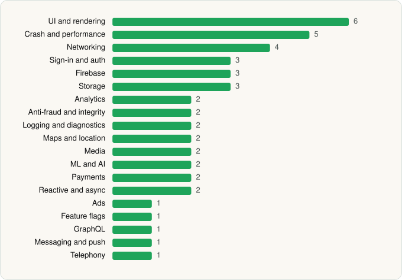

<picture><source media="(prefers-color-scheme: dark)" srcset="../../../../assets/logo/logo-dark.svg"></picture> [Tech Stack](../../../../README.md) / [Wayfair, LLC](../../../../companies/wayfair-llc.md) / Wayfair

# Wayfair - Shop All Things Home

<picture><source media="(prefers-color-scheme: dark)" srcset="../../../../assets/badges/android-dark.svg"></picture> <picture><source media="(prefers-color-scheme: dark)" srcset="../../../../assets/badges/inactive-dark.svg"></picture>

[Google Play](https://play.google.com/store/apps/details?id=com.wayfair.wayfair) · [latest.json](latest.json)

| | |
|---|---|
| Company | [Wayfair, LLC](../../../../companies/wayfair-llc.md) |
| Store id | `com.wayfair.wayfair` |
| Bundle / package id | `com.wayfair.wayfair` |
| Latest version | 7.21.0 (analysed 2026-06-19) |
| Versions tracked | 1 |
| SDKs in latest version | 45 |
| Languages | C/C++ (native), Java, Kotlin |
| UI | Coil, Fresco, Glide, Jetpack Compose, Lottie, Material Components |
| Build | Gradle (inferred) |
| Minimum OS | API 29, targets API 35 |
| Devices / ABIs | Android |
| Capabilities | 8 |
| Declares tracking | Yes |
| Tracked | No. Kept for history. |

## SDKs by category

<picture><source media="(prefers-color-scheme: dark)" srcset="../../../../assets/charts/apps/android/wayfair-llc/wayfair-dark.svg"></picture>

- **UI and rendering** (6): Coil, Fresco, Glide, Jetpack Compose, Lottie, Material Components
- **Crash and performance** (5): Crashlytics, Datadog, Datadog (native), Firebase Crashlytics, Firebase Performance
- **Networking** (4): Ktor, OkHttp, Retrofit, Volley
- **Sign-in and auth** (3): Auth0, Credential Manager, Google Sign-In / Auth
- **Firebase** (3): Firebase, Google DataTransport, Google Play services
- **Storage** (3): DataStore, Room, SQLDelight
- **Analytics** (2): Firebase Analytics, Google App Measurement
- **Anti-fraud and integrity** (2): Play Integrity, reCAPTCHA
- **Logging and diagnostics** (2): Chucker, Stetho
- **Maps and location** (2): Google Location, Google Maps
- **Media** (2): ExoPlayer, Media3 (ExoPlayer)
- **ML and AI** (2): ML Kit, ML Kit (barcode/vision)
- **Payments** (2): Braintree, Stripe
- **Reactive and async** (2): Kotlin Coroutines, RxJava
- **Ads** (1): Google Mobile Ads (AdMob)
- **Feature flags** (1): Firebase Remote Config
- **GraphQL** (1): Apollo GraphQL
- **Messaging and push** (1): Firebase Messaging
- **Telephony** (1): libphonenumber

Capabilities (8)

Advertising ID, Approximate location, Biometric auth, Camera, Fingerprint auth, Foreground service, Notifications, Precise location

## Version history

| Version | Analysed | Store update | SDKs | Change | SDK list is a floor | Binary encrypted | File |
|---|---|---|---|---|---|---|---|
| 7.21.0 | 2026-06-19 |  | 45 |  | No | No | [7.21.0.json](7.21.0.json) |

---

Generated by `scripts/build_readme.py` from the JSON files. Do not edit by hand.
