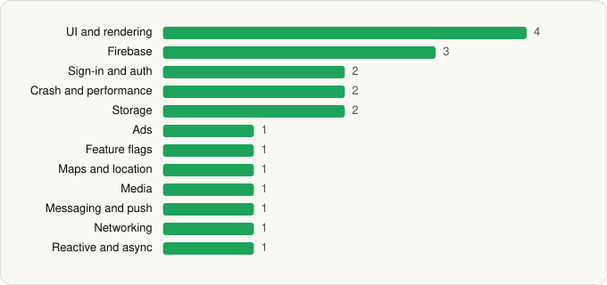

<picture><source media="(prefers-color-scheme: dark)" srcset="../../../../assets/logo/logo-dark.svg"></picture> [Tech Stack](../../../../README.md) / [waze](../../../../companies/waze.md) / Waze Navigation & Live Traffic

# Waze Navigation & Live Traffic

<picture><source media="(prefers-color-scheme: dark)" srcset="../../../../assets/badges/android-dark.svg"></picture> <picture><source media="(prefers-color-scheme: dark)" srcset="../../../../assets/badges/inactive-dark.svg"></picture>

[Google Play](https://play.google.com/store/apps/details?id=com.waze) · [latest.json](latest.json)

| | |
|---|---|
| Company | [waze](../../../../companies/waze.md) |
| Store id | `com.waze` |
| Bundle / package id | `com.waze` |
| Latest version | 5.19.90.900 (analysed 2026-06-19) |
| Versions tracked | 1 |
| SDKs in latest version | 20 |
| Languages | C/C++ (native), Java, Kotlin |
| UI | Glide, Jetpack Compose, Lottie, Material Components |
| Build | Gradle (inferred) |
| Minimum OS | API 29, targets API 35 |
| Devices / ABIs | Android |
| Capabilities | 16 |
| Declares tracking | Yes |
| Tracked | No. Kept for history. |

## SDKs by category

<picture><source media="(prefers-color-scheme: dark)" srcset="../../../../assets/charts/apps/android/waze/waze-navigation-live-traffic-dark.svg"></picture>

- **UI and rendering** (4): Glide, Jetpack Compose, Lottie, Material Components
- **Firebase** (3): Firebase, Google DataTransport, Google Play services
- **Sign-in and auth** (2): Credential Manager, Google Sign-In / Auth
- **Crash and performance** (2): Firebase Crashlytics, Firebase Performance
- **Storage** (2): DataStore, Room
- **Ads** (1): Google Mobile Ads (AdMob)
- **Feature flags** (1): Firebase Remote Config
- **Maps and location** (1): Google Location
- **Media** (1): Media3 (ExoPlayer)
- **Messaging and push** (1): Firebase Messaging
- **Networking** (1): OkHttp
- **Reactive and async** (1): Kotlin Coroutines

Capabilities (16)

Advertising ID, Approximate location, Background location, Bluetooth, Bluetooth (connect), Bluetooth (scan), Calendar (read), Camera, Contacts (read), Draw over other apps, Foreground service, Foreground service: location, Microphone, Notifications, Phone / carrier info, Precise location

## Version history

| Version | Analysed | Store update | SDKs | Change | SDK list is a floor | Binary encrypted | File |
|---|---|---|---|---|---|---|---|
| 5.19.90.900 | 2026-06-19 |  | 20 |  | No | No | [5.19.90.900.json](5.19.90.900.json) |

---

Generated by `scripts/build_readme.py` from the JSON files. Do not edit by hand.
