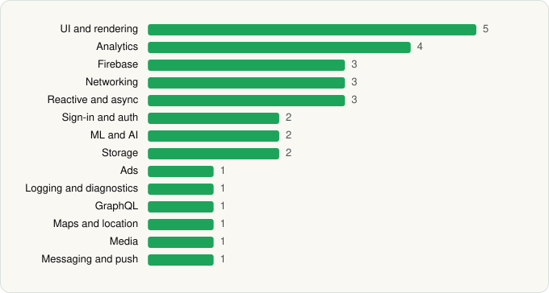

<picture><source media="(prefers-color-scheme: dark)" srcset="../../../../assets/logo/logo-dark.svg"></picture> [Tech Stack](../../../../README.md) / [Wells Fargo Mobile](../../../../companies/wells-fargo-mobile.md) / Wells Fargo Mobile®

# Wells Fargo Mobile®

<picture><source media="(prefers-color-scheme: dark)" srcset="../../../../assets/badges/android-dark.svg"></picture> <picture><source media="(prefers-color-scheme: dark)" srcset="../../../../assets/badges/inactive-dark.svg"></picture>

[Google Play](https://play.google.com/store/apps/details?id=com.wf.wellsfargomobile) · [latest.json](latest.json)

| | |
|---|---|
| Company | [Wells Fargo Mobile](../../../../companies/wells-fargo-mobile.md) |
| Store id | `com.wf.wellsfargomobile` |
| Bundle / package id | `com.wf.wellsfargomobile` |
| Latest version | 26.04.02.13 (analysed 2026-06-19) |
| Versions tracked | 1 |
| SDKs in latest version | 30 |
| Languages | C/C++ (native), Java, Kotlin |
| UI | Coil, Jetpack Compose, Lottie, Material Components |
| Build | Gradle (inferred) |
| Minimum OS | API 29, targets API 35 |
| Devices / ABIs | Android |
| Capabilities | 16 |
| Declares tracking | Yes |
| Tracked | No. Kept for history. |

## SDKs by category

<picture><source media="(prefers-color-scheme: dark)" srcset="../../../../assets/charts/apps/android/wells-fargo-mobile/wells-fargo-mobile-dark.svg"></picture>

- **UI and rendering** (5): AndroidSVG, Coil, Jetpack Compose, Lottie, Material Components
- **Analytics** (4): Adobe Experience Platform, Firebase Analytics, Google App Measurement, Medallia
- **Firebase** (3): Firebase, Google DataTransport, Google Play services
- **Networking** (3): OkHttp, Retrofit, Volley
- **Reactive and async** (3): Kotlin Coroutines, RxJava, RxJava 3
- **Sign-in and auth** (2): Credential Manager, Google Sign-In / Auth
- **ML and AI** (2): ML Kit, ML Kit (barcode/vision)
- **Storage** (2): Okio, Room
- **Ads** (1): Google Mobile Ads (AdMob)
- **Logging and diagnostics** (1): Chucker
- **GraphQL** (1): Apollo GraphQL
- **Maps and location** (1): Google Location
- **Media** (1): Media3 (ExoPlayer)
- **Messaging and push** (1): Firebase Messaging

Capabilities (16)

Advertising ID, Approximate location, Biometric auth, Bluetooth, Camera, Contacts (read), Fingerprint auth, Foreground service, Microphone, NFC, Notifications, Phone / carrier info, Precise location, Query all installed apps, Storage (read), Storage (write)

## Version history

| Version | Analysed | Store update | SDKs | Change | SDK list is a floor | Binary encrypted | File |
|---|---|---|---|---|---|---|---|
| 26.04.02.13 | 2026-06-19 |  | 30 |  | No | No | [26.04.02.13.json](26.04.02.13.json) |

## Model-written summary

> Android banking app in Kotlin/Java using Jetpack Compose, MiSnap native libs with TFLite models, root detection, and first-party Wells Fargo backends via Retrofit

Written by a language model from the detected signals (`inferred[]`). It is commentary, not measurement.

---

Generated by `scripts/build_readme.py` from the JSON files. Do not edit by hand.
