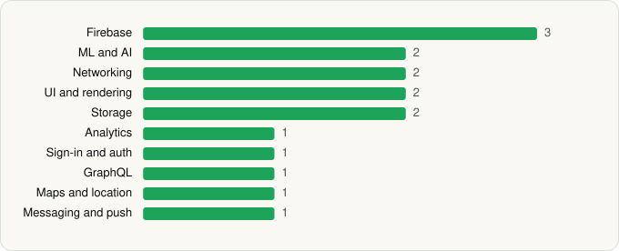

<picture><source media="(prefers-color-scheme: dark)" srcset="../../../../assets/logo/logo-dark.svg"></picture> [Tech Stack](../../../../README.md) / [Wells Fargo Mobile](../../../../companies/wells-fargo-mobile.md) / Wells Fargo Vantage®

# Wells Fargo Vantage®

<picture><source media="(prefers-color-scheme: dark)" srcset="../../../../assets/badges/android-dark.svg"></picture> <picture><source media="(prefers-color-scheme: dark)" srcset="../../../../assets/badges/inactive-dark.svg"></picture>

[Google Play](https://play.google.com/store/apps/details?id=com.wellsFargo.ceomobile) · [latest.json](latest.json)

| | |
|---|---|
| Company | [Wells Fargo Mobile](../../../../companies/wells-fargo-mobile.md) |
| Store id | `com.wellsFargo.ceomobile` |
| Bundle / package id | `com.wellsFargo.ceomobile` |
| Latest version | 26.4.2.7 (analysed 2026-06-19) |
| Versions tracked | 1 |
| SDKs in latest version | 16 |
| Languages | C/C++ (native), Java, Kotlin |
| UI | Jetpack Compose, Material Components |
| Build | Gradle (inferred) |
| Minimum OS | API 31, targets API 35 |
| Devices / ABIs | Android |
| Capabilities | 8 |
| Declares tracking | Yes |
| Tracked | No. Kept for history. |

## SDKs by category

<picture><source media="(prefers-color-scheme: dark)" srcset="../../../../assets/charts/apps/android/wells-fargo-mobile/wells-fargo-vantage-dark.svg"></picture>

- **Firebase** (3): Firebase, Google DataTransport, Google Play services
- **ML and AI** (2): ML Kit, OpenCV
- **Networking** (2): OkHttp, Volley
- **UI and rendering** (2): Jetpack Compose, Material Components
- **Storage** (2): Room, SQLCipher
- **Analytics** (1): Firebase Analytics
- **Sign-in and auth** (1): Google Sign-In / Auth
- **GraphQL** (1): Apollo GraphQL
- **Maps and location** (1): Google Location
- **Messaging and push** (1): Firebase Messaging

Capabilities (8)

Approximate location, Biometric auth, Bluetooth, Camera, Fingerprint auth, Notifications, Precise location, Query all installed apps

## Version history

| Version | Analysed | Store update | SDKs | Change | SDK list is a floor | Binary encrypted | File |
|---|---|---|---|---|---|---|---|
| 26.4.2.7 | 2026-06-19 |  | 16 |  | No | No | [26.4.2.7.json](26.4.2.7.json) |

---

Generated by `scripts/build_readme.py` from the JSON files. Do not edit by hand.
