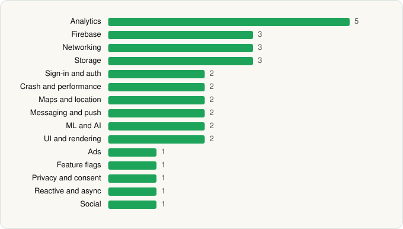

<picture><source media="(prefers-color-scheme: dark)" srcset="../../../../assets/logo/logo-dark.svg"></picture> [Tech Stack](../../../../README.md) / [Wendy's Int'l., LLC](../../../../companies/wendy-s-int-l-llc.md) / Wendy’s

# Wendy’s

<picture><source media="(prefers-color-scheme: dark)" srcset="../../../../assets/badges/android-dark.svg"></picture> <picture><source media="(prefers-color-scheme: dark)" srcset="../../../../assets/badges/inactive-dark.svg"></picture>

[Google Play](https://play.google.com/store/apps/details?id=com.wendys.nutritiontool) · [latest.json](latest.json)

| | |
|---|---|
| Company | [Wendy's Int'l., LLC](../../../../companies/wendy-s-int-l-llc.md) |
| Store id | `com.wendys.nutritiontool` |
| Bundle / package id | `com.wendys.nutritiontool` |
| Latest version | 11.53.1 (analysed 2026-06-22) |
| Versions tracked | 1 |
| SDKs in latest version | 31 |
| Languages | C/C++ (native), Flutter / Dart, Java, Kotlin |
| UI | Glide, Material Components |
| Build | Gradle (inferred) |
| Minimum OS | API 28, targets API 36 |
| Devices / ABIs | Android |
| Capabilities | 10 |
| Declares tracking | Yes |
| Tracked | No. Kept for history. |

## SDKs by category

<picture><source media="(prefers-color-scheme: dark)" srcset="../../../../assets/charts/apps/android/wendy-s-int-l-llc/wendy-s-dark.svg"></picture>

- **Analytics** (5): Branch, Facebook SDK, Firebase Analytics, Google App Measurement, Medallia
- **Firebase** (3): Firebase, Google DataTransport, Google Play services
- **Networking** (3): OkHttp, Retrofit, Volley
- **Storage** (3): DataStore, Okio, Room
- **Sign-in and auth** (2): Facebook Login, Google Sign-In / Auth
- **Crash and performance** (2): Firebase Crashlytics, Firebase Performance
- **Maps and location** (2): Google Location, Google Maps
- **Messaging and push** (2): Braze, Firebase Messaging
- **ML and AI** (2): ML Kit, ML Kit (barcode/vision)
- **UI and rendering** (2): Glide, Material Components
- **Ads** (1): Google Mobile Ads (AdMob)
- **Feature flags** (1): Firebase Remote Config
- **Privacy and consent** (1): OneTrust
- **Reactive and async** (1): Kotlin Coroutines
- **Social** (1): Facebook Share

Capabilities (10)

Advertising ID, Approximate location, Background location, Biometric auth, Camera, Fingerprint auth, Foreground service, NFC, Notifications, Precise location

## Version history

| Version | Analysed | Store update | SDKs | Change | SDK list is a floor | Binary encrypted | File |
|---|---|---|---|---|---|---|---|
| 11.53.1 | 2026-06-22 |  | 31 |  | No | No | [11.53.1.json](11.53.1.json) |

---

Generated by `scripts/build_readme.py` from the JSON files. Do not edit by hand.
