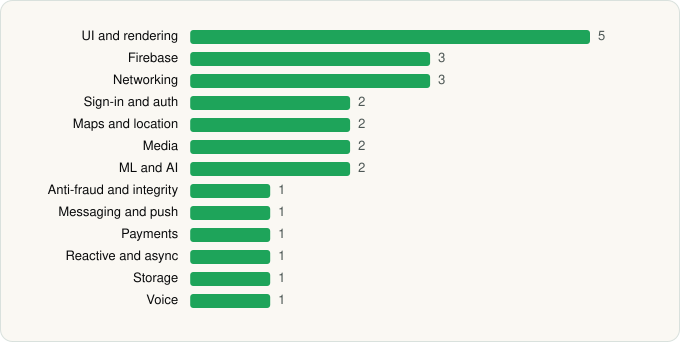

<picture><source media="(prefers-color-scheme: dark)" srcset="../../../../assets/logo/logo-dark.svg"></picture> [Tech Stack](../../../../README.md) / [WhatsApp LLC](../../../../companies/whatsapp-llc.md) / WhatsApp Business

# WhatsApp Business

<picture><source media="(prefers-color-scheme: dark)" srcset="../../../../assets/badges/android-dark.svg"></picture> <picture><source media="(prefers-color-scheme: dark)" srcset="../../../../assets/badges/inactive-dark.svg"></picture>

[Google Play](https://play.google.com/store/apps/details?id=com.whatsapp.w4b) · [latest.json](latest.json)

| | |
|---|---|
| Company | [WhatsApp LLC](../../../../companies/whatsapp-llc.md) |
| Store id | `com.whatsapp.w4b` |
| Bundle / package id | `com.whatsapp.w4b` |
| Latest version | 2.26.44.74 (analysed 2026-11-13) |
| Versions tracked | 1 |
| SDKs in latest version | 25 |
| Languages | C/C++ (native), Java, Kotlin, React Native / JavaScript |
| UI | Fresco, Jetpack Compose, Lottie, Material Components |
| Build | Gradle (inferred) |
| Minimum OS | API 23, targets API 36 |
| Devices / ABIs | Android |
| Capabilities | 26 |
| Declares tracking | Yes |
| Tracked | No. Kept for history. |

## SDKs by category

<picture><source media="(prefers-color-scheme: dark)" srcset="../../../../assets/charts/apps/android/whatsapp-llc/whatsapp-business-dark.svg"></picture>

- **UI and rendering** (5): AndroidSVG, Fresco, Jetpack Compose, Lottie, Material Components
- **Firebase** (3): Firebase, Google DataTransport, Google Play services
- **Networking** (3): Cronet, Cronet (Google), OkHttp
- **Sign-in and auth** (2): Credential Manager, Google Sign-In / Auth
- **Maps and location** (2): Google Location, Google Maps
- **Media** (2): ExoPlayer, Media3 (ExoPlayer)
- **ML and AI** (2): ML Kit, Mobile Vision
- **Anti-fraud and integrity** (1): Play Integrity
- **Messaging and push** (1): Firebase Messaging
- **Payments** (1): Google Play Billing
- **Reactive and async** (1): Kotlin Coroutines
- **Storage** (1): Room
- **Voice** (1): WebRTC

Capabilities (26)

Advertising ID, Approximate location, Biometric auth, Bluetooth, Bluetooth (connect), Camera, Contacts (read), Contacts (write), Fingerprint auth, Foreground service, Foreground service: camera, Foreground service: location, Foreground service: media playback, Foreground service: microphone, Install other apps, Media: audio, Media: images, Media: video, Microphone, NFC, Notifications, Phone / carrier info, Precise location, SMS (send), Storage (read), Storage (write)

## Version history

| Version | Analysed | Store update | SDKs | Change | SDK list is a floor | Binary encrypted | File |
|---|---|---|---|---|---|---|---|
| 2.26.44.74 | 2026-11-13 |  | 25 |  | No | No | [2.26.44.74.json](2.26.44.74.json) |

---

Generated by `scripts/build_readme.py` from the JSON files. Do not edit by hand.
