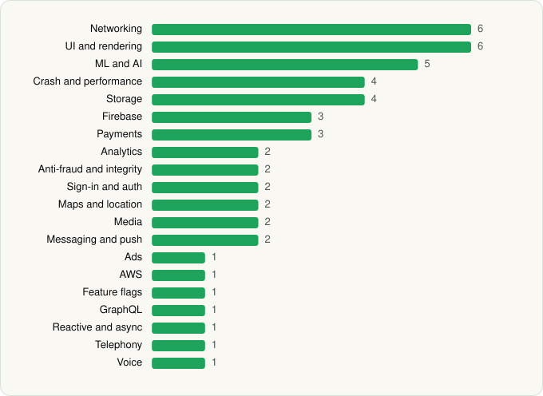

<picture><source media="(prefers-color-scheme: dark)" srcset="../../../../assets/logo/logo-dark.svg"></picture> [Tech Stack](../../../../README.md) / [X Corp.](../../../../companies/x-corp.md) / X

# X

<picture><source media="(prefers-color-scheme: dark)" srcset="../../../../assets/badges/android-dark.svg"></picture> <picture><source media="(prefers-color-scheme: dark)" srcset="../../../../assets/badges/inactive-dark.svg"></picture>

[Google Play](https://play.google.com/store/apps/details?id=com.twitter.android) · [latest.json](latest.json)

| | |
|---|---|
| Company | [X Corp.](../../../../companies/x-corp.md) |
| Store id | `com.twitter.android` |
| Bundle / package id | `com.twitter.android` |
| Latest version | 12.36.1-prod.01 (analysed 2026-10-24) |
| Versions tracked | 1 |
| SDKs in latest version | 50 |
| Languages | C/C++ (native), Java, Kotlin |
| UI | Coil, Glide, Jetpack Compose, Lottie, Material Components |
| Build | Gradle (inferred) |
| Minimum OS | API 32, targets API 36 |
| Devices / ABIs | Android |
| Capabilities | 19 |
| Declares tracking | Yes |
| Tracked | No. Kept for history. |

## SDKs by category

<picture><source media="(prefers-color-scheme: dark)" srcset="../../../../assets/charts/apps/android/x-corp/x-dark.svg"></picture>

- **Networking** (6): Cronet, Cronet (Google), Ktor, OkHttp, Retrofit, Volley
- **UI and rendering** (6): AndroidSVG, Coil, Glide, Jetpack Compose, Lottie, Material Components
- **ML and AI** (5): ML Kit, ONNX Runtime, OpenCV, TensorFlow, TensorFlow Lite
- **Crash and performance** (4): Datadog, Firebase Crashlytics, Firebase Performance, Sentry
- **Storage** (4): DataStore, Okio, Room, SQLDelight
- **Firebase** (3): Firebase, Google DataTransport, Google Play services
- **Payments** (3): Google Play Billing, Plaid, Stripe
- **Analytics** (2): Firebase Analytics, Google App Measurement
- **Anti-fraud and integrity** (2): Persona, Play Integrity
- **Sign-in and auth** (2): Credential Manager, Google Sign-In / Auth
- **Maps and location** (2): Google Location, Google Maps
- **Media** (2): Google Cast, Media3 (ExoPlayer)
- **Messaging and push** (2): Braze, Firebase Messaging
- **Ads** (1): Google Mobile Ads (AdMob)
- **AWS** (1): AWS Amplify
- **Feature flags** (1): Firebase Remote Config
- **GraphQL** (1): Apollo GraphQL
- **Reactive and async** (1): Kotlin Coroutines
- **Telephony** (1): libphonenumber
- **Voice** (1): WebRTC

Capabilities (19)

Advertising ID, Approximate location, Biometric auth, Bluetooth, Camera, Contacts (read), Draw over other apps, Fingerprint auth, Foreground service, Foreground service: camera, Foreground service: media playback, Foreground service: microphone, Media: images, Media: video, Microphone, Notifications, Phone / carrier info, Storage (read), Storage (write)

## Version history

| Version | Analysed | Store update | SDKs | Change | SDK list is a floor | Binary encrypted | File |
|---|---|---|---|---|---|---|---|
| 12.36.1-prod.01 | 2026-10-24 | 2026-10-21 | 50 |  | No | No | [12.36.1-prod.01.json](12.36.1-prod.01.json) |

---

Generated by `scripts/build_readme.py` from the JSON files. Do not edit by hand.
