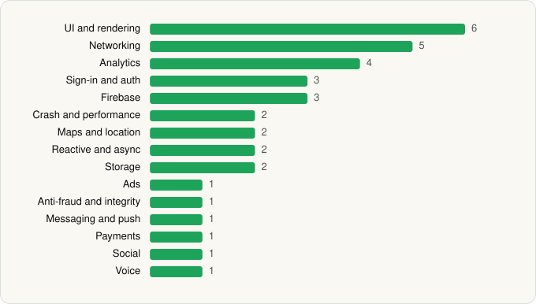

<picture><source media="(prefers-color-scheme: dark)" srcset="../../../../assets/logo/logo-dark.svg"></picture> [Tech Stack](../../../../README.md) / [行吟信息科技(上海)有限公司](../../../../companies/xingin-information-technology-shanghai-co-ltd.md) / rednote

# rednote

<picture><source media="(prefers-color-scheme: dark)" srcset="../../../../assets/badges/android-dark.svg"></picture> <picture><source media="(prefers-color-scheme: dark)" srcset="../../../../assets/badges/inactive-dark.svg"></picture>

[Google Play](https://play.google.com/store/apps/details?id=com.xingin.xhs) · [latest.json](latest.json)

| | |
|---|---|
| Company | [行吟信息科技(上海)有限公司](../../../../companies/xingin-information-technology-shanghai-co-ltd.md) |
| Store id | `com.xingin.xhs` |
| Bundle / package id | `com.xingin.xhs` |
| Latest version | 9.51.0 (analysed 2026-10-24) |
| Versions tracked | 1 |
| SDKs in latest version | 35 |
| Languages | C/C++ (native), Java, Kotlin, React Native / JavaScript |
| UI | Fresco, Jetpack Compose, Lottie, Material Components |
| Build | Gradle (inferred) |
| Minimum OS | API 21, targets API 36 |
| Devices / ABIs | Android |
| Capabilities | 22 |
| Declares tracking | Yes |
| Tracked | No. Kept for history. |

## SDKs by category

<picture><source media="(prefers-color-scheme: dark)" srcset="../../../../assets/charts/apps/android/xingin-information-technology-shanghai-co-ltd/rednote-dark.svg"></picture>

- **UI and rendering** (6): Fresco, Jetpack Compose, jLaTeXMath, Lottie, Markwon, Material Components
- **Networking** (5): Cronet, Cronet (Chromium net), Ktor, OkHttp, Retrofit
- **Analytics** (4): AppsFlyer, Facebook SDK, Firebase Analytics, Google App Measurement
- **Sign-in and auth** (3): Credential Manager, Facebook Login, Google Sign-In / Auth
- **Firebase** (3): Firebase, Google DataTransport, Google Play services
- **Crash and performance** (2): Sentry, Sentry (native)
- **Maps and location** (2): Google Location, Google Maps
- **Reactive and async** (2): Kotlin Coroutines, RxJava
- **Storage** (2): Okio, Room
- **Ads** (1): Google Mobile Ads (AdMob)
- **Anti-fraud and integrity** (1): Play Integrity
- **Messaging and push** (1): Firebase Messaging
- **Payments** (1): Google Play Billing
- **Social** (1): Facebook Share
- **Voice** (1): WebRTC

Capabilities (22)

Advertising ID, Approximate location, Biometric auth, Bluetooth (connect), Calendar (read), Calendar (write), Camera, Contacts (read), Draw over other apps, Fingerprint auth, Foreground service, Foreground service: media playback, Foreground service: microphone, Media: audio, Media: images, Media: video, Microphone, NFC, Notifications, Precise location, Storage (read), Storage (write)

## Version history

| Version | Analysed | Store update | SDKs | Change | SDK list is a floor | Binary encrypted | File |
|---|---|---|---|---|---|---|---|
| 9.51.0 | 2026-10-24 | 2026-10-23 | 35 |  | No | No | [9.51.0.json](9.51.0.json) |

---

Generated by `scripts/build_readme.py` from the JSON files. Do not edit by hand.
