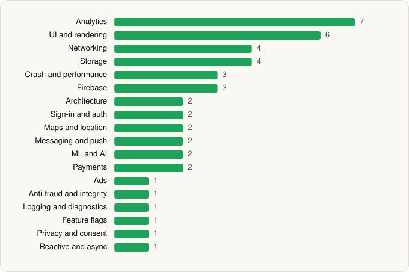

<picture><source media="(prefers-color-scheme: dark)" srcset="../../../../assets/logo/logo-dark.svg"></picture> [Tech Stack](../../../../README.md) / [Yum Brands Inc - KFC India Division](../../../../companies/yum-brands-inc-kfc-india-division.md) / KFC India online ordering app

# KFC India online ordering app

<picture><source media="(prefers-color-scheme: dark)" srcset="../../../../assets/badges/android-dark.svg"></picture> <picture><source media="(prefers-color-scheme: dark)" srcset="../../../../assets/badges/inactive-dark.svg"></picture>

[Google Play](https://play.google.com/store/apps/details?id=com.yum.kfc) · [latest.json](latest.json)

| | |
|---|---|
| Company | [Yum Brands Inc - KFC India Division](../../../../companies/yum-brands-inc-kfc-india-division.md) |
| Store id | `com.yum.kfc` |
| Bundle / package id | `com.yum.kfc` |
| Latest version | 2605.0.0 (analysed 2026-06-22) |
| Versions tracked | 1 |
| SDKs in latest version | 45 |
| Languages | C/C++ (native), Java, Kotlin, React Native / JavaScript |
| UI | Fresco, Glide, Lottie, Material Components |
| Build | Gradle (inferred) |
| Minimum OS | API 24, targets API 35 |
| Devices / ABIs | Android |
| Capabilities | 9 |
| Declares tracking | Yes |
| Tracked | No. Kept for history. |

## SDKs by category

<picture><source media="(prefers-color-scheme: dark)" srcset="../../../../assets/charts/apps/android/yum-brands-inc-kfc-india-division/kfc-india-online-ordering-app-dark.svg"></picture>

- **Analytics** (7): Amplitude, AppsFlyer, Branch, Firebase Analytics, FullStory, Google App Measurement, Qualtrics
- **UI and rendering** (6): Fresco, Glide, Lottie, Material Components, React Native Reanimated, react-native-svg
- **Networking** (4): axios, OkHttp, Retrofit, Volley
- **Storage** (4): DataStore, Okio, Realm, Room
- **Crash and performance** (3): Datadog, Firebase Crashlytics, Sentry
- **Firebase** (3): Firebase, Google DataTransport, Google Play services
- **Architecture** (2): CodePush, Redux
- **Sign-in and auth** (2): AppAuth, Google Sign-In / Auth
- **Maps and location** (2): Google Location, Google Maps
- **Messaging and push** (2): Braze, Firebase Messaging
- **ML and AI** (2): ML Kit, ML Kit (barcode/vision)
- **Payments** (2): Adyen, Braintree
- **Ads** (1): Google Mobile Ads (AdMob)
- **Anti-fraud and integrity** (1): RootBeer
- **Logging and diagnostics** (1): Chucker
- **Feature flags** (1): Firebase Remote Config
- **Privacy and consent** (1): OneTrust
- **Reactive and async** (1): Kotlin Coroutines

Capabilities (9)

Advertising ID, Approximate location, Camera, Foreground service, Microphone, Notifications, Precise location, Storage (read), Storage (write)

## Version history

| Version | Analysed | Store update | SDKs | Change | SDK list is a floor | Binary encrypted | File |
|---|---|---|---|---|---|---|---|
| 2605.0.0 | 2026-06-22 |  | 45 |  | No | No | [2605.0.0.json](2605.0.0.json) |

---

Generated by `scripts/build_readme.py` from the JSON files. Do not edit by hand.
