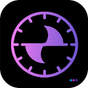
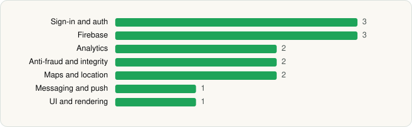

<picture><source media="(prefers-color-scheme: dark)" srcset="../../../../assets/logo/logo-dark.svg"></picture> [Tech Stack](../../../../README.md) / [Zelle Solutions](../../../../companies/zelle-solutions.md) / Zelle Track

# Zelle Track

<picture><source media="(prefers-color-scheme: dark)" srcset="../../../../assets/badges/android-dark.svg"></picture> <picture><source media="(prefers-color-scheme: dark)" srcset="../../../../assets/badges/inactive-dark.svg"></picture> <picture><source media="(prefers-color-scheme: dark)" srcset="../../../../assets/badges/floor-dark.svg"></picture>

[Google Play](https://play.google.com/store/apps/details?id=com.zelle.fmattendance) · [latest.json](latest.json)

| | |
|---|---|
| Company | [Zelle Solutions](../../../../companies/zelle-solutions.md) |
| Store id | `com.zelle.fmattendance` |
| Bundle / package id | `com.zelle.fmattendance` |
| Latest version | 1.0.1 (analysed 2026-06-19) |
| Versions tracked | 1 |
| SDKs in latest version | 14 |
| Languages | C/C++ (native), Flutter / Dart, Java, Kotlin |
| UI | Material Components |
| Build | Gradle (inferred), R8 / ProGuard (name obfuscation detected) |
| Minimum OS | API 23, targets API 34 |
| Devices / ABIs | Android |
| Capabilities | 6 |
| Declares tracking | Yes |
| Tracked | No. Kept for history. |

## SDKs by category

<picture><source media="(prefers-color-scheme: dark)" srcset="../../../../assets/charts/apps/android/zelle-solutions/zelle-track-dark.svg"></picture>

- **Sign-in and auth** (3): Credential Manager, Firebase Auth, Google Sign-In / Auth
- **Firebase** (3): Firebase, Google DataTransport, Google Play services
- **Analytics** (2): Firebase Analytics, Google App Measurement
- **Anti-fraud and integrity** (2): Play Integrity, reCAPTCHA
- **Maps and location** (2): Google Location, Google Maps
- **Messaging and push** (1): Firebase Messaging
- **UI and rendering** (1): Material Components

Capabilities (6)

Advertising ID, Approximate location, Notifications, Precise location, Storage (read), Storage (write)

## Version history

| Version | Analysed | Store update | SDKs | Change | SDK list is a floor | Binary encrypted | File |
|---|---|---|---|---|---|---|---|
| 1.0.1 | 2026-06-19 |  | 14 |  | Yes | No | [1.0.1.json](1.0.1.json) |

---

Generated by `scripts/build_readme.py` from the JSON files. Do not edit by hand.
