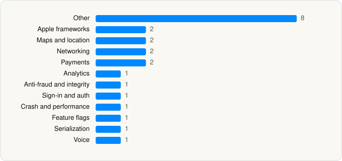

<picture><source media="(prefers-color-scheme: dark)" srcset="../../../../assets/logo/logo-dark.svg"></picture> [Tech Stack](../../../../README.md) / [Airbnb, Inc.](../../../../companies/airbnb-inc.md) / Airbnb

# Airbnb

<picture><source media="(prefers-color-scheme: dark)" srcset="../../../../assets/badges/ios-dark.svg"></picture> <picture><source media="(prefers-color-scheme: dark)" srcset="../../../../assets/badges/active-dark.svg"></picture> <picture><source media="(prefers-color-scheme: dark)" srcset="../../../../assets/badges/floor-dark.svg"></picture> <picture><source media="(prefers-color-scheme: dark)" srcset="../../../../assets/badges/encrypted-dark.svg"></picture>

[App Store](https://apps.apple.com/app/id401626263) · [latest.json](latest.json)

| | |
|---|---|
| Company | [Airbnb, Inc.](../../../../companies/airbnb-inc.md) |
| Store id | `401626263` |
| Bundle / package id | `com.airbnb.app` |
| Latest version | 26.43.1 (analysed 2026-10-24) |
| Versions tracked | 1 |
| SDKs in latest version | 23 |
| Languages | C/C++, Metal (shaders), Objective-C, Swift |
| UI | SwiftUI, UIKit |
| Build | Swift Package Manager (SwiftPM) |
| Minimum OS | iOS 18.0 (built with Xcode 27.1, SDK iphoneos27.1) |
| Devices / ABIs | iPhone, iPad |
| Localisations | 66 |
| Capabilities | 12 |
| Declares tracking | Yes |
| Tracked | Yes |

## SDKs by category

<picture><source media="(prefers-color-scheme: dark)" srcset="../../../../assets/charts/apps/ios/airbnb-inc/airbnb-dark.svg"></picture>

- **Other** (8): ArkoseLabsKit 2.20.1, CardinalMobile 2.2.5, DocumentReader 8.5.5461, DocumentReaderCore 9.8.20496, KlarnaCore 2.11.0, KlarnaMobileSDK 2.11.0, Razorpay 1.4.6, Threads
- **Apple frameworks** (2): InternalCollectionsUtilities, OrderedCollections
- **Maps and location** (2): GMSCore 26.30.0, GoogleMaps 11.0.0
- **Networking** (2): NIO, Starscream
- **Payments** (2): KlarnaPayments 2.11.0, LinkKit 6.4.2
- **Analytics** (1): Facebook SDK
- **Anti-fraud and integrity** (1): Fingerprint 2.10.1
- **Sign-in and auth** (1): NaverThirdPartyLogin 4.2.3
- **Crash and performance** (1): Bugsnag
- **Feature flags** (1): Experiment
- **Serialization** (1): ResilientDecoding
- **Voice** (1): WebRTC 1.0

Frameworks (42)

AdServices (Apple Search Ads attribution), AdSupport (IDFA), App Intents, App Tracking Transparency (ATT), ARKit, Authentication Services (Sign in with Apple / passkeys), AVFoundation (audio/video), AVKit, CallKit (VoIP), Combine (reactive), Contacts, Core Data, Core Image, Core Location, Core ML, Core Motion, Core NFC, CryptoKit, DeviceCheck / App Attest, Local Authentication (Face ID / Touch ID), MapKit, MessageUI (mail / SMS compose), MetalKit, MetricKit (diagnostics), Natural Language, Network.framework, PassKit (Wallet / Apple Pay), PDFKit, PencilKit, Photos, PhotosUI, PushKit (VoIP push), SafariServices, SceneKit, SiriKit (Intents), Speech (recognition), StoreKit (in-app purchase), Swift Charts, SwiftUI, UIKit, User Notifications, Vision

Capabilities (12)

App Groups, Apple Pay, Associated Domains (Universal Links), Background App Refresh, Background Push, Communication Notifications, Keychain Sharing, NFC, Push Notifications (APNs), Sign in with Apple, Time-Sensitive Notifications, VoIP

## Version history

| Version | Analysed | Store update | SDKs | Change | SDK list is a floor | Binary encrypted | File |
|---|---|---|---|---|---|---|---|
| 26.43.1 | 2026-10-24 | 2026-10-23 | 23 |  | Yes | Yes | [26.43.1.json](26.43.1.json) |

---

Generated by `scripts/build_readme.py` from the JSON files. Do not edit by hand.
