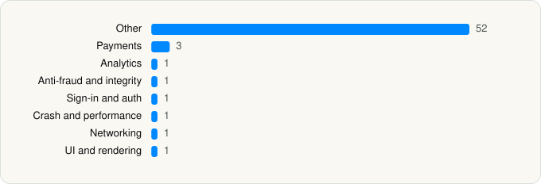

<picture><source media="(prefers-color-scheme: dark)" srcset="../../../../assets/logo/logo-dark.svg"></picture> [Tech Stack](../../../../README.md) / [Alibaba](../../../../companies/alibaba.md) / AliExpress

# AliExpress - Shopping App

<picture><source media="(prefers-color-scheme: dark)" srcset="../../../../assets/badges/ios-dark.svg"></picture> <picture><source media="(prefers-color-scheme: dark)" srcset="../../../../assets/badges/inactive-dark.svg"></picture> <picture><source media="(prefers-color-scheme: dark)" srcset="../../../../assets/badges/floor-dark.svg"></picture> <picture><source media="(prefers-color-scheme: dark)" srcset="../../../../assets/badges/encrypted-dark.svg"></picture>

[App Store](https://apps.apple.com/app/id436672029) · [latest.json](latest.json)

| | |
|---|---|
| Company | [Alibaba](../../../../companies/alibaba.md) |
| Store id | `436672029` |
| Bundle / package id | `com.alibaba.iAliexpress` |
| Latest version | 8.180.0 (analysed 2026-10-24) |
| Versions tracked | 1 |
| SDKs in latest version | 61 |
| Languages | C/C++, Metal (shaders), Objective-C, Swift |
| UI | Lottie (animations), SwiftUI, UIKit |
| Build | Unknown / Xcode native |
| Minimum OS | iOS 13.0 (built with Xcode 26.2, SDK iphoneos26.2) |
| Devices / ABIs | iPhone, iPad |
| Localisations | 21 |
| Capabilities | 7 |
| Declares tracking | Yes |
| Tracked | No. Kept for history. |

## SDKs by category

<picture><source media="(prefers-color-scheme: dark)" srcset="../../../../assets/charts/apps/ios/alibaba/aliexpress-dark.svg"></picture>

- **Other** (52): AEABTest 1.0.38, AEAIOrder 1.0.12, AEAIPlaceOrder 1.0.122, AEAtlas, AEAvifLib 1.0.8, AEGlobalExperimentSDK 1.0.2, AELangDetection 1.0.1, AELineSDK 1.0.8, AELocalPrice 1.0.37, AEMessage, AEMessageService 0.0.0, AEModuleCoin, AEModuleHome, AEModuleHomeCore 1.0.328, AEModuleTrade, AEModuleUGCChannel, AEModuleUGCFeatures, AEModuleW 0.6.3, AENFloorContainer 1.0.158, AENPublicRecommend 1.0.31, AENSearchCore 1.0.227, AENSearchRcmd 1.0.75, AENYTPhotoViewer, AEPageFlash 1.0.89, AESaasAccountLocator, AESearchX 1.0.353, AETBMessageKit 1.0.2, AEVerifySDK 1.0.14, AEWCounter 1.0.58, AEWidgetLibrary, AEWindmill, AEXMediaOCR 1.0.36, ALGFoundation 1.4.178, ANC 1.0.70, GEUIKitCore 0.0.173, GlobalHouyiAdapter, GlobalLocale, GlobalVerifySDK 1.0.25, HYAddress 1.0, KakaoSDKAuth 2.22.9, KakaoSDKCommon 2.22.11, KakaoSDKUser 2.22.6, LTCRepairer 1.0, NebulaWK, PayPalDataCollector 5.26.0, Player 1.0, SecVIVerifyCore, TBTradeSDK, WindMixView, WindVaneCore, WKYTPlayerView, XMediaSamples
- **Payments** (3): AEPaymentSDK, Braintree 5.26.0, HYWallet 1.0
- **Analytics** (1): Facebook SDK
- **Anti-fraud and integrity** (1): PPRiskMagnes 1.0
- **Sign-in and auth** (1): NaverThirdPartyLogin 4.2.3
- **Crash and performance** (1): TBAPMAssistant 1.0.2
- **Networking** (1): Alamofire 5.9.1
- **UI and rendering** (1): Lottie 4.4.18

Frameworks (37)

ActivityKit (Live Activities), AdServices (Apple Search Ads attribution), AdSupport (IDFA), App Intents, App Tracking Transparency (ATT), Authentication Services (Sign in with Apple / passkeys), AVFoundation (audio/video), AVKit, Combine (reactive), Contacts, Core Bluetooth, Core Data, Core Image, Core Location, Core Motion, Core NFC, CryptoKit, DeviceCheck / App Attest, EventKit (Calendar / Reminders), Local Authentication (Face ID / Touch ID), MapKit, MessageUI (mail / SMS compose), MetalKit, MetricKit (diagnostics), Network.framework, PassKit (Wallet / Apple Pay), Photos, PhotosUI, SafariServices, SceneKit, SiriKit (Intents), SpriteKit, StoreKit (in-app purchase), SwiftUI, UIKit, User Notifications, WidgetKit (widgets)

Capabilities (7)

App Groups, Apple Pay, Associated Domains (Universal Links), Multipath networking, Push Notifications (APNs), Sign in with Apple, Time-Sensitive Notifications

## Version history

| Version | Analysed | Store update | SDKs | Change | SDK list is a floor | Binary encrypted | File |
|---|---|---|---|---|---|---|---|
| 8.180.0 | 2026-10-24 | 2026-10-24 | 61 |  | Yes | Yes | [8.180.0.json](8.180.0.json) |

---

Generated by `scripts/build_readme.py` from the JSON files. Do not edit by hand.
