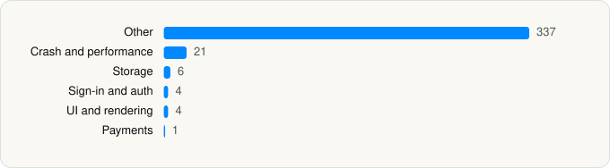

<picture><source media="(prefers-color-scheme: dark)" srcset="../../../../assets/logo/logo-dark.svg"></picture> [Tech Stack](../../../../README.md) / [Alipay (Hangzhou) Technology Co., Ltd.](../../../../companies/alipay-hangzhou-technology-co-ltd.md) / Alipay

# Alipay - Simplify Your Life

<picture><source media="(prefers-color-scheme: dark)" srcset="../../../../assets/badges/ios-dark.svg"></picture> <picture><source media="(prefers-color-scheme: dark)" srcset="../../../../assets/badges/inactive-dark.svg"></picture> <picture><source media="(prefers-color-scheme: dark)" srcset="../../../../assets/badges/floor-dark.svg"></picture> <picture><source media="(prefers-color-scheme: dark)" srcset="../../../../assets/badges/encrypted-dark.svg"></picture>

[App Store](https://apps.apple.com/app/id333206289) · [latest.json](latest.json)

| | |
|---|---|
| Company | [Alipay (Hangzhou) Technology Co., Ltd.](../../../../companies/alipay-hangzhou-technology-co-ltd.md) |
| Store id | `333206289` |
| Bundle / package id | `com.alipay.iphoneclient` |
| Latest version | 12.12.38 (analysed 2026-10-24) |
| Versions tracked | 1 |
| SDKs in latest version | 381 |
| Languages | C/C++, Kotlin Multiplatform, Metal (shaders), Objective-C, Swift |
| UI | Lottie (animations), SwiftUI, UIKit |
| Build | Swift Package Manager (SwiftPM) |
| Minimum OS | iOS 15.0 (built with Xcode 27.1, SDK iphoneos27.1) |
| Devices / ABIs | iPhone, iPad |
| Localisations | 4 |
| Capabilities | 21 |
| Declares tracking | Yes |
| Tracked | No. Kept for history. |

## SDKs by category

<picture><source media="(prefers-color-scheme: dark)" srcset="../../../../assets/charts/apps/ios/alipay-hangzhou-technology-co-ltd/alipay-dark.svg"></picture>

- **Other** (337): abilities, AccountAuth, AccountSecurity, adapter, ADDisplayFoundation, AFWFinancePotTradePlugin, AFWFinChartCases, AFWStock, AFWStockAP, AFWStockTradeJsApiPlugin, AFWStockTradePlugin, agent, AIRPythonLite, alert, alnnet, ALPAuthorize, alppass, AMap, AMap3D, AnimatiableBase, Ant3D, antaienhance, AntCardSDK, AntCube, antdlog, AntDynamic, antimage, AntTranslation, AntUIToken, ANXOfflinePay, AOMPDevice, AOMPExtHub, AOMPFavorite, AOMPFileManager, APAISearch, APAppClipsCenter, APAssistantDynamic, APAuthLogic, APAutoPage, APBGServiceMg, APBinAOP, APBToygerFacade, APBusinessCommon, APBusinessInterceptors, APBusinessSchemeHandlers, APBusinessServices, APCommandCenter, APCommonAuthorizationGuide, APCommonUI, APContentPublisher, APCrashGuard, APDeCAuthenticate, APDigitalCarKey, APDowngrade, APDynamicLanguage, APEventBusCommon, APExtUI, APFlowCustoms, APFrameworkBase, APGlobalSearch, APHomeStatusCenter, api, APKcart, APLiveActivityCenter, APLongLinkService, APNotificationActions, APOfflinePay, APPaintEgg, AppBack, AppMarket, APPropertyCenter, APSecRDS, APSecSecuritySDK, APSetting, APSettingManagers, APShareKit, APShareService, APSplashScreen, APTaskManager, APTAssistant, APWIdAuth, AriverCommonability, AriverComponent, AriverExtHub, AriverKernel, AriverMap, AriverRuntime, ARScan, assistant, AUBase, AUBrightnessService, AUFunctionalService, AUKeyboard, AUTheme, avatar, BankcardIcon, basemodule, BeeAIComponent, beeaudio, BEEAudioUtil, BeeCapture, BeeCityPicker, BeeControllers, BeeHive, BeeImageEditor, BeeLocationPicker, BeeMediaFileEditor, BeeMediaFlowWrapper, BeeMediaMine, BeeMediaPlayer, BeePhoto, BeePhotoBrowser, BeePhotoPicker, BeeRTCPlayerWrapper, beertcroom, BeeUtils, BeeViews, BillApp, BinAOPExtension, Blox, bluetap, bridge, BridgeSDK, bundle, bundle2h, bundlev3, Canvas, CardBiz, CardSDK, CardStorage, CardUIPlugins, cdpbase, changeprotection, chatImage, ChatLCK, ChatRTC, Columbus, ColumbusUI, Compliance, componentservice, compose, ContactApp, ContentSupport, CubeKit, discovery, DynamicDeployment, DynamicRelease, EmotionBoard, EmotionManager, EmotionService, employment, engine, eventcenter, eventregistry, FalconCardManager, FalconLooks, FalconService, Floating, FlyBird, FlyBirdUI, FortuneCardSdk, FortuneHome, framework, GestureService, GifSearch, GlobalLauncher, GlobalO2O, GlobalO2OStatic, GLOptionCenter, groupon, growth, GuestRouter, HiChat, HiChatEngine, highlightjs, home, HomeCard, homeleftdrawer, HomeMsg, IDCard, impl, IndustryCode, inschat, Inside, insone, integration, IntelligentDecision, InterestingCommunity, interface, interview, iOSSecurityProduct, IotSecurity, iSMIKit, kmp, Launcher, lens, leopardcamera, Life, lifechannel, living, LuiContainer, luistorage, manager, Masonry, MBProgressHUD, MBSocialSubscribe, Mcdp, mediaflowtools, MessageBox, MobApp, MobileAiX, MobileAiXDataCenter, MobileAixEdgeMining, MobileFoundation, MPBadgeService, mrtcbiz, multimediakmp, multimodalcamera, MyApp, MyArchives, MyFavorites, MyFavoritesBiz, mylive, MyLiveAsset, MyLiveCommon, NebulaAppBiz, NebulaAppManager, NebulaBiz, NebulaConfig, NebulaDebug, NebulaPoseidon, nfcjsapi, nfcPay, nfcschemehandler, nova, O2OCornucopia, OfflinePayCred, OnsitePay, OnsitePayEngine, OnsitePayProtocol, OnsitePaySafe, OperationSentry, page, Paladin, paladin-xengine, PaladinCore, payee, portfolio, PPChat, Promotion, pushbusinessservice, qengine, RealNameIdentify, RedEnvelope, rtm, ScanApp, SchemeLauncherBiz, security, SecurityAppCommon, SecurityCommon, SecVISECert, service, ShareToken, ShortcutsSettings, skin, skincenter, SNSContentEditor, Social3DTouch, SocialBizAdapter, SocialCacheCenter, SocialChat, SocialChatBiz, SocialCommonUI, SocialContact, SocialContactBiz, SocialDataCenter, SocialDB, SocialMobKit, socialmsgtab, SocialNet, SocialOption, SocialProfile, SocialRemind, SocialSDK, SportKit, stock, stocksdk, storage, task, TBScanSDK, tecla, teclabilities, teclability, Texel, TianYan, TimeLine, TinyAppCommon, TinyappService, ToygerService, tracker, transfer, TransferBiz, TransferCore, translation, TTTAttributedLabel, Ucdp, uep, Unify, UploadAddress, Uppr, use, userflow, v3, VerifyIdentity, VIBNTemplate, VIDynamicContainer, VIModules, VIVerifyCore, voiceshortcut, WealthAccount, WealthAnna, WealthBankCard, WealthCalc, WealthCommon, WealthFund, WealthSearch, WeiboSDK, XMedia, xquic, XRiverKit, xui, YunOSWatch, ZolozAdaptor, zolozbiometric, ZolozDoc, ZolozKit, ZolozSensorServices
- **Crash and performance** (21): APMAftsCommon, APMAlipayAdapter, APMap, APMCDNImage, APMediaBasic, APMediaEditor, APMFileTransfer, APMHevc, APMImageProcessing, APMMediaCache, APMobileFoundation, APMobileFramework, APMobileNetwork, APMOCR, APMonitor, APMPaaSAdapter, APMSilk, APMultimedia, APMUtils, APMVideo, APMVoiceManager
- **Storage** (6): database, OpenPlatform, OpenPlatformAdapter, OpenPlatformApp, PublicPlatform, PublicPlatformAPI
- **Sign-in and auth** (4): APBIOAuthenticator, APSSOTokenAuthApp, BioAuthEngine, TaobaoAuthSDK
- **UI and rendering** (4): AntMarkdown, BeeLottiePlayerPlugins, Highlight.js 11.10.0, Lottie
- **Payments** (1): APPayment

Frameworks (39)

ActivityKit (Live Activities), AdSupport (IDFA), App Intents, App Tracking Transparency (ATT), ARKit, Authentication Services (Sign in with Apple / passkeys), AVFoundation (audio/video), AVKit, Combine (reactive), Contacts, Core Bluetooth, Core Data, Core Image, Core Location, Core ML, Core Motion, Core NFC, EventKit (Calendar / Reminders), HealthKit, Local Authentication (Face ID / Touch ID), MapKit, Media Player, MessageUI (mail / SMS compose), MetalKit, MetricKit (diagnostics), Network.framework, PassKit (Wallet / Apple Pay), Photos, PhotosUI, PushKit (VoIP push), SafariServices, SiriKit (Intents), StoreKit (in-app purchase), SwiftUI, UIKit, User Notifications, Vision, Watch Connectivity, WidgetKit (widgets)

Capabilities (21)

App Groups, Associated Domains (Universal Links), Background App Refresh, Background Audio, Background Location, Background Push, Background: network-authentication, Bluetooth (central), Bluetooth (peripheral), Communication Notifications, HealthKit, iCloud, iCloud Key-Value Storage, Keychain Sharing, NFC, Push Notifications (APNs), Sign in with Apple, SiriKit, Time-Sensitive Notifications, VoIP, Wallet passes

## Version history

| Version | Analysed | Store update | SDKs | Change | SDK list is a floor | Binary encrypted | File |
|---|---|---|---|---|---|---|---|
| 12.12.38 | 2026-10-24 | 2026-10-21 | 381 |  | Yes | Yes | [12.12.38.json](12.12.38.json) |

---

Generated by `scripts/build_readme.py` from the JSON files. Do not edit by hand.
