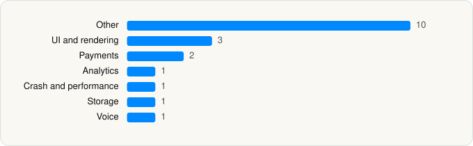

<picture><source media="(prefers-color-scheme: dark)" srcset="../../../../assets/logo/logo-dark.svg"></picture> [Tech Stack](../../../../README.md) / [Alpha Exploration Co.](../../../../companies/alpha-exploration-co.md) / Clubhouse

# Clubhouse

<picture><source media="(prefers-color-scheme: dark)" srcset="../../../../assets/badges/ios-dark.svg"></picture> <picture><source media="(prefers-color-scheme: dark)" srcset="../../../../assets/badges/inactive-dark.svg"></picture> <picture><source media="(prefers-color-scheme: dark)" srcset="../../../../assets/badges/floor-dark.svg"></picture> <picture><source media="(prefers-color-scheme: dark)" srcset="../../../../assets/badges/encrypted-dark.svg"></picture>

[App Store](https://apps.apple.com/app/id1503133294) · [latest.json](latest.json)

| | |
|---|---|
| Company | [Alpha Exploration Co.](../../../../companies/alpha-exploration-co.md) |
| Store id | `1503133294` |
| Bundle / package id | `co.alphaexploration.clubhouse` |
| Latest version | 26.10.29 (analysed 2026-11-04) |
| Versions tracked | 2 |
| SDKs in latest version | 32 |
| Languages | C/C++, Objective-C, Swift |
| UI | Lottie (animations), SwiftUI, UIKit |
| Build | Swift Package Manager (SwiftPM) |
| Minimum OS | iOS 17.0 (built with Xcode 26.0.1, SDK iphoneos26.0) |
| Devices / ABIs | iPhone |
| Localisations | 6 |
| Capabilities | 7 |
| Declares tracking | Yes |
| Tracked | No. Kept for history. |

## SDKs by category

<picture><source media="(prefers-color-scheme: dark)" srcset="../../../../assets/charts/apps/ios/alpha-exploration-co/clubhouse-dark.svg"></picture>

- **Other** (11): Agorafdkaac 1.0.0, Agoraffmpeg 4.5.2, AgoraSoundTouch 2.0.16, AICohost, aosl 1.3.0, GiphyUISDK 2.2.15, LuciqSDK 19.1.0, MagicalRoom, OutOfNetworkMatching, PaidReactions, SurveyMonkeyiOSSDK 1.0
- **Analytics** (8): Branch, FacebookAEM, FacebookCore, FBAEMKit 1.0, FBSDKCoreKit 1.0, SCSDKCoreKit 2.5.0, TikTokOpenSDK, TikTokOpenShareSDK
- **UI and rendering** (3): Lottie 4.4.2, Mantis, RiveRuntime 6.26.0
- **Social** (3): FacebookShare, FBSDKShareKit 1.0, SCSDKCreativeKit 2.5.0
- **Payments** (2): RevenueCat, Stripe
- **Anti-fraud and integrity** (1): RecaptchaEnterprise 1.0
- **Sign-in and auth** (1): SCSDKLoginKit 2.5.0
- **Crash and performance** (1): Sentry 9.24.0
- **Telephony** (1): PhoneNumberKit
- **Voice** (1): AgoraRtcKit 4.5.2

Frameworks (37)

AdServices (Apple Search Ads attribution), AdSupport (IDFA), App Tracking Transparency (ATT), Authentication Services (Sign in with Apple / passkeys), AVFoundation (audio/video), AVKit, CallKit (VoIP), Combine (reactive), Contacts, Core Data, Core Image, Core Location, Core ML, Core Motion, CryptoKit, DeviceCheck / App Attest, EventKit (Calendar / Reminders), Local Authentication (Face ID / Touch ID), MapKit, Media Player, MessageUI (mail / SMS compose), MetalKit, MetricKit (diagnostics), Natural Language, Network.framework, PassKit (Wallet / Apple Pay), PDFKit, Photos, SafariServices, SiriKit (Intents), Speech (recognition), StoreKit (in-app purchase), Swift Charts, SwiftUI, UIKit, User Notifications, Vision

Capabilities (7)

App Groups, Associated Domains (Universal Links), Background App Refresh, Background Audio, Background Push, Communication Notifications, Push Notifications (APNs)

## Version history

| Version | Analysed | Store update | SDKs | Change | SDK list is a floor | Binary encrypted | File |
|---|---|---|---|---|---|---|---|
| 26.10.29 | 2026-11-04 | 2026-11-02 | 32 | +15 / −2 | Yes | Yes | [26.10.29.json](26.10.29.json) |
| 26.06.02 | 2026-06-23 |  | 19 |  | Yes | Yes | [26.06.02.json](26.06.02.json) |

### SDK changes between versions

- 26.06.02 → 26.10.29: added FacebookAEM, FacebookCore, FacebookShare, FBAEMKit, FBSDKCoreKit, FBSDKShareKit, PhoneNumberKit, RecaptchaEnterprise, RiveRuntime, SCSDKCoreKit, SCSDKCreativeKit, SCSDKLoginKit, SurveyMonkeyiOSSDK, TikTokOpenSDK, TikTokOpenShareSDK; removed FlagPhoneNumber, React Native

---

Generated by `scripts/build_readme.py` from the JSON files. Do not edit by hand.
