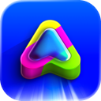
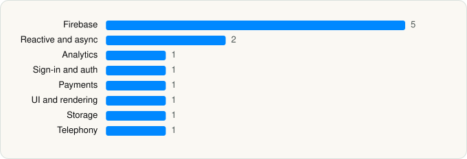

<picture><source media="(prefers-color-scheme: dark)" srcset="../../../../assets/logo/logo-dark.svg"></picture> [Tech Stack](../../../../README.md) / [amo](../../../../companies/amo.md) / Bump

# Bump - real life is happening

<picture><source media="(prefers-color-scheme: dark)" srcset="../../../../assets/badges/ios-dark.svg"></picture> <picture><source media="(prefers-color-scheme: dark)" srcset="../../../../assets/badges/inactive-dark.svg"></picture> <picture><source media="(prefers-color-scheme: dark)" srcset="../../../../assets/badges/floor-dark.svg"></picture> <picture><source media="(prefers-color-scheme: dark)" srcset="../../../../assets/badges/encrypted-dark.svg"></picture>

[App Store](https://apps.apple.com/app/id6471519217) · [latest.json](latest.json)

| | |
|---|---|
| Company | [amo](../../../../companies/amo.md) |
| Store id | `6471519217` |
| Bundle / package id | `co.amo.ios.location` |
| Latest version | 2.129.1 (analysed 2026-11-11) |
| Versions tracked | 1 |
| SDKs in latest version | 13 |
| Languages | C/C++, Metal (shaders), Objective-C, Swift |
| UI | SwiftUI, UIKit |
| Build | Swift Package Manager (SwiftPM) |
| Minimum OS | iOS 16.0 (built with Xcode 27.2, SDK iphoneos27.2) |
| Devices / ABIs | iPhone |
| Localisations | 33 |
| Capabilities | 11 |
| Declares tracking | No |
| Tracked | No. Kept for history. |

## SDKs by category

<picture><source media="(prefers-color-scheme: dark)" srcset="../../../../assets/charts/apps/ios/amo/bump-dark.svg"></picture>

- **Firebase** (5): FBLPromises, FirebaseCore, FirebaseCoreInternal, FirebaseInstallations, GoogleUtilities 1.0
- **Reactive and async** (2): RxRelay, RxSwift
- **Analytics** (1): Amplitude 1.0
- **Sign-in and auth** (1): SpotifyLogin 1.1.1
- **Payments** (1): RevenueCat
- **UI and rendering** (1): RiveRuntime 6.29.0
- **Storage** (1): ZIPFoundation
- **Telephony** (1): PhoneNumberKit

Frameworks (38)

ActivityKit (Live Activities), AdServices (Apple Search Ads attribution), AdSupport (IDFA), App Intents, App Tracking Transparency (ATT), ARKit, Authentication Services (Sign in with Apple / passkeys), AVFoundation (audio/video), AVKit, Background Tasks, CallKit (VoIP), Combine (reactive), Contacts, Core Data, Core Image, Core Location, Core Motion, CryptoKit, MapKit, MessageUI (mail / SMS compose), MetalKit, MetricKit (diagnostics), MusicKit, Natural Language, Network.framework, PDFKit, Photos, PhotosUI, SafariServices, SceneKit, SiriKit (Intents), SpriteKit, StoreKit (in-app purchase), SwiftUI, UIKit, User Notifications, Vision, WidgetKit (widgets)

Capabilities (11)

App Groups, Associated Domains (Universal Links), Background App Refresh, Background Audio, Background Location, Background Push, Communication Notifications, Keychain Sharing, Push Notifications (APNs), Sign in with Apple, Time-Sensitive Notifications

## Version history

| Version | Analysed | Store update | SDKs | Change | SDK list is a floor | Binary encrypted | File |
|---|---|---|---|---|---|---|---|
| 2.129.1 | 2026-11-11 |  | 13 |  | Yes | Yes | [2.129.1.json](2.129.1.json) |

---

Generated by `scripts/build_readme.py` from the JSON files. Do not edit by hand.
