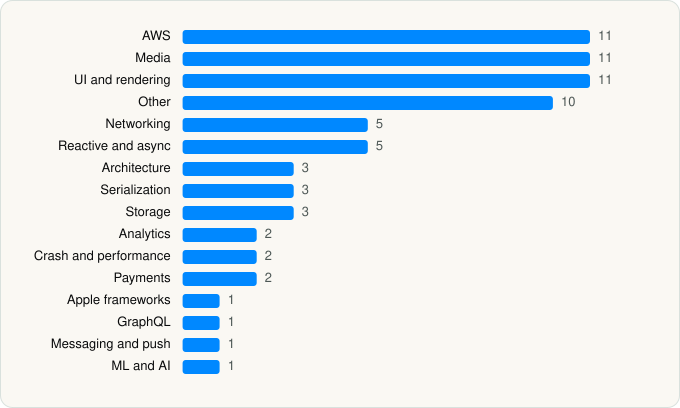

<picture><source media="(prefers-color-scheme: dark)" srcset="../../../../assets/logo/logo-dark.svg"></picture> [Tech Stack](../../../../README.md) / [AMZN Mobile LLC](../../../../companies/amzn-mobile-llc.md) / Amazon Music

# Amazon Music: Songs & Podcasts

<picture><source media="(prefers-color-scheme: dark)" srcset="../../../../assets/badges/ios-dark.svg"></picture> <picture><source media="(prefers-color-scheme: dark)" srcset="../../../../assets/badges/inactive-dark.svg"></picture> <picture><source media="(prefers-color-scheme: dark)" srcset="../../../../assets/badges/floor-dark.svg"></picture> <picture><source media="(prefers-color-scheme: dark)" srcset="../../../../assets/badges/encrypted-dark.svg"></picture>

[App Store](https://apps.apple.com/app/id510855668) · [latest.json](latest.json)

| | |
|---|---|
| Company | [AMZN Mobile LLC](../../../../companies/amzn-mobile-llc.md) |
| Store id | `510855668` |
| Bundle / package id | `com.amazon.mp3.AmazonCloudPlayer` |
| Latest version | 26.17.0 (analysed 2026-06-23) |
| Versions tracked | 1 |
| SDKs in latest version | 72 |
| Languages | C/C++, Kotlin Multiplatform, Metal (shaders), Objective-C, React Native / JavaScript, Swift |
| UI | Lottie (animations), SwiftUI, UIKit |
| Build | Swift Package Manager (SwiftPM) |
| Minimum OS | iOS 16.0 (built with Xcode 26.2, SDK iphoneos26.2) |
| Devices / ABIs | iPhone, iPad |
| Localisations | 15 |
| Capabilities | 11 |
| Declares tracking | Yes |
| Tracked | No. Kept for history. |

## SDKs by category

<picture><source media="(prefers-color-scheme: dark)" srcset="../../../../assets/charts/apps/ios/amzn-mobile-llc/amazon-music-dark.svg"></picture>

- **AWS** (11): Amplify 1.31.0, AmplifyPlugins 1.31.0, AppSyncRealTimeClient 3.2.0, AWSAPIGateway 2.40.2, AWSAuthCore 2.40.2, AWSCognitoIdentityProvider 2.40.2, AWSCognitoIdentityProviderASF 2.40.2, AWSCore 2.40.2, AWSIoT 2.40.2, AWSMobileClient 2.40.2, AWSPluginsCore 1.31.0
- **Media** (11): AIVHLSManifest 1.6.1, AIVHLSManifestLib 1.6.1, AIViOSPlayer 4.0.7, AIViOSPlayerFramework 5.9.1, AudibleAPI, AudibleWhispersync, IOSPlayerAuthProxy 3.1.0, IOSPlayerPlaybackObservers 6.0.0, IOSPlayerPlaybackResourceServiceClient 8.2.0, IOSPlayerSDKConfig 7.12.0, PVPlayerSDK 6.3.2
- **UI and rendering** (11): FlashList, Half 1.4.2, hermes 0.12.0, HMSegmentedControl 1.5.3, Kingfisher 8.1.1, Lottie 4.5.0, MarqueeLabel 4.0.5, React Native, React Native Reanimated, react-native-svg, XLPagerTabStrip 9.0.0
- **Other** (10): ApplePlayerSDKModels 3.5.2, av 8.1, Lodash, Moment.js, MXPagerView 0.2.1, MXParallaxHeader 0.6.1, MXSegmentedPager 3.2.2, PVTelemetryClientSdkSwift 0.2.3, TagListView 1.4.1, WazeAudio 1.3
- **Networking** (5): Alamofire 5.9.1, ApplePlayerSDKNetworking 1.1.0, ASN1Swift 1.2.7, Axios, Starscream 4.0.8
- **Reactive and async** (5): RxBlocking 6.9.0, RxCocoa 6.9.0, RxJS, RxRelay 6.9.0, RxSwift 6.9.0
- **Architecture** (3): MobX, NeedleFoundation 0.25.1, React Navigation
- **Serialization** (3): CBORCoding 1.4.0, Protobuf 3.29.5, XMLCoder 0.5.1
- **Storage** (3): GRDB 4.14.0, GZIP 1.0.3, SQLite 0.13.2
- **Analytics** (2): Amplitude, Branch 3.13.3
- **Crash and performance** (2): Bugsnag 1.13.0, BugsnagPerformance
- **Payments** (2): FoveaFramework 0.1.5, TPInAppReceipt 3.3.4
- **Apple frameworks** (1): OrderedCollections 1.0.4
- **GraphQL** (1): Apollo GraphQL
- **Messaging and push** (1): InAppMessagingClientiOS 1.0
- **ML and AI** (1): TensorFlowLite 2.14.0

Frameworks (33)

AdServices (Apple Search Ads attribution), AdSupport (IDFA), Authentication Services (Sign in with Apple / passkeys), AVFoundation (audio/video), AVKit, CallKit (VoIP), Combine (reactive), Contacts, Core Data, Core Image, Core Location, Core ML, Core Motion, CryptoKit, EventKit (Calendar / Reminders), Local Authentication (Face ID / Touch ID), Media Player, MessageUI (mail / SMS compose), MetalKit, MetricKit (diagnostics), Network.framework, Photos, PhotosUI, SafariServices, SiriKit (Intents), Speech (recognition), StoreKit (in-app purchase), SwiftUI, UIKit, User Notifications, Vision, VisionKit (document/data scanning), Watch Connectivity

Capabilities (11)

App Groups, Associated Domains (Universal Links), Background App Refresh, Background Audio, Background Push, Bluetooth (central), CarPlay, External Accessory, Keychain Sharing, Push Notifications (APNs), SiriKit

## Version history

| Version | Analysed | Store update | SDKs | Change | SDK list is a floor | Binary encrypted | File |
|---|---|---|---|---|---|---|---|
| 26.17.0 | 2026-06-23 |  | 72 |  | Yes | Yes | [26.17.0.json](26.17.0.json) |

## Model-written summary

> Hybrid React Native-SwiftUI Amazon Music iOS app with AWS Amplify, 9 Metal shaders, CarPlay/SiriKit, and 100+ Alcatraz first-party modules

Written by a language model from the detected signals (`inferred[]`). It is commentary, not measurement.

---

Generated by `scripts/build_readme.py` from the JSON files. Do not edit by hand.
