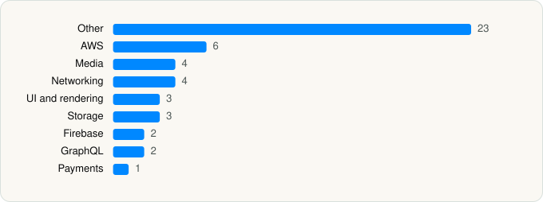

<picture><source media="(prefers-color-scheme: dark)" srcset="../../../../assets/logo/logo-dark.svg"></picture> [Tech Stack](../../../../README.md) / [AMZN Mobile LLC](../../../../companies/amzn-mobile-llc.md) / Amazon Prime Video

# Amazon Prime Video

<picture><source media="(prefers-color-scheme: dark)" srcset="../../../../assets/badges/ios-dark.svg"></picture> <picture><source media="(prefers-color-scheme: dark)" srcset="../../../../assets/badges/active-dark.svg"></picture> <picture><source media="(prefers-color-scheme: dark)" srcset="../../../../assets/badges/floor-dark.svg"></picture> <picture><source media="(prefers-color-scheme: dark)" srcset="../../../../assets/badges/encrypted-dark.svg"></picture>

[App Store](https://apps.apple.com/app/id545519333) · [latest.json](latest.json)

| | |
|---|---|
| Company | [AMZN Mobile LLC](../../../../companies/amzn-mobile-llc.md) |
| Store id | `545519333` |
| Bundle / package id | `com.amazon.aiv.AIVApp` |
| Latest version | 10.134 (analysed 2026-06-23) |
| Versions tracked | 1 |
| SDKs in latest version | 48 |
| Languages | C/C++, Metal (shaders), Objective-C, Swift |
| UI | Lottie (animations), SwiftUI, UIKit |
| Build | Swift Package Manager (SwiftPM) |
| Minimum OS | iOS 17.0 (built with Xcode 26.2, SDK iphoneos26.2) |
| Devices / ABIs | iPhone, iPad |
| Localisations | 34 |
| Capabilities | 8 |
| Declares tracking | No |
| Tracked | Yes |

## SDKs by category

<picture><source media="(prefers-color-scheme: dark)" srcset="../../../../assets/charts/apps/ios/amzn-mobile-llc/amazon-prime-video-dark.svg"></picture>

- **Other** (23): ApplePlayerLiveEventExplore, BigNumber 999.99.9, CocoaMQTT 1.0, DViOSSKAdNetworkSupport 1.0.14, Fido2Lib 1.0.0, IOSPlayerUI, MAPiOSLib 0.0.1, MBProgressHUD, PVAppleAppUI, PVAppleAppUIObjC, PVAppleAssistantPresentation, PVAppleFantasyPresentation, PVAppleFoundationUI, PVAppleOnboardingComponent, PVAppleProfileComponent, PVAppleRegularCarouselComponent, PVAppleRothkoFramework, PVAppleTitleDetailsPreview, PVAppleUI, PVAppleXrayLiveFramework, PVAppleXrayVODClient, PVAppleXrayVODFramework, Quincy
- **AWS** (6): AWSAPIGateway 2.34.0, AWSAuthCore 2.34.0, AWSCognitoIdentityProvider 2.34.0, AWSCognitoIdentityProviderASF 2.34.0, AWSCore 2.34.0, AWSMobileClient 2.34.0
- **Media** (4): AIViOSPlayer, GoogleCast 4.8.0, IOSPlayerSDKConfig, MatterTvCastingBridge 1.0
- **Networking** (4): AFNetworkActivityLogger 4.0.0, AFNetworking 4.0.1, Alamofire, Starscream
- **UI and rendering** (3): Lottie, Nuke 12.4.0, SDWebImage 4.1.4
- **Storage** (3): NukeUI 12.4.0, SAMKeychain, SSZipArchive 2.1.4
- **Firebase** (2): FBLPromises, GoogleUtilities 7.13.3
- **GraphQL** (2): Apollo 1, ApolloAPI 1
- **Payments** (1): FoveaFramework 0.1.5

Frameworks (31)

ActivityKit (Live Activities), AdSupport (IDFA), App Tracking Transparency (ATT), Authentication Services (Sign in with Apple / passkeys), AVFoundation (audio/video), AVKit, Background Tasks, CallKit (VoIP), Combine (reactive), Core Bluetooth, Core Data, Core Image, Core Location, Core ML, CryptoKit, Group Activities (SharePlay), Local Authentication (Face ID / Touch ID), Media Player, MessageUI (mail / SMS compose), MetricKit (diagnostics), Network.framework, Photos, PhotosUI, SafariServices, Speech (recognition), StoreKit (in-app purchase), Swift Charts, SwiftUI, UIKit, User Notifications, WidgetKit (widgets)

Capabilities (8)

App Groups, Associated Domains (Universal Links), Background App Refresh, Background Audio, Background Processing, Background Push, Keychain Sharing, Push Notifications (APNs)

## Version history

| Version | Analysed | Store update | SDKs | Change | SDK list is a floor | Binary encrypted | File |
|---|---|---|---|---|---|---|---|
| 10.134 | 2026-06-23 |  | 48 |  | Yes | Yes | [10.134.json](10.134.json) |

## Model-written summary

> iOS Amazon Prime Video app with custom PVApple UI modules, AWS/Firebase backends, Live Activities extension, Google Cast, and Metal shaders

Written by a language model from the detected signals (`inferred[]`). It is commentary, not measurement.

---

Generated by `scripts/build_readme.py` from the JSON files. Do not edit by hand.
