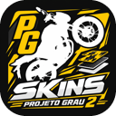
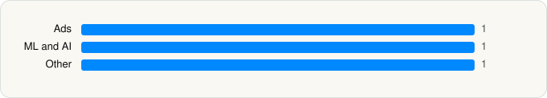

<picture><source media="(prefers-color-scheme: dark)" srcset="../../../../assets/logo/logo-dark.svg"></picture> [Tech Stack](../../../../README.md) / [Anderson Mateus de Lima](../../../../companies/anderson-mateus-de-lima.md) / Skins Projeto Grau 2

# Skins Projeto Grau 2

<picture><source media="(prefers-color-scheme: dark)" srcset="../../../../assets/badges/ios-dark.svg"></picture> <picture><source media="(prefers-color-scheme: dark)" srcset="../../../../assets/badges/inactive-dark.svg"></picture> <picture><source media="(prefers-color-scheme: dark)" srcset="../../../../assets/badges/floor-dark.svg"></picture> <picture><source media="(prefers-color-scheme: dark)" srcset="../../../../assets/badges/encrypted-dark.svg"></picture>

[App Store](https://apps.apple.com/app/id6818339091) · [latest.json](latest.json)

| | |
|---|---|
| Company | [Anderson Mateus de Lima](../../../../companies/anderson-mateus-de-lima.md) |
| Store id | `6818339091` |
| Bundle / package id | `com.InsanityGroup.SkinsProjetoGrau2` |
| Latest version | 1.0.3 (analysed 2026-11-10) |
| Versions tracked | 1 |
| SDKs in latest version | 3 |
| Languages | C/C++, Objective-C, Swift, Unity (C# / IL2CPP) |
| UI | UIKit |
| Build | Unknown / Xcode native |
| Minimum OS | iOS 15.0 (built with Xcode 26.0.1, SDK iphoneos26.0) |
| Devices / ABIs | iPhone, iPad |
| Localisations | 0 |
| Capabilities | 0 |
| Declares tracking | No |
| Tracked | No. Kept for history. |

## SDKs by category

<picture><source media="(prefers-color-scheme: dark)" srcset="../../../../assets/charts/apps/ios/anderson-mateus-de-lima/skins-projeto-grau-2-dark.svg"></picture>

- **Ads** (1): Google Mobile Ads (AdMob)
- **ML and AI** (1): UnityFramework 1.0
- **Other** (1): unity-plugin-library 1.0

Frameworks (11)

AdSupport (IDFA), App Tracking Transparency (ATT), AVFoundation (audio/video), AVKit, Core Motion, Media Player, MessageUI (mail / SMS compose), Network.framework, SafariServices, StoreKit (in-app purchase), UIKit

## Version history

| Version | Analysed | Store update | SDKs | Change | SDK list is a floor | Binary encrypted | File |
|---|---|---|---|---|---|---|---|
| 1.0.3 | 2026-11-10 |  | 3 |  | Yes | Yes | [1.0.3.json](1.0.3.json) |

---

Generated by `scripts/build_readme.py` from the JSON files. Do not edit by hand.
