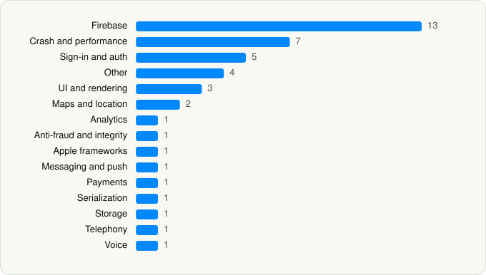

<picture><source media="(prefers-color-scheme: dark)" srcset="../../../../assets/logo/logo-dark.svg"></picture> [Tech Stack](../../../../README.md) / [Anthropic PBC](../../../../companies/anthropic-pbc.md) / Claude by Anthropic

# Claude by Anthropic

<picture><source media="(prefers-color-scheme: dark)" srcset="../../../../assets/badges/ios-dark.svg"></picture> <picture><source media="(prefers-color-scheme: dark)" srcset="../../../../assets/badges/active-dark.svg"></picture> <picture><source media="(prefers-color-scheme: dark)" srcset="../../../../assets/badges/floor-dark.svg"></picture> <picture><source media="(prefers-color-scheme: dark)" srcset="../../../../assets/badges/encrypted-dark.svg"></picture>

[App Store](https://apps.apple.com/app/id6473753684) · [latest.json](latest.json)

| | |
|---|---|
| Company | [Anthropic PBC](../../../../companies/anthropic-pbc.md) |
| Store id | `6473753684` |
| Bundle / package id | `com.anthropic.claude` |
| Latest version | 1.261021.20 (analysed 2026-10-23) |
| Versions tracked | 4 |
| SDKs in latest version | 43 |
| Languages | C/C++, Metal (shaders), Objective-C, Swift |
| UI | SwiftUI, UIKit |
| Build | Swift Package Manager (SwiftPM) |
| Minimum OS | iOS 18.0 (built with Xcode 27.1, SDK iphoneos27.1) |
| Devices / ABIs | iPhone, iPad |
| Localisations | 36 |
| Capabilities | 11 |
| Declares tracking | No |
| Tracked | Yes |

## SDKs by category

<picture><source media="(prefers-color-scheme: dark)" srcset="../../../../assets/charts/apps/ios/anthropic-pbc/claude-dark.svg"></picture>

- **Firebase** (13): abseil, AppCheck, FBLPromises, Firebase, FirebaseCore, FirebaseCoreInternal, FirebaseInstallations, GoogleDataTransport, GoogleUtilities, gRPC, leveldb, nanopb, Promises
- **Crash and performance** (7): Datadog, DatadogCore, DatadogCrashReporting, DatadogRUM, KSCrash, opentelemetry, Sentry
- **Sign-in and auth** (5): AppAuth, GoogleSignIn, GTMAppAuth, GTMSessionFetcher, InteropForGoogle
- **Other** (4): GooglePlaces 11.2.0, GooglePlacesSwift 11.2.0, GooglePlacesSwiftTarget, GooglePlacesTarget
- **UI and rendering** (3): cmark-gfm, Kingfisher, SwiftMath
- **Maps and location** (2): GMSCore 26.03.0, GoogleMaps
- **Analytics** (1): GoogleAppMeasurement
- **Anti-fraud and integrity** (1): sift-ios
- **Apple frameworks** (1): swift-collections
- **Messaging and push** (1): FirebaseMessaging
- **Payments** (1): LinkKit 7.2.0
- **Serialization** (1): SwiftProtobuf
- **Storage** (1): GRDB
- **Telephony** (1): PhoneNumberKit
- **Voice** (1): LiveKit 1.0

Frameworks (35)

ActivityKit (Live Activities), AdServices (Apple Search Ads attribution), App Intents, Authentication Services (Sign in with Apple / passkeys), AVFoundation (audio/video), Background Tasks, CloudKit, Combine (reactive), Contacts, Core Data, Core Image, Core Location, CryptoKit, DeviceCheck / App Attest, EventKit (Calendar / Reminders), HealthKit, Local Authentication (Face ID / Touch ID), Media Player, MetalKit, MetricKit (diagnostics), Natural Language, Network.framework, PDFKit, PencilKit, Photos, PhotosUI, SafariServices, SiriKit (Intents), StoreKit (in-app purchase), Swift Charts, SwiftData (persistence), SwiftUI, UIKit, User Notifications, WidgetKit (widgets)

Capabilities (11)

App Attest, App Groups, Associated Domains (Universal Links), Background Audio, Background Push, CarPlay, HealthKit, Keychain Sharing, Push Notifications (APNs), Sign in with Apple, Time-Sensitive Notifications

## Version history

| Version | Analysed | Store update | SDKs | Change | SDK list is a floor | Binary encrypted | File |
|---|---|---|---|---|---|---|---|
| 1.261021.20 | 2026-10-23 | 2026-10-22 | 43 | +6 / −11 | Yes | Yes | [1.261021.20.json](1.261021.20.json) |
| 1.260604.0 | 2026-06-23 |  | 48 | +4 / −0 | Yes | Yes | [1.260604.0.json](1.260604.0.json) |
| 1.260528.1 | 2026-06-09 |  | 44 | +0 / −19 | Yes | Yes | [1.260528.1.json](1.260528.1.json) |
| 1.260521.1 | 2026-06-01 |  | 63 |  | Yes | Yes | [1.260521.1.json](1.260521.1.json) |

### SDK changes between versions

- 1.260604.0 → 1.261021.20: added GooglePlaces, GooglePlacesSwift, GooglePlacesSwiftTarget, GooglePlacesTarget, LinkKit, LiveKit; removed Highlight.js, Highlightr, JSONSafeEncoding, Lottie, NetworkImage, ResilientDecoding, Segment, Sovran, swift-markdown-ui, SwiftSoup, YouTubeiOSPlayerHelper
- 1.260528.1 → 1.260604.0: added DatadogCore, FirebaseCore, Highlight.js, ResilientDecoding
- 1.260521.1 → 1.260528.1: removed combine-schedulers, DatadogCore, FirebaseCore, Markdown, mathFonts, ResilientDecoding, Sharing, sqlite-data, swift-async-algorithms, swift-atomics, swift-clocks, swift-concurrency-extras, swift-custom-dump, swift-dependencies, swift-identified-collections, swift-perception, swift-sharing, swift-structured-queries, swift-syntax

---

Generated by `scripts/build_readme.py` from the JSON files. Do not edit by hand.
