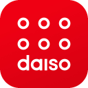
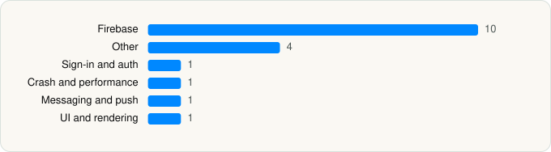

<picture><source media="(prefers-color-scheme: dark)" srcset="../../../../assets/logo/logo-dark.svg"></picture> [Tech Stack](../../../../README.md) / [ASUNGDAISO, Co.,Ltd.](../../../../companies/asungdaiso-co-ltd.md) / 다이소몰

# 다이소몰

<picture><source media="(prefers-color-scheme: dark)" srcset="../../../../assets/badges/ios-dark.svg"></picture> <picture><source media="(prefers-color-scheme: dark)" srcset="../../../../assets/badges/inactive-dark.svg"></picture> <picture><source media="(prefers-color-scheme: dark)" srcset="../../../../assets/badges/floor-dark.svg"></picture> <picture><source media="(prefers-color-scheme: dark)" srcset="../../../../assets/badges/encrypted-dark.svg"></picture>

[App Store](https://apps.apple.com/app/id1070715498) · [latest.json](latest.json)

| | |
|---|---|
| Company | [ASUNGDAISO, Co.,Ltd.](../../../../companies/asungdaiso-co-ltd.md) |
| Store id | `1070715498` |
| Bundle / package id | `net.pointwell.wipoint` |
| Latest version | 5.1.44 (analysed 2026-11-10) |
| Versions tracked | 1 |
| SDKs in latest version | 18 |
| Languages | C/C++, Flutter / Dart, Objective-C, Swift |
| UI | SwiftUI, UIKit |
| Build | Swift Package Manager (SwiftPM) |
| Minimum OS | iOS 15.0 (built with Xcode 27.2, SDK iphoneos27.2) |
| Devices / ABIs | iPhone |
| Localisations | 1 |
| Capabilities | 6 |
| Declares tracking | Yes |
| Tracked | No. Kept for history. |

## SDKs by category

<picture><source media="(prefers-color-scheme: dark)" srcset="../../../../assets/charts/apps/ios/asungdaiso-co-ltd/app-dark.svg"></picture>

- **Firebase** (10): FBLPromises 2.4.1, Firebase 16.6.0, FirebaseCore 12.18.0, FirebaseCoreInternal 12.18.0, FirebaseInstallations 12.18.0, FirebaseRemoteConfig 12.18.0, GoogleDataTransport 10.1.1, GoogleUtilities 8.1.3, nanopb 3.30910.0, Promises 2.4.1
- **Other** (4): Airbridge 4.12.0, Flutter 1.0, GroobeeKit 1.1.0, NidCore 5.0.1
- **Sign-in and auth** (1): NidThirdPartyLogin 5.0.1
- **Crash and performance** (1): FirebaseCrashlytics 12.18.0
- **Messaging and push** (1): FirebaseMessaging 12.18.0
- **UI and rendering** (1): SDWebImage 5.21.7

Frameworks (21)

AdServices (Apple Search Ads attribution), AdSupport (IDFA), App Tracking Transparency (ATT), Authentication Services (Sign in with Apple / passkeys), AVFoundation (audio/video), Combine (reactive), Contacts, Core Data, Core Image, Core Location, Core Motion, Network.framework, Photos, PhotosUI, SafariServices, Speech (recognition), StoreKit (in-app purchase), SwiftUI, UIKit, User Notifications, Vision

Capabilities (6)

App Groups, Associated Domains (Universal Links), Background App Refresh, Background Push, Push Notifications (APNs), Sign in with Apple

## Version history

| Version | Analysed | Store update | SDKs | Change | SDK list is a floor | Binary encrypted | File |
|---|---|---|---|---|---|---|---|
| 5.1.44 | 2026-11-10 |  | 18 |  | Yes | Yes | [5.1.44.json](5.1.44.json) |

---

Generated by `scripts/build_readme.py` from the JSON files. Do not edit by hand.
