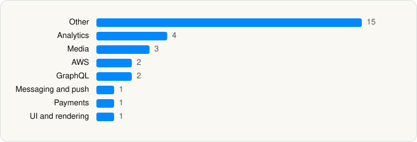

<picture><source media="(prefers-color-scheme: dark)" srcset="../../../../assets/logo/logo-dark.svg"></picture> [Tech Stack](../../../../README.md) / [Audible, Inc.](../../../../companies/audible-inc.md) / Audible

# Audible: Audiobooks & Podcasts

<picture><source media="(prefers-color-scheme: dark)" srcset="../../../../assets/badges/ios-dark.svg"></picture> <picture><source media="(prefers-color-scheme: dark)" srcset="../../../../assets/badges/inactive-dark.svg"></picture> <picture><source media="(prefers-color-scheme: dark)" srcset="../../../../assets/badges/floor-dark.svg"></picture> <picture><source media="(prefers-color-scheme: dark)" srcset="../../../../assets/badges/encrypted-dark.svg"></picture>

[App Store](https://apps.apple.com/app/id379693831) · [latest.json](latest.json)

| | |
|---|---|
| Company | [Audible, Inc.](../../../../companies/audible-inc.md) |
| Store id | `379693831` |
| Bundle / package id | `com.audible.iphone` |
| Latest version | 4.71.1 (analysed 2026-06-23) |
| Versions tracked | 1 |
| SDKs in latest version | 29 |
| Languages | C/C++, Metal (shaders), Objective-C, Swift |
| UI | Lottie (animations), SwiftUI, UIKit |
| Build | Swift Package Manager (SwiftPM) |
| Minimum OS | iOS 18.1 (built with Xcode 26.2, SDK iphoneos26.2) |
| Devices / ABIs | iPhone, iPad |
| Localisations | 16 |
| Capabilities | 10 |
| Declares tracking | No |
| Tracked | No. Kept for history. |

## SDKs by category

<picture><source media="(prefers-color-scheme: dark)" srcset="../../../../assets/charts/apps/ios/audible-inc/audible-dark.svg"></picture>

- **Other** (15): AlexaKit, BuyBox, Capture 0.22.6, ClientRuntime, ConductorKit, ContentModeration, FullPlayer, MAPiOSLib, Marketplace, MetaWearablesSDK 14.2.0, MetricsFactory, Mosaic, NowPlayingInfoCenter, PryonLite 2.10.6, WazeAudio 1.3
- **Analytics** (4): AEPCore, AEPServices, BrazeKit 14.1.0, Kochava 8.1.1
- **Media** (3): AudibleAPI, AudibleWhispersync, PlayerSDK
- **AWS** (2): AWSClientRuntime, AwsCommonRuntimeKit
- **GraphQL** (2): Apollo, ApolloAPI
- **Messaging and push** (1): BrazeUI
- **Payments** (1): PurchaseKit
- **UI and rendering** (1): Lottie 4.5.2

Frameworks (34)

ActivityKit (Live Activities), AdServices (Apple Search Ads attribution), App Intents, App Tracking Transparency (ATT), Authentication Services (Sign in with Apple / passkeys), AVFoundation (audio/video), AVKit, Background Tasks, Combine (reactive), Core Data, Core Image, Core Location, Core Motion, CryptoKit, DeviceCheck / App Attest, Local Authentication (Face ID / Touch ID), MapKit, Media Player, MessageUI (mail / SMS compose), MetricKit (diagnostics), Network.framework, PDFKit, SafariServices, SiriKit (Intents), Speech (recognition), SpriteKit, StoreKit (in-app purchase), Swift Charts, SwiftUI, UIKit, User Notifications, VisionKit (document/data scanning), Watch Connectivity, WidgetKit (widgets)

Capabilities (10)

App Groups, Associated Domains (Universal Links), Background App Refresh, Background Audio, Background Push, CarPlay, External Accessory, Keychain Sharing, Push Notifications (APNs), SiriKit

## Version history

| Version | Analysed | Store update | SDKs | Change | SDK list is a floor | Binary encrypted | File |
|---|---|---|---|---|---|---|---|
| 4.71.1 | 2026-06-23 |  | 29 |  | Yes | Yes | [4.71.1.json](4.71.1.json) |

## Model-written summary

> SwiftUI/UIKit iOS audiobook app with App Intents, SiriKit, AlexaKit, Adobe/Braze analytics, and Audible backend

Written by a language model from the detected signals (`inferred[]`). It is commentary, not measurement.

---

Generated by `scripts/build_readme.py` from the JSON files. Do not edit by hand.
