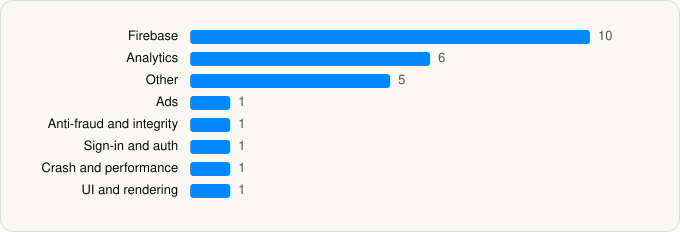

<picture><source media="(prefers-color-scheme: dark)" srcset="../../../../assets/logo/logo-dark.svg"></picture> [Tech Stack](../../../../README.md) / [Australia Post](../../../../companies/australia-post.md) / Australia Post

# Australia Post

<picture><source media="(prefers-color-scheme: dark)" srcset="../../../../assets/badges/ios-dark.svg"></picture> <picture><source media="(prefers-color-scheme: dark)" srcset="../../../../assets/badges/inactive-dark.svg"></picture> <picture><source media="(prefers-color-scheme: dark)" srcset="../../../../assets/badges/floor-dark.svg"></picture> <picture><source media="(prefers-color-scheme: dark)" srcset="../../../../assets/badges/encrypted-dark.svg"></picture>

[App Store](https://apps.apple.com/app/id380897313) · [latest.json](latest.json)

| | |
|---|---|
| Company | [Australia Post](../../../../companies/australia-post.md) |
| Store id | `380897313` |
| Bundle / package id | `com.auspost.mobile` |
| Latest version | 7.12.1 (analysed 2026-11-19) |
| Versions tracked | 1 |
| SDKs in latest version | 26 |
| Languages | C/C++, Objective-C, Swift |
| UI | Lottie (animations), SwiftUI, UIKit |
| Build | Swift Package Manager (SwiftPM) |
| Minimum OS | iOS 16.0 (built with Xcode 26.6, SDK iphoneos26.5) |
| Devices / ABIs | iPhone, iPad |
| Localisations | 1 |
| Capabilities | 6 |
| Declares tracking | Yes |
| Tracked | No. Kept for history. |

## SDKs by category

<picture><source media="(prefers-color-scheme: dark)" srcset="../../../../assets/charts/apps/ios/australia-post/australia-post-dark.svg"></picture>

- **Firebase** (10): FBLPromises, Firebase, FirebaseCore, FirebaseCoreInternal, FirebaseInstallations, FirebaseRemoteConfig, GoogleDataTransport, GoogleUtilities, nanopb, Promises
- **Analytics** (6): AEPCore, AEPServices, Branch, FirebaseAnalytics 12.19.0, GoogleAppMeasurement 12.19.0, GoogleAppMeasurementIdentitySupport 12.19.0
- **Other** (5): GooglePlaces 10.15.0, GooglePlacesSwift 10.15.0, GooglePlacesSwiftTarget, GooglePlacesTarget, InAppSettingsKit
- **Ads** (1): GoogleAdsOnDeviceConversion 3.7.0
- **Anti-fraud and integrity** (1): DataDomeSDK 3.1.0
- **Sign-in and auth** (1): Auth0
- **Crash and performance** (1): FirebaseCrashlytics
- **UI and rendering** (1): Lottie

Frameworks (23)

AdServices (Apple Search Ads attribution), App Intents, Authentication Services (Sign in with Apple / passkeys), AVFoundation (audio/video), Combine (reactive), Core Data, Core Image, Core Location, CryptoKit, Local Authentication (Face ID / Touch ID), MapKit, MessageUI (mail / SMS compose), Network.framework, PassKit (Wallet / Apple Pay), PDFKit, SafariServices, SiriKit (Intents), StoreKit (in-app purchase), SwiftUI, UIKit, User Notifications, Watch Connectivity, WidgetKit (widgets)

Capabilities (6)

App Groups, Associated Domains (Universal Links), Background Location, Keychain Sharing, Push Notifications (APNs), Wallet passes

## Version history

| Version | Analysed | Store update | SDKs | Change | SDK list is a floor | Binary encrypted | File |
|---|---|---|---|---|---|---|---|
| 7.12.1 | 2026-11-19 |  | 26 |  | Yes | Yes | [7.12.1.json](7.12.1.json) |

---

Generated by `scripts/build_readme.py` from the JSON files. Do not edit by hand.
