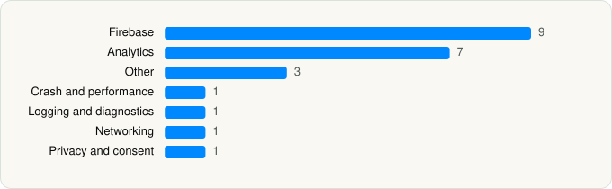

<picture><source media="(prefers-color-scheme: dark)" srcset="../../../../assets/logo/logo-dark.svg"></picture> [Tech Stack](../../../../README.md) / [AXS](../../../../companies/axs.md) / AXS Tickets

# AXS Tickets

<picture><source media="(prefers-color-scheme: dark)" srcset="../../../../assets/badges/ios-dark.svg"></picture> <picture><source media="(prefers-color-scheme: dark)" srcset="../../../../assets/badges/inactive-dark.svg"></picture> <picture><source media="(prefers-color-scheme: dark)" srcset="../../../../assets/badges/floor-dark.svg"></picture> <picture><source media="(prefers-color-scheme: dark)" srcset="../../../../assets/badges/encrypted-dark.svg"></picture>

[App Store](https://apps.apple.com/app/id679805463) · [latest.json](latest.json)

| | |
|---|---|
| Company | [AXS](../../../../companies/axs.md) |
| Store id | `679805463` |
| Bundle / package id | `com.axs.AXSMobile` |
| Latest version | 6.32.2 (analysed 2026-11-10) |
| Versions tracked | 1 |
| SDKs in latest version | 23 |
| Languages | C/C++, Objective-C, Swift |
| UI | SwiftUI, UIKit |
| Build | Swift Package Manager (SwiftPM) |
| Minimum OS | iOS 15.0 (built with Xcode 26.5, SDK iphoneos26.5) |
| Devices / ABIs | iPhone, iPad |
| Localisations | 7 |
| Capabilities | 8 |
| Declares tracking | No |
| Tracked | No. Kept for history. |

## SDKs by category

<picture><source media="(prefers-color-scheme: dark)" srcset="../../../../assets/charts/apps/ios/axs/axs-tickets-dark.svg"></picture>

- **Firebase** (9): FBLPromises, Firebase, FirebaseCore, FirebaseCoreInternal, FirebaseInstallations, GoogleDataTransport, GoogleUtilities, nanopb, Promises
- **Analytics** (7): AEPCore, AEPServices, FirebaseAnalytics 10.28.0, GoogleAppMeasurement 10.28.0, GoogleAppMeasurementIdentitySupport 10.28.0, MarketingCloudSDK 9.0.3, RudderStackAnalytics
- **Other** (3): Evergage 1.5.0, LogRocket 1.61.2, SFMCSDK 2.0.1
- **Crash and performance** (1): FirebaseCrashlytics
- **Logging and diagnostics** (1): CocoaLumberjack
- **Networking** (1): Alamofire
- **Privacy and consent** (1): OTPublishersHeadlessSDK 202306.2.0

Frameworks (26)

ActivityKit (Live Activities), App Tracking Transparency (ATT), Authentication Services (Sign in with Apple / passkeys), AVFoundation (audio/video), Background Tasks, Combine (reactive), Contacts, Core Bluetooth, Core Data, Core Image, Core Location, EventKit (Calendar / Reminders), Local Authentication (Face ID / Touch ID), MapKit, Media Player, MessageUI (mail / SMS compose), MetricKit (diagnostics), Natural Language, Network.framework, PassKit (Wallet / Apple Pay), SafariServices, StoreKit (in-app purchase), SwiftUI, UIKit, User Notifications, WidgetKit (widgets)

Capabilities (8)

Associated Domains (Universal Links), Background App Refresh, Background Location, Background Push, Bluetooth (central), Push Notifications (APNs), Sign in with Apple, Wallet passes

## Version history

| Version | Analysed | Store update | SDKs | Change | SDK list is a floor | Binary encrypted | File |
|---|---|---|---|---|---|---|---|
| 6.32.2 | 2026-11-10 |  | 23 |  | Yes | Yes | [6.32.2.json](6.32.2.json) |

---

Generated by `scripts/build_readme.py` from the JSON files. Do not edit by hand.
