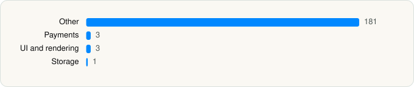

<picture><source media="(prefers-color-scheme: dark)" srcset="../../../../assets/logo/logo-dark.svg"></picture> [Tech Stack](../../../../README.md) / [Beijing Baidu Netcom Science & Technology Co.,Ltd](../../../../companies/beijing-baidu-netcom-science-technology-co-ltd.md) / 百度-AI智能搜索

# 百度-AI智能搜索

<picture><source media="(prefers-color-scheme: dark)" srcset="../../../../assets/badges/ios-dark.svg"></picture> <picture><source media="(prefers-color-scheme: dark)" srcset="../../../../assets/badges/active-dark.svg"></picture> <picture><source media="(prefers-color-scheme: dark)" srcset="../../../../assets/badges/floor-dark.svg"></picture> <picture><source media="(prefers-color-scheme: dark)" srcset="../../../../assets/badges/encrypted-dark.svg"></picture>

[App Store](https://apps.apple.com/app/id382201985) · [latest.json](latest.json)

| | |
|---|---|
| Company | [Beijing Baidu Netcom Science & Technology Co.,Ltd](../../../../companies/beijing-baidu-netcom-science-technology-co-ltd.md) |
| Store id | `382201985` |
| Bundle / package id | `com.baidu.BaiduMobile` |
| Latest version | 15.81.0 (analysed 2026-10-24) |
| Versions tracked | 1 |
| SDKs in latest version | 188 |
| Languages | C/C++, Metal (shaders), Objective-C, Swift |
| UI | Lottie (animations), SwiftUI, UIKit |
| Build | Swift Package Manager (SwiftPM) |
| Minimum OS | iOS 15.0 (built with Xcode 27.0, SDK iphoneos27.0) |
| Devices / ABIs | iPhone, iPad |
| Localisations | 4 |
| Capabilities | 13 |
| Declares tracking | No |
| Tracked | Yes |

## SDKs by category

<picture><source media="(prefers-color-scheme: dark)" srcset="../../../../assets/charts/apps/ios/beijing-baidu-netcom-science-technology-co-ltd/baidu-dark.svg"></picture>

- **Other** (181): Ad, AISearch, ALALiveRes, AlipaySDK, BaiduAR, BBAAccountSDK, BBAAudioPlayer, BBABalabooloo, BBABarrageCore, BBABigPicture, BBABrowser, BBABrowserCore, BBABrowserVideoTab, BBAComment, BBACompose, BBACRM, BBACRMKit, BBADesignTokens, BBADeviceScore, BBADHAgent, BBADigitalZone, BBADiskCleanConfig, BBADiskCleanUI, BBADislike, BBADownload, BBADynamicAppIcon, BBAEasyImageTextBrowser, BBAEBrowser, BBAEmoticon, BBAFavorHis, BBAFeedPay, BBAFeedPaySupportsDesignTokens, BBAFeedPurchase, BBAFeedPurchaseBar, BBAFeedPurchaseUI, BBAFeedTemplate, BBAFeedTemplateVideo, BBAFlowAudio, BBAFlowVideoCollectionLandingPage, BBAHKFlowVideoLandingPage, BBAHomePage, BBAHomePageFeed, BBAHotSpot, BBAImageSearch, BBALightAlbum, BBALive, BBALMConfig, BBAMessage, BBAMNP, BBAMnpImage, BBAMNPPreset, BBAMNPPyramid, BBANewFeature, BBANightMode, BBANovel, BBAOperations, BBAPayWall, BBAPersonalCenter, BBAPhotoBrowser, BBAPlecostomus, BBAPraise, BBARefresh, BBAResultScrollThrough, BBASchemeDispatcherExt, BBASearchBasics, BBASearchCommonPage, BBASearchLandingPageTTS, BBASearchMusicPlayer, BBASearchPage, BBASearchUtil, BBAServerDowngrade, BBASettings, BBASkin, BBASmartMenuImpl, BBASmartTagImpl, BBASnifferImpl, BBASport, BBAStateManager, BBASuggestion, BBASuperInterestCore, BBASuperInterestTemplate, BBASuperInterestVideoPlayer, BBASuspensionBall, BBATabbar, BBATaskOperation, BBAThemes, BBATTS, BBATTSAudioZone, BBAUIComponent, BBAUIKit, BBAUnifiedRemoteConfig, BBAUnifiedToolBar, BBAUnifiedVideoPlayer, BBAUpdateExt, BBAUserSetting, BBAVendorAd, BBAVideoPlayerUIKit, BBAVideoPlayerVulcanUILayers, BBAVoiceSearch 1.0, BBAVoiceSearchEntry, BBAWeatherLanding, BBAWordCommand, BDPAppearance, BDPAVRecorder, BDPCommentCore, BDPEasyBrowser, BDPFeedCore, BDPFeedData, BDPFeedHotSearch, BDPFeedLike, BDPFeedPage, BDPFeedSegment, BDPFeedTab, BDPFeedTTS, BDPFeedUI, BDPFeedUIKit, BDPFlowAdItems, BDPFlowBase, BDPFlowNewsFeed, BDPFlowVideoDesignTokens, BDPGrowthSystemWealthVideo, BDPGuaranteeSDK, BDPLikeHistory, BDPPermissions, BDPPersonalPage, BDPPhotoEditor, BDPPublisher, BDPPushInApp, BDPPushKit, BDPSubscribe, BDPTalosBox, BDPTeenager, BDPTTSVoiceRecord, BDPVdieoPublisher, BDSClientSDK, BJHCreativeCenterImpl, BLPRecommend, BoxPlugins, BZDAdvisorySDK, CSAICall, CSSideBar, dwsudb, DXMPaySDK, Explorer, IJKMediaFramework, KMMRes, map.iphone.baidu.comdetailtmpl, mapapi, MJRefresh, NADCore, options, PASSBiometricsFaceKit, PassECommerceKit, PassportKit, PassValidationKit, Phoenix, player, PMS, Portal, RecycleBin, SimpleSettingView, TalosCoreInterface, ttssdk, vastmetal, video, vlp, WeiboSDK, yybaseapisdkresources 8.4.2, yybaseserviceresources 8.4.3, yychannelbaseresources 8.4.5, yychannelcomponentresources 8.4.9, yyfeedbackcomponentresources 8.6.2, yygiftviewcomponentresources 0.1.0, YYHost 0.1.0, yyiapcomponentbundle 0.1.0, yyreportcomponentresources 8.4.1, yyuchatmodulebundle 8.41.2, yyulivesdkresources 8.41.2, YYUnionSource 8.41.2, yyvideolib, yywebcomponentresources 8.4.1
- **Payments** (3): BBAFeedPaymentVLP, BDPWalletBDFSGRIM, PaymentControlPrivacy
- **UI and rendering** (3): AFXAnimation, Lottie, SDWebImage
- **Storage** (1): FMDB

Frameworks (43)

ActivityKit (Live Activities), AdServices (Apple Search Ads attribution), AdSupport (IDFA), App Intents, App Tracking Transparency (ATT), ARKit, Authentication Services (Sign in with Apple / passkeys), AVFoundation (audio/video), AVKit, CallKit (VoIP), Combine (reactive), Contacts, Core Data, Core Image, Core Location, Core ML, Core Motion, CryptoKit, DeviceCheck / App Attest, EventKit (Calendar / Reminders), HealthKit, Local Authentication (Face ID / Touch ID), MapKit, Media Player, MessageUI (mail / SMS compose), MetalKit, MetricKit (diagnostics), Natural Language, Network.framework, PassKit (Wallet / Apple Pay), Photos, PhotosUI, PushKit (VoIP push), SafariServices, SiriKit (Intents), SpriteKit, StoreKit (in-app purchase), SwiftUI, UIKit, User Notifications, Vision, Watch Connectivity, WidgetKit (widgets)

Capabilities (13)

App Groups, Associated Domains (Universal Links), Background App Refresh, Background Audio, Background Push, Background: network-authentication, Communication Notifications, HealthKit, Keychain Sharing, Push Notifications (APNs), Sign in with Apple, SiriKit, Time-Sensitive Notifications

## Version history

| Version | Analysed | Store update | SDKs | Change | SDK list is a floor | Binary encrypted | File |
|---|---|---|---|---|---|---|---|
| 15.81.0 | 2026-10-24 | 2026-10-22 | 188 |  | Yes | Yes | [15.81.0.json](15.81.0.json) |

---

Generated by `scripts/build_readme.py` from the JSON files. Do not edit by hand.
