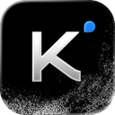
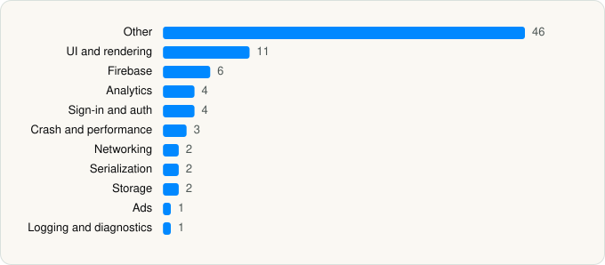

<picture><source media="(prefers-color-scheme: dark)" srcset="../../../../assets/logo/logo-dark.svg"></picture> [Tech Stack](../../../../README.md) / [Beijing Moonshot Technology Co., Ltd](../../../../companies/beijing-moonshot-technology-co-ltd.md) / Kimi

# Kimi - Your Personal AI Agent

<picture><source media="(prefers-color-scheme: dark)" srcset="../../../../assets/badges/ios-dark.svg"></picture> <picture><source media="(prefers-color-scheme: dark)" srcset="../../../../assets/badges/active-dark.svg"></picture> <picture><source media="(prefers-color-scheme: dark)" srcset="../../../../assets/badges/floor-dark.svg"></picture> <picture><source media="(prefers-color-scheme: dark)" srcset="../../../../assets/badges/encrypted-dark.svg"></picture>

[App Store](https://apps.apple.com/app/id6474233312) · [latest.json](latest.json)

| | |
|---|---|
| Company | [Beijing Moonshot Technology Co., Ltd](../../../../companies/beijing-moonshot-technology-co-ltd.md) |
| Store id | `6474233312` |
| Bundle / package id | `com.moonshot.kimichat` |
| Latest version | 3.1.6 (analysed 2026-10-24) |
| Versions tracked | 1 |
| SDKs in latest version | 82 |
| Languages | C/C++, Metal (shaders), Objective-C, Swift |
| UI | Lottie (animations), SwiftUI, UIKit |
| Build | Swift Package Manager (SwiftPM) |
| Minimum OS | iOS 15.0 (built with Xcode 26.5, SDK iphoneos26.5) |
| Devices / ABIs | iPhone, iPad |
| Localisations | 16 |
| Capabilities | 7 |
| Declares tracking | Yes |
| Tracked | Yes |

## SDKs by category

<picture><source media="(prefers-color-scheme: dark)" srcset="../../../../assets/charts/apps/ios/beijing-moonshot-technology-co-ltd/kimi-dark.svg"></picture>

- **Other** (46): FDTemplateLayoutCell 1.6.0, LocalizedStringKit, MSStainSDK 0.2.1, Parchment, RangersAppLog 6.17.6, RangersAppLogDevTools 6.17.6, Runestone, Shimmer 1.0.2, TDCorePlugin 4.3.4, TreeSitterAstroQueries, TreeSitterBashQueries, TreeSitterCommentQueries, TreeSitterCPPQueries, TreeSitterCQueries, TreeSitterCSharpQueries, TreeSitterCSSQueries, TreeSitterElixirQueries, TreeSitterElmQueries, TreeSitterGoQueries, TreeSitterHaskellQueries, TreeSitterHTMLQueries, TreeSitterJavaQueries, TreeSitterJavaScriptQueries, TreeSitterJSDocQueries, TreeSitterJSON5Queries, TreeSitterJSONQueries, TreeSitterJuliaQueries, TreeSitterLaTeXQueries, TreeSitterLuaQueries, TreeSitterOCamlQueries, TreeSitterPerlQueries, TreeSitterPHPQueries, TreeSitterPythonQueries, TreeSitterRegexQueries, TreeSitterRQueries, TreeSitterRubyQueries, TreeSitterRustQueries, TreeSitterSCSSQueries, TreeSitterSQLQueries, TreeSitterSvelteQueries, TreeSitterSwiftQueries, TreeSitterTOMLQueries, TreeSitterTSXQueries, TreeSitterTypeScriptQueries, TreeSitterYAMLQueries, TXSoundTouch 1.0
- **UI and rendering** (11): Highlight.js 9.4.0, Lottie, MathJax, MathJaxSwift, RiveRuntime 6.15.1, SDWebImage, SDWebImageSwiftUI, SnapKit, TOCropViewController, TreeSitterMarkdownInlineQueries, TreeSitterMarkdownQueries
- **Firebase** (6): FBLPromises, FirebaseCore, FirebaseCoreInternal, FirebaseInstallations, GoogleUtilities, nanopb
- **Analytics** (4): AppsFlyerLib 1.0, FirebaseAnalytics 12.16.0, GoogleAppMeasurement 12.16.0, GoogleAppMeasurementIdentitySupport 12.16.0
- **Sign-in and auth** (4): AppAuth, GoogleSignIn, GTMAppAuth, GTMSessionFetcher
- **Crash and performance** (3): APMInsightCore, APMInsightCrash, RangersAPMPrivacyInfo 3.9.0
- **Networking** (2): Alamofire, Starscream
- **Serialization** (2): SwiftProtobuf, SwiftyJSON
- **Storage** (2): MMKV 2.0.0, MMKVCore 2.0.2
- **Ads** (1): GoogleAdsOnDeviceConversion 3.6.0
- **Logging and diagnostics** (1): CocoaLumberjack

Frameworks (28)

ActivityKit (Live Activities), AdServices (Apple Search Ads attribution), AdSupport (IDFA), App Intents, App Tracking Transparency (ATT), ARKit, Authentication Services (Sign in with Apple / passkeys), AVFoundation (audio/video), AVKit, Combine (reactive), Core Image, Core Location, Core Motion, CryptoKit, DeviceCheck / App Attest, Local Authentication (Face ID / Touch ID), MetalKit, Network.framework, Photos, PhotosUI, SafariServices, SiriKit (Intents), StoreKit (in-app purchase), SwiftUI, UIKit, User Notifications, Vision, WidgetKit (widgets)

Capabilities (7)

App Groups, Associated Domains (Universal Links), Background App Refresh, Background Audio, Background Push, Push Notifications (APNs), Sign in with Apple

## Version history

| Version | Analysed | Store update | SDKs | Change | SDK list is a floor | Binary encrypted | File |
|---|---|---|---|---|---|---|---|
| 3.1.6 | 2026-10-24 | 2026-10-24 | 82 |  | Yes | Yes | [3.1.6.json](3.1.6.json) |

---

Generated by `scripts/build_readme.py` from the JSON files. Do not edit by hand.
