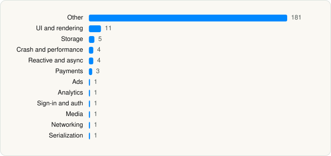

<picture><source media="(prefers-color-scheme: dark)" srcset="../../../../assets/logo/logo-dark.svg"></picture> [Tech Stack](../../../../README.md) / [Beijing Zhizhetianxia Technology Co., Ltd.](../../../../companies/beijing-zhizhetianxia-technology-co-ltd.md) / 知乎

# 知乎

<picture><source media="(prefers-color-scheme: dark)" srcset="../../../../assets/badges/ios-dark.svg"></picture> <picture><source media="(prefers-color-scheme: dark)" srcset="../../../../assets/badges/inactive-dark.svg"></picture> <picture><source media="(prefers-color-scheme: dark)" srcset="../../../../assets/badges/floor-dark.svg"></picture> <picture><source media="(prefers-color-scheme: dark)" srcset="../../../../assets/badges/encrypted-dark.svg"></picture>

[App Store](https://apps.apple.com/app/id432274380) · [latest.json](latest.json)

| | |
|---|---|
| Company | [Beijing Zhizhetianxia Technology Co., Ltd.](../../../../companies/beijing-zhizhetianxia-technology-co-ltd.md) |
| Store id | `432274380` |
| Bundle / package id | `com.zhihu.ios` |
| Latest version | 11.12.0 (analysed 2026-10-24) |
| Versions tracked | 1 |
| SDKs in latest version | 214 |
| Languages | C/C++, Metal (shaders), Objective-C, React Native / JavaScript, Swift |
| UI | Lottie (animations), SwiftUI, UIKit |
| Build | Swift Package Manager (SwiftPM) |
| Minimum OS | iOS 13.0 (built with Xcode 26.2, SDK iphoneos26.2) |
| Devices / ABIs | iPhone, iPad |
| Localisations | 1 |
| Capabilities | 7 |
| Declares tracking | Yes |
| Tracked | No. Kept for history. |

## SDKs by category

<picture><source media="(prefers-color-scheme: dark)" srcset="../../../../assets/charts/apps/ios/beijing-zhizhetianxia-technology-co-ltd/zhihu-dark.svg"></picture>

- **Other** (181): AlibabaAuthSDK, amadeus-rn 1.0.0, BJLMetal 3.8.2, Broadcastor-iOS, BUAdTestMeasurement 7.0.0, CCSDK 1.0, ChinaMobileCloudStorageImage 1.0.0, CocoaLumberjackPrivacy 3.7.0, CommunityLegacy 0.0.1, CSJAdSDK 7.0.0, dayjs, EduLiveCoreSDKImage 0.1.0, EduLiveRoomImage 1.0.0, EUIBaseImage 0.1.0, EUIZXTImage 0.1.0, fiore-rn 1.0.0, FMDB 2.6.2, GDTMobSDK 1.0, HyphenateChat 4.1.1, KSMediaPlayer 1.0, KSVideoPlayer 6.70.0, LegoShareUIImage 1.0.0, libpag 4.0.0, LinkCardShareUIImage 1.0.0, Lodash, mapapi, MegLiveV5Detect, MJRefresh, MMKVCore-Privacy 1.2.14, MobileLiveBroadcast 0.0.28, MQTTClient 1.0.0, NebulaWK, pag, Popup 0.0.1, Professional, ProgressServiceResourcesImage 1.0.0, QuestMobile 0.1.0, RangersAppLog 6.16.8, ReactionSharedUIImage 0.1.0, ReaderService 1.0.0, ReaderShareUIImage 1.0.0, RingFeatureImage 1.0.0, RxDataSources 5.0.0, ShortContainerFeatureImage 1.0.0, SmartLink, sylas 1.0.0, Tquic 95.4624.0, TraceLogServiceImage 1.0.0, ttboringssl 1.0, ttcrypto 1.0, TTNetworkManager 1.0, TXFFmpeg 1.0, TXSoundTouch 1.0, VIPPlayerImage 1.0.0, VolcEngineRTC 3.50.403, WeiboSDK, WindVaneBasic, ZHADSDKImage 1.0.0, ZHApp 9.12.0, ZHAppImage 9.12.0, ZHAsyncTextLabel 1.0.1, ZHAwardModuleImage 1.0.0, ZHBarrageImage 0.0.1, ZHBetterSegmentedControl 2021.0.1, ZHChoiceFeatureImage 1.0.0, ZHContentReactionImage 0.1.0, ZHCoreAlertImage 0.1.0, ZHCoreHudImage 0.1.0, ZHCoreHybrid, ZHCoreModelImage 0.2.0, ZHCoreNetworkImage 2.0.0, ZHCorePhotoViewerImage 1.5.1, ZHCoreRefresh 1.0.0, ZHCoreUsefullViewsImage 0.1.0, ZHCppKit 0.1.0, ZHDebugUI 0.6.1, ZHEditImageSDKRepo 0.0.1, ZHEffectSDKiOS 0.1.0, ZHEmoticonSDKEmoticon, ZHEmoticonSDKImage 1.0.0, ZHIconsLib 1.0.1, ZHIHUSDKInsertionImage 0.1.0, ZHImages, ZHIMSDKImage 0.0.1, ZHKnowledgeKMSceneImage 1.0.0, ZHMiddlewareEditorImage 0.0.1, ZHMiddlewareImage 0.0.1, ZHMiddlewareListImage 0.0.1, ZHMiddlewareMedia 0.0.1, ZHMiddlewareMediaImage 0.0.1, ZHMiddlewarePublishParcel, ZHMiddlewareSearchImage 0.0.1, ZHMiddlewareShareImage 0.0.1, ZHMiddlewareVideoImage 0.0.1, ZHMixShortContainerImage 0.1.0, ZHModuleAccountImage 0.0.1, ZHModuleAppGuideImage 0.0.1, ZHModuleBookImage 8.35.0, ZHModuleBoutiqueImage 1.0.0, ZHModuleColumnImage 0.0.1, ZHModuleColumnParcel, ZHModuleCommentsImage 0.1.0, ZHModuleCommentsPAG, ZHModuleCommunityImage 0.0.1, ZHModuleConsultImage 0.0.1, ZHModuleConsultParcel, ZHModuleCourseDetailContainerImage 9.5.0, ZHModuleCourseDetailResourcesImage 8.0.0, ZHModuleCreation, ZHModuleCreationImage 0.1.0, ZHModuleDBImage 0.0.1, ZHModuleDistributionImage 0.1.0, ZHModuleEditorImage 0.0.1, ZHModuleEduDetailResourcesImage 8.34.0, ZHModuleEduKitImage 1.0.0, ZHModuleEDULiveImage 8.32.0, ZHModuleEduManuscriptImage 0.0.1, ZHModuleEduVideoCoreResourcesImage 8.39.0, ZHModuleEduVideoResourcesImage 8.38.0, ZHModuleEduZRichPluginImage 1.0.0, ZHModuleExperienceCenter 0.0.1, ZHModuleFeedImage 0.0.3, ZHModuleFollowImage 0.1.0, ZHModuleGrowthImage 0.0.1, ZHModuleGrowthLocal, ZHModuleHybridImage 0.0.1, ZHModuleImagePickerImage 0.6.2, ZHModuleInteractionResourceImage 1.0.0, ZHModuleKMKitImage 4.44.0, ZHModuleKMResourcesImage 4.27.0, ZHModuleKMSceneImage 1.0.0, ZHModuleKMTabImage 1.0.0, ZHModuleKVipKitImage 1.0.0, ZHModuleKVipManuscriptImage 1.0.0, ZHModuleKVipSKUDetailResourcesImage 1.0.0, ZHModuleLiveImage 6.10.0, ZHModuleLiveParcel, ZHModuleManuscriptImage 1.0.0, ZHModuleNotificationImage 0.0.1, ZHModuleNotificationParcel, ZHModulePheidiImage 1.0.0, ZHModulePublish, ZHModulePushImage 0.1.0, ZHModuleQAImage 0.0.1, ZHModuleQAPAG, ZHModuleQRCodeImage 0.0.1, ZHModuleSearchImage 0.6.4, ZHModuleSKUDetailResourcesImage 1.0.0, ZHModuleTopicImage 1.0.0, ZHModuleTopicPAG, ZHModuleUserImage 0.0.2, ZHModuleUserPAG, ZHModuleUserParcel, ZHModuleVideoCourseImage 0.1.0, ZHModuleVideoEntityImage 0.0.1, ZHModuleVideoEntityParcel, ZHModuleVideoXImage 0.1.0, ZHModuleVideoXParcel, ZHModuleVIPChannelImage 1.0.0, ZHMorphSDKImage 0.0.1, ZHPINCache 8.18.0, ZHReaderFeatureImage 0.0.1, ZHReaderUIImage 1.0.0, ZHSDShareUI 1.0.0, ZHShareSDKImage 0.1.0, ZHShortStory 1.0.0, ZHShortStoryImage 1.0.0, ZHSpotBugImages, ZHStrategyService 1.0.0, ZHSystemServices 1.2.0, ZHTemplateDebugFile, ZHTemplateEngineFiles, ZHTemplateFile 1.0.0, ZHUIKitDebugImage 1.0.1, ZHUIKitImage 1.0.1, ZHUnifiedCard 1.0.1, ZHWidgetShareUI 1.0.0, ZHWordPressEditorSDKImage 0.0.1, ZHYYCache 1.0.4, ZHZXTFeedFeatureImage 1.0.0, ZRNFoundation 1.0.0
- **UI and rendering** (11): FlashList, IGListKit 3.4.0, React Native, React Native Reanimated, react-native-svg, ReactionSharedUILotties, SDWebImage 5.7.3, SnapKit 4.0.0, ZHContentReactionLotties, ZHModuleVideoEntityLotties, ZHTemplateEngineLotties
- **Storage** (5): MMKV, MMKV-Privacy 1.2.14, SAMKeychain, SSZipArchive 2.2.3, ZHZipArchive 1.4.0
- **Crash and performance** (4): APMInsightCore, APMInsightCrash, RangersAPMPrivacyInfo 5.2.9, Sentry
- **Reactive and async** (4): ReactiveObjC 1.0.1, RxCocoa 5.0.1, RxRelay 5.0.1, RxSwift 5.0.1
- **Payments** (3): ZHModuleWalletImage 1.0.4, ZHPaymentKitImage 0.0.1, ZHVIPPaymentSDKImage 0.0.1
- **Ads** (1): Google Mobile Ads (AdMob)
- **Analytics** (1): Amplitude
- **Sign-in and auth** (1): ZHLoginFeatureImage 0.1.0
- **Media** (1): NvStreamingSdkCore 1.0
- **Networking** (1): AFNetworking 3.2.1
- **Serialization** (1): Protobuf 3.11.4

Frameworks (36)

AdServices (Apple Search Ads attribution), AdSupport (IDFA), App Tracking Transparency (ATT), Authentication Services (Sign in with Apple / passkeys), AVFoundation (audio/video), AVKit, Combine (reactive), Contacts, Core Bluetooth, Core Data, Core Image, Core Location, Core ML, Core Motion, CryptoKit, DeviceCheck / App Attest, EventKit (Calendar / Reminders), Local Authentication (Face ID / Touch ID), MapKit, Media Player, MessageUI (mail / SMS compose), MetalKit, MetricKit (diagnostics), Network.framework, PDFKit, Photos, PhotosUI, PushKit (VoIP push), SafariServices, SiriKit (Intents), StoreKit (in-app purchase), SwiftUI, UIKit, User Notifications, Vision, WidgetKit (widgets)

Capabilities (7)

App Groups, Associated Domains (Universal Links), Background Audio, Communication Notifications, Keychain Sharing, Push Notifications (APNs), Sign in with Apple

## Version history

| Version | Analysed | Store update | SDKs | Change | SDK list is a floor | Binary encrypted | File |
|---|---|---|---|---|---|---|---|
| 11.12.0 | 2026-10-24 | 2026-10-23 | 214 |  | Yes | Yes | [11.12.0.json](11.12.0.json) |

---

Generated by `scripts/build_readme.py` from the JSON files. Do not edit by hand.
