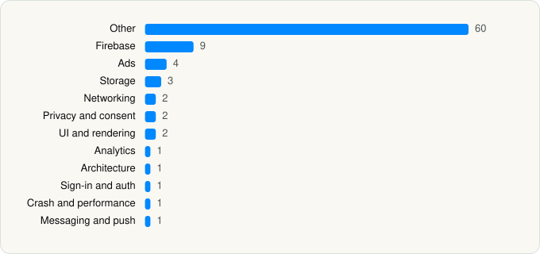

<picture><source media="(prefers-color-scheme: dark)" srcset="../../../../assets/logo/logo-dark.svg"></picture> [Tech Stack](../../../../README.md) / [Bending Spoons Apps ApS](../../../../companies/bending-spoons-apps-aps.md) / Remini

# Remini - AI Photo Enhancer

<picture><source media="(prefers-color-scheme: dark)" srcset="../../../../assets/badges/ios-dark.svg"></picture> <picture><source media="(prefers-color-scheme: dark)" srcset="../../../../assets/badges/active-dark.svg"></picture> <picture><source media="(prefers-color-scheme: dark)" srcset="../../../../assets/badges/floor-dark.svg"></picture> <picture><source media="(prefers-color-scheme: dark)" srcset="../../../../assets/badges/encrypted-dark.svg"></picture>

[App Store](https://apps.apple.com/app/id1470373330) · [latest.json](latest.json)

| | |
|---|---|
| Company | [Bending Spoons Apps ApS](../../../../companies/bending-spoons-apps-aps.md) |
| Store id | `1470373330` |
| Bundle / package id | `com.bigwinepot.nwdn.international` |
| Latest version | 2.10.221 (analysed 2026-10-24) |
| Versions tracked | 1 |
| SDKs in latest version | 87 |
| Languages | C/C++, Metal (shaders), Objective-C, Swift |
| UI | Lottie (animations), SwiftUI, UIKit |
| Build | Swift Package Manager (SwiftPM) |
| Minimum OS | iOS 15.0 (built with Xcode 26.1.1, SDK iphoneos26.1) |
| Devices / ABIs | iPhone, iPad |
| Localisations | 17 |
| Capabilities | 7 |
| Declares tracking | No |
| Tracked | Yes |

## SDKs by category

<picture><source media="(prefers-color-scheme: dark)" srcset="../../../../assets/charts/apps/ios/bending-spoons-apps-aps/remini-dark.svg"></picture>

- **Other** (60): AIPhotosAutomaticTrainingImplementation, AIStickersImplementation, AIStudioImplementation, AIStyleImplementation, AppSetup, BSPConcierge, BSPIrisImplementation, BSPLegal, ChatExperienceImplementation, Chocolate, ConfigurableOnboardingCardsSurveyImplementation, ConfigurableOnboardingFeaturesImplementation, ConfigurableOnboardingIntroImplementation, ConfigurableOnboardingLandingImplementation, ConfigurableOnboardingNotificationsPermissionsImplementation, ConfigurableOnboardingOngoingImplementation, ConfigurableOnboardingPermissionsImplementation, ConfigurableOnboardingSurveyImplementation, ConfigurableOnboardingUserIntentImplementation, CrisperCoreEnzymes, EmailInputImplementation, EnhanceImplementation, FaceFixImplementation, FakeDoorPaywallImplementation, Fellini, GenderSelectorImplementation, HomeImplementation, IconsSurveyImplementation, InAppReceipt, InjetKitImplementation, Inpainting, InstantProcessingImplementation, LegalUpdate, LoadingImplementation, LocalizationQualityExperiment, MediaSharing, MLModelsImplementation, MockExampleImplementation, MultiAvatarGenerationWizardImplementation, MultiAvatarResultImplementation, OracleImplementation, PaywallImplementation, PhotoLibraryManagerImplementation, PhotoRestorationImplementation, Pico, PostProcessingImplementation, PromotionPopupImplementation, RetakeBackendInterfaceImplementation, RetakeGenerationWizardImplementation, RetakeImplementation, RetouchImplementation, SearchImplementation, SettingsImplementation, SuggestFeature, TextualEditsImplementation, Tools, UnlockFeatureImplementation, VideoEnhance, VideoForEnhance, WebViewImplementation
- **Firebase** (9): FBLPromises, Firebase 1.0, FirebaseCore, FirebaseCoreInternal, FirebaseInstallations, GoogleDataTransport, GoogleUtilities 1.0, nanopb, Promises
- **Ads** (4): AppLovin 7.12.8, Google Mobile Ads (AdMob), MolocoSDK 4.4.1, MonetizationManager
- **Storage** (3): PersistenceImplementation, PersistenceSCA, ZIPFoundation
- **Networking** (2): Alamofire, ASN1Swift
- **Privacy and consent** (2): FacialDataConsentImplementation, InAppTrackingConsentImplementation
- **UI and rendering** (2): Lottie 4.4.3, VideoRendering
- **Analytics** (1): Facebook SDK
- **Architecture** (1): ComposableArchitecture 1.0
- **Sign-in and auth** (1): ConfigurableOnboardingLoginImplementation
- **Crash and performance** (1): FirebaseCrashlytics
- **Messaging and push** (1): FirebaseMessaging

Frameworks (33)

ActivityKit (Live Activities), AdServices (Apple Search Ads attribution), AdSupport (IDFA), App Tracking Transparency (ATT), Authentication Services (Sign in with Apple / passkeys), AVFoundation (audio/video), AVKit, Combine (reactive), Core Data, Core Image, Core Location, Core ML, Core Motion, CryptoKit, DeviceCheck / App Attest, Media Player, MessageUI (mail / SMS compose), MetalKit, MetricKit (diagnostics), Natural Language, Network.framework, PassKit (Wallet / Apple Pay), PDFKit, Photos, PhotosUI, SafariServices, StoreKit (in-app purchase), Swift Charts, SwiftUI, UIKit, User Notifications, Vision, WidgetKit (widgets)

Capabilities (7)

App Attest, App Groups, Apple Pay, Associated Domains (Universal Links), Keychain Sharing, Push Notifications (APNs), Sign in with Apple

## Version history

| Version | Analysed | Store update | SDKs | Change | SDK list is a floor | Binary encrypted | File |
|---|---|---|---|---|---|---|---|
| 2.10.221 | 2026-10-24 | 2026-10-10 | 87 |  | Yes | Yes | [2.10.221.json](2.10.221.json) |

---

Generated by `scripts/build_readme.py` from the JSON files. Do not edit by hand.
