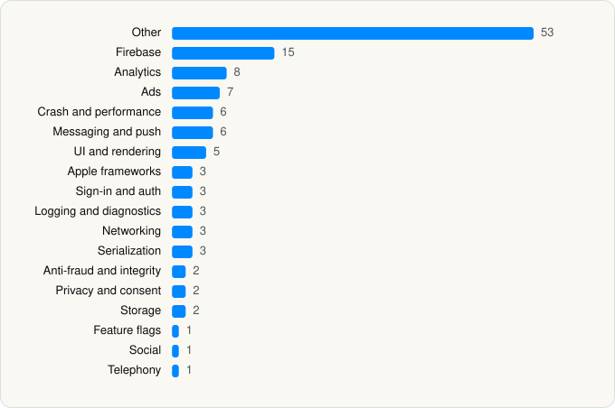

<picture><source media="(prefers-color-scheme: dark)" srcset="../../../../assets/logo/logo-dark.svg"></picture> [Tech Stack](../../../../README.md) / [BeReal](../../../../companies/bereal.md) / BeReal

# BeReal: Photos & Friends Daily

<picture><source media="(prefers-color-scheme: dark)" srcset="../../../../assets/badges/ios-dark.svg"></picture> <picture><source media="(prefers-color-scheme: dark)" srcset="../../../../assets/badges/inactive-dark.svg"></picture> <picture><source media="(prefers-color-scheme: dark)" srcset="../../../../assets/badges/floor-dark.svg"></picture> <picture><source media="(prefers-color-scheme: dark)" srcset="../../../../assets/badges/encrypted-dark.svg"></picture>

[App Store](https://apps.apple.com/app/id1459645446) · [latest.json](latest.json)

| | |
|---|---|
| Company | [BeReal](../../../../companies/bereal.md) |
| Store id | `1459645446` |
| Bundle / package id | `AlexisBarreyat.BeReal` |
| Latest version | 4.99.0 (analysed 2026-11-02) |
| Versions tracked | 3 |
| SDKs in latest version | 124 |
| Languages | C/C++, Metal (shaders), Objective-C, Swift |
| UI | Lottie (animations), SwiftUI, UIKit |
| Build | Swift Package Manager (SwiftPM) |
| Minimum OS | iOS 17.0 (built with Xcode 26.2, SDK iphoneos26.2) |
| Devices / ABIs | iPhone |
| Localisations | 14 |
| Capabilities | 10 |
| Declares tracking | Yes |
| Tracked | No. Kept for history. |

## SDKs by category

<picture><source media="(prefers-color-scheme: dark)" srcset="../../../../assets/charts/apps/ios/bereal/bereal-dark.svg"></picture>

- **Other** (53): AdMeasurement, AppHarbrSDK 1.38.3, Atoms, BRPushKit, Cache, CameraKitData, ContactPermissionPresentation, CoreChatData, CoreExtension 1.0, CrashReporter, Diagnostics 1.0, EmojiKitData, EmojiKitPresentation, Entities 1.0, EntitiesStore, FaceTecSDK 9.7.88, FactoryKit, FeatureCameraPresentation, FeatureChatPresentation, FeatureDraftsPresentation, FeatureMusicPresentation, FeatureSharingPresentation, FeedsFeaturePresentation, FeedsUIPresentation, GULUserDefaults 1.0, HyBid 3.8.0, LegacyDesignSystem, LocalisationKit, MemoriesPresentation, OnboardingPresentation, OpenWrapSDK 5.3.0, PreludeCore 1.0, PreludeKit 1.0, ProfileOnboardingPresentation, ProfilePresentation, Pubnativenet 1.6.3, RealComponents, RelationshipsPresentation, RSKImageCropper, SDKConfigurations 2.0.0, Shake 17.2.3, SlidesRecapPresentation, StreakRecoveryPresentation, third-party-IsAppEncrypted 1.0, VideoGenerationKitDomain, VoodooAdn 1.0, Voodooio 1.6.1, VungleAdsSDK 1.0, WebViewKit, YotiNetwork 4.0.0, YotiSDKCore 10.0.1, YotiSDKDesign 24.0.1, YotiSDKFace 15.0.0
- **Firebase** (15): BRFirebaseAuth 1.0, BRFirebaseCore 1.0, BRFirebaseInstallations 1.0, BRFirebaseMessaging 1.0, FBLPromises, Firebase 1.0, FirebaseAuth, FirebaseCore, FirebaseCoreInternal, FirebaseInstallations, GoogleDataTransport, GoogleUtilities 1.0, gRPC, nanopb, Promises
- **Analytics** (8): Adjust 1.0, AdjustSdk, Amplitude 1.0, FirebaseAnalytics 11.15.0, GoogleAppMeasurement 11.15.0, GoogleAppMeasurementIdentitySupport 11.15.0, Kronos, SCSDKCoreKit 2.5.0
- **Ads** (7): AppLovin 110400.0.0, Google Mobile Ads (AdMob), GoogleAdsOnDeviceConversion 2.1.0, GoogleMobileAds 12.14.0, InMobiSDK 11.4.0, MolocoSDK 4.6.1, Pubmatic 1.6.3
- **Crash and performance** (6): BRFirebaseCrashlytics 1.0, DatadogCore, DatadogCrashReporting, DatadogRUM, FirebaseCrashlytics, PLCrashReporter
- **Messaging and push** (6): FirebaseMessaging, MessagingAPI 4.0.0, MessagingSDK 4.0.0, SupportProvidersSDK 6.0.0, SupportSDK 6.0.0, ZendeskCoreSDK 3.0.0
- **UI and rendering** (5): CommonUISDK 7.0.0, Kingfisher, Lottie 4.6.1, SDWebImage, SnapKit
- **Apple frameworks** (3): DequeModule 1.0, InternalCollectionsUtilities 1.0, OrderedCollections 1.0
- **Sign-in and auth** (3): GTMSessionFetcher, Lock 1.0, SCSDKLoginKit 2.5.0
- **Logging and diagnostics** (3): Atlantis, Logging 1.0, Proxyman 1.0
- **Networking** (3): NIO, NIOPosix, NIOSSL
- **Serialization** (3): ADNSwiftProtobuf, Protobuf 1.0, SwiftProtobuf
- **Anti-fraud and integrity** (2): RecaptchaEnterprise 1.0, RecaptchaInterop 1.0
- **Privacy and consent** (2): ConsentViewController 1.0, UserMessagingPlatform 3.1.0
- **Storage** (2): CorePlatform, YotiSDKFaceTec 3.5.1
- **Feature flags** (1): Experiment
- **Social** (1): SCSDKCreativeKit 2.5.0
- **Telephony** (1): PhoneNumberKit

Frameworks (38)

ActivityKit (Live Activities), AdServices (Apple Search Ads attribution), AdSupport (IDFA), App Intents, App Tracking Transparency (ATT), Authentication Services (Sign in with Apple / passkeys), AVFoundation (audio/video), AVKit, Background Tasks, Combine (reactive), Contacts, Core Data, Core Image, Core Location, Core Motion, Core NFC, CryptoKit, DeviceCheck / App Attest, EventKit (Calendar / Reminders), Local Authentication (Face ID / Touch ID), MapKit, Media Player, MessageUI (mail / SMS compose), MetricKit (diagnostics), MusicKit, Natural Language, Network.framework, PassKit (Wallet / Apple Pay), Photos, PhotosUI, SafariServices, SiriKit (Intents), StoreKit (in-app purchase), SwiftUI, UIKit, User Notifications, Vision, WidgetKit (widgets)

Capabilities (10)

App Groups, Associated Domains (Universal Links), Background App Refresh, Background Audio, Background Processing, Background Push, Communication Notifications, Push Notifications (APNs), Time-Sensitive Notifications, VoIP

## Version history

| Version | Analysed | Store update | SDKs | Change | SDK list is a floor | Binary encrypted | File |
|---|---|---|---|---|---|---|---|
| 4.99.0 | 2026-11-02 |  | 124 | +16 / −26 | Yes | Yes | [4.99.0.json](4.99.0.json) |
| 4.79.1 | 2026-06-23 |  | 134 | +4 / −2 | Yes | Yes | [4.79.1.json](4.79.1.json) |
| 4.77.2 | 2026-06-19 |  | 132 |  | Yes | Yes | [4.77.2.json](4.77.2.json) |

### SDK changes between versions

- 4.79.1 → 4.99.0: added ADNSwiftProtobuf, BRPushKit, CoreChatData, CoreExtension, Diagnostics, FactoryKit, FeatureChatPresentation, FeatureMusicPresentation, FeatureSharingPresentation, FirebaseAnalytics, GoogleAppMeasurement, GoogleAppMeasurementIdentitySupport, LocalisationKit, PreludeKit, Pubnativenet, VideoGenerationKitDomain; removed AdsGlobalPackage, BRGoogleAdsOnDeviceConversion, BRLogKit, BRPreludeKit, BRVideoKit, ChatData, ChatPresentation, CoreSharingDomain, Datadog, DiagnosticsData, DiagnosticsDomain, Factory, FeaturePOVPresentation, FeatureReactionsPresentation, KeychainAccess, Localisation, MusicPresentation, PAGAdSDK, PushNotificationDomain, RxCocoa, RxRelay, RxSwift, Sentry, UnityAds, WorldCup26Data, WorldCup26Presentation
- 4.77.2 → 4.79.1: added DiagnosticsData, DiagnosticsDomain, WorldCup26Data, WorldCup26Presentation; removed adapter, BigoADS

---

Generated by `scripts/build_readme.py` from the JSON files. Do not edit by hand.
