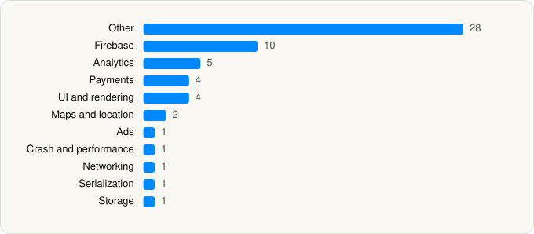

<picture><source media="(prefers-color-scheme: dark)" srcset="../../../../assets/logo/logo-dark.svg"></picture> [Tech Stack](../../../../README.md) / [BLINK COMMERCE PRIVATE LIMITED](../../../../companies/blink-commerce-private-limited.md) / Blinkit

# Blinkit: Groceries & more

<picture><source media="(prefers-color-scheme: dark)" srcset="../../../../assets/badges/ios-dark.svg"></picture> <picture><source media="(prefers-color-scheme: dark)" srcset="../../../../assets/badges/inactive-dark.svg"></picture> <picture><source media="(prefers-color-scheme: dark)" srcset="../../../../assets/badges/floor-dark.svg"></picture> <picture><source media="(prefers-color-scheme: dark)" srcset="../../../../assets/badges/encrypted-dark.svg"></picture>

[App Store](https://apps.apple.com/app/id960335206) · [latest.json](latest.json)

| | |
|---|---|
| Company | [BLINK COMMERCE PRIVATE LIMITED](../../../../companies/blink-commerce-private-limited.md) |
| Store id | `960335206` |
| Bundle / package id | `com.grofers.consumer` |
| Latest version | 19.01.1 (analysed 2026-11-06) |
| Versions tracked | 1 |
| SDKs in latest version | 58 |
| Languages | C/C++, Metal (shaders), Objective-C, Swift |
| UI | Lottie (animations), SwiftUI, UIKit |
| Build | Swift Package Manager (SwiftPM) |
| Minimum OS | iOS 16.0 (built with Xcode 27.1, SDK iphoneos27.1) |
| Devices / ABIs | iPhone |
| Localisations | 1 |
| Capabilities | 6 |
| Declares tracking | Yes |
| Tracked | No. Kept for history. |

## SDKs by category

<picture><source media="(prefers-color-scheme: dark)" srcset="../../../../assets/charts/apps/ios/blink-commerce-private-limited/blinkit-dark.svg"></picture>

- **Other** (28): AmazonPayHardenediOSSDK 1.0, BUIKit 1.0, ECUIBridgeKit, ECVideoPlayer, EternalCardSDK, MisoKit 1.0, Nugget 1.1.0, QAtlas, QuickDeliveryKit 1.0, QuickDeliveryKitSwift, Sushi 1.0, SushiUI 1.0, ZAtomicKit 1.0, ZAutoLayoutBuilder 1.0, ZCartKit 1.0, ZCommons 1.0, ZFoundation 1.0, ZJumbo 1.0, ZJumboSwift, ZLocationKit 1.0, ZModelsKit 1.0, ZMTApiManager 1.0, ZNetworkRouter 1.0, ZScout 1.0, ZSwiftUIKit 1.0, ZUICompositeKit 1.0, ZUIKit 1.0, ZUIKitSwift
- **Firebase** (10): FBLPromises, Firebase, FirebaseCore, FirebaseCoreInternal, FirebaseInstallations, FirebaseRemoteConfig, GoogleDataTransport, GoogleUtilities, nanopb, Promises
- **Analytics** (5): AppsFlyerLib 1.0, Branch, FirebaseAnalytics 12.5.0, GoogleAppMeasurement 12.5.0, GoogleAppMeasurementIdentitySupport 12.5.0
- **Payments** (4): ZPaymentsKit 1.0, ZPaymentsServiceiOSKit 1.0, ZPaymentsServiceiOSKitSwift, ZWalletKit 1.0
- **UI and rendering** (4): Lottie 1.0, Mantis, Nuke 1.0, SDWebImage
- **Maps and location** (2): GMSCore 26.03.0, GoogleMaps
- **Ads** (1): GoogleAdsOnDeviceConversion 3.2.0
- **Crash and performance** (1): FirebaseCrashlytics
- **Networking** (1): Alamofire 1.0
- **Serialization** (1): Decodable 1.0
- **Storage** (1): SwiftGzip

Frameworks (37)

ActivityKit (Live Activities), AdServices (Apple Search Ads attribution), AdSupport (IDFA), App Intents, App Tracking Transparency (ATT), Authentication Services (Sign in with Apple / passkeys), AVFoundation (audio/video), AVKit, Background Tasks, CallKit (VoIP), Combine (reactive), Contacts, Core Data, Core Image, Core Location, Core Motion, CryptoKit, EventKit (Calendar / Reminders), Local Authentication (Face ID / Touch ID), MapKit, MessageUI (mail / SMS compose), MetricKit (diagnostics), Network.framework, PassKit (Wallet / Apple Pay), PDFKit, Photos, PhotosUI, SafariServices, SceneKit, SiriKit (Intents), Speech (recognition), StoreKit (in-app purchase), SwiftUI, UIKit, User Notifications, Vision, WidgetKit (widgets)

Capabilities (6)

App Groups, Apple Pay, Associated Domains (Universal Links), Background Push, Push Notifications (APNs), Time-Sensitive Notifications

## Version history

| Version | Analysed | Store update | SDKs | Change | SDK list is a floor | Binary encrypted | File |
|---|---|---|---|---|---|---|---|
| 19.01.1 | 2026-11-06 | 2026-10-30 | 58 |  | Yes | Yes | [19.01.1.json](19.01.1.json) |

---

Generated by `scripts/build_readme.py` from the JSON files. Do not edit by hand.
