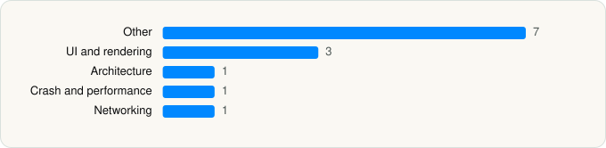

<picture><source media="(prefers-color-scheme: dark)" srcset="../../../../assets/logo/logo-dark.svg"></picture> [Tech Stack](../../../../README.md) / [Bluesky PBLLC](../../../../companies/bluesky-pbllc.md) / Bluesky Social

# Bluesky Social

<picture><source media="(prefers-color-scheme: dark)" srcset="../../../../assets/badges/ios-dark.svg"></picture> <picture><source media="(prefers-color-scheme: dark)" srcset="../../../../assets/badges/inactive-dark.svg"></picture> <picture><source media="(prefers-color-scheme: dark)" srcset="../../../../assets/badges/floor-dark.svg"></picture> <picture><source media="(prefers-color-scheme: dark)" srcset="../../../../assets/badges/encrypted-dark.svg"></picture>

[App Store](https://apps.apple.com/app/id6444370199) · [latest.json](latest.json)

| | |
|---|---|
| Company | [Bluesky PBLLC](../../../../companies/bluesky-pbllc.md) |
| Store id | `6444370199` |
| Bundle / package id | `xyz.blueskyweb.app` |
| Latest version | 1.136.0 (analysed 2026-10-23) |
| Versions tracked | 2 |
| SDKs in latest version | 13 |
| Languages | C/C++, Metal (shaders), Objective-C, React Native / JavaScript, Swift |
| UI | SwiftUI, UIKit |
| Build | Swift Package Manager (SwiftPM) |
| Minimum OS | iOS 16.4 (built with Xcode 26.4.1, SDK iphoneos26.4) |
| Devices / ABIs | iPhone, iPad |
| Localisations | 41 |
| Capabilities | 5 |
| Declares tracking | No |
| Tracked | No. Kept for history. |

## SDKs by category

<picture><source media="(prefers-color-scheme: dark)" srcset="../../../../assets/charts/apps/ios/bluesky-pbllc/bluesky-dark.svg"></picture>

- **Other** (7): EXConstants 57.0.19, ExpoModulesJSI 1.0, EXUpdates 57.0.23, hermesvm 1.0.0, Lodash, MCEmojiPicker 1.2.5, RNViewShotPrivacyInfo 5.1.1
- **UI and rendering** (3): Mantis 3.1.0, RNSVGFilters 15.15.4, SDWebImage 5.21.7
- **Architecture** (1): React Navigation
- **Crash and performance** (1): Sentry
- **Networking** (1): ReachabilitySwift 5.2.4

Frameworks (28)

Authentication Services (Sign in with Apple / passkeys), AVFoundation (audio/video), AVKit, Combine (reactive), Contacts, Core Data, Core Image, Core Location, Core Motion, CryptoKit, DeviceCheck / App Attest, Media Player, MessageUI (mail / SMS compose), MetricKit (diagnostics), Natural Language, Network.framework, PDFKit, Photos, PhotosUI, SafariServices, SiriKit (Intents), Swift Charts, SwiftUI, UIKit, User Notifications, Vision, VisionKit (document/data scanning), WidgetKit (widgets)

Capabilities (5)

App Groups, Associated Domains (Universal Links), Background Push, Communication Notifications, Push Notifications (APNs)

## Version history

| Version | Analysed | Store update | SDKs | Change | SDK list is a floor | Binary encrypted | File |
|---|---|---|---|---|---|---|---|
| 1.136.0 | 2026-10-23 | 2026-10-22 | 13 | +3 / −6 | Yes | Yes | [1.136.0.json](1.136.0.json) |
| 1.122.0 | 2026-06-19 |  | 16 |  | Yes | Yes | [1.122.0.json](1.122.0.json) |

### SDK changes between versions

- 1.122.0 → 1.136.0: added ExpoModulesJSI, hermesvm, RNViewShotPrivacyInfo; removed Amplitude, hermes, MMKV, React Native, React Native Reanimated, react-native-svg

---

Generated by `scripts/build_readme.py` from the JSON files. Do not edit by hand.
